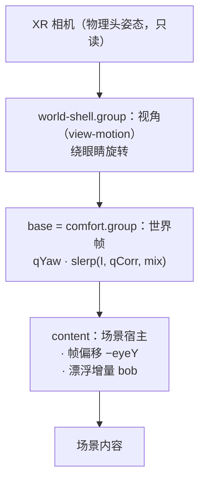

# 动画系统：漂浮、起身、俯仰修正

三个动画共用一个世界，谁写哪一层必须先说清楚，否则它们会互相覆盖——审查时正是这样。
本文记录分层、当前实现、本轮修掉的缺陷，以及尚未决定的两件场景侧事项。

## 1 分层与所有权



| 系统 | 所有者 | 写入 |
| --- | --- | --- |
| 视角 | `view-motion` | shell 的旋转（绕眼点） |
| 世界帧 | `comfort` + `app/world-runtime` | base 的旋转：`qYaw · slerp(I, qCorrection, mix)` |
| 漂浮 | `app/floating` | content 的位置（帧偏移 + bob） |
| 起身 | `app/world-runtime` | **mix 的斜坡**，0↔1 |

`comfort` 只有一个通道：**修正量 mix**。

| mix | 患者看到 | base |
| --- | --- | --- |
| 0 | **天花板就是真实的天花板**；房间只按头部朝向（yaw）转正 | `qYaw` |
| 1 | 患者舒适体位**面向前方墙壁**（站立视野） | `q0 = qYaw · qCorrection` |
| 中间 | 平滑过渡（slerp + smootherstep） | 部分修正 |

会话**从场景声明的 rest mix 开始**（`core/anatomy.restMixOf`）：仰卧场景（湖面 / 病房）从 0 开始，房间只按头部朝向转正；立姿场景（洁净立便间）从 1 开始，第一帧就是它被画出来的站立体位——否则患者头两秒会看到一间把立便器装在天花板上的房间，得等技术员按「起身」。
校准只决定两件患者无法选择的事：**朝向**（yaw，取头部朝向）和**修正量**（测量到的体位），不看患者此刻望向哪里，卡片也不再要求任何朝向。

斜坡只属于技术员：「修正朝前 / 回天花板 / 停住」，时长平板设定（4–14 s，默认 6 s）；回躺 = 反向斜坡；停住 = 冻结在当前 mix。仰卧场景另有一次**排定的自动起身**（`v-rise-1` 播完后 0→1），立姿场景不排——它已经在 1，斜坡与语音都会是空的。旧的「90° 翻滚 + 眼高位移」的 `SitUpPath` 已删除——起身不再改变眼高，只改变"前方"。

合成顺序 **shell ∘ base ∘ content**：任何"世界里的方向"都要先过这两层旋转。漂浮的起伏轴用
`visualUpInContent(headUp, (shellQ × baseQ)⁻¹)`——只反解 base 会在操作员把视角抬到 30° 时把起伏斜推 28.6°（实测）。

帧的推进顺序（render 管线）：`view-motion` → `world-motion`，无相位滞后。

## 2 关键约束

- **地平线永不倾斜**：没有摆动通道，世界只平移不旋转。
- **起伏沿视觉竖直**：`floating` 只写沿轴的位移，轴由"头向上"经父链反解得到。
- **校准期间冻结**：`world.hold(true)`，任何世界运动都不许动。

## 3 时序

```text
进入 XR → 校准（保持 1.8 s + 3 s 取样）→ mix = 场景 rest mix（仰卧 0 / 立姿 1）
        → 仰卧场景：v-rise-1 之后排定 0→1 自动起身；任何操作可打断
        → 「回天花板」→ mix 1→0（手动，4–14 s）
```

## 3.1 校准窗口：不阻塞契约

校准期间世界被 `world.hold(true)` 冻结、漂浮与视角命令被关，所以这个窗口**必须**在有限时间内交出控制权。
四条释放路径，任一条到达就解冻：

| 路径 | 触发 | 结果 |
| --- | --- | --- |
| 正常完成 | 保持 1.8 s + 3 s 取样 | 用取样均值建帧，启动 8 s 自动修正 |
| 患者按确认键 | 任意时刻 | 用**当前**头部朝向建帧（`capturePending` 在这次调用里清掉） |
| 硬超时 | 卡片显示满 9 s | 用当前朝向建帧，不看卡片、不看姿态 |
| 姿态从未到达 | 1.5 s 无有效四元数 | 同上（当帧可能只有 (0,0,0,0)） |

三条实现约束（都有测试守着）：

1. 推进由 **`capturePending`** 驱动，不由卡片可见性驱动——卡片被隐藏也不能让标志位永远挂着。
2. `capturePending` 只在 `applyCalibration()` 一处清除；`finishCalibration` 不碰它。
   这样"确认键直接建帧"这条捷径与"计时器超时"走到同一个出口。
3. 无有效姿态时也 `hold(false)`：没有帧可以让世界保持原样，但**不能**把冻结留到下一次会话。
   会话结束（含校准中停止、断链、XR 退出）统一走 `resetWorldToRest()`：清 `capturePending`、`world.hold(false)`、`clearBase()`。

`tests/calibration-run.test.ts` 覆盖：静止完成、姿态始终缺失、持续晃动不拖过 9 s、中途掉帧 30 s 后单帧落地、done 之后不再重开、重启后重新计时。

## 4 代码归属

| 层 | 模块 | 职责 |
| --- | --- | --- |
| 帧选择 | `core/xr/world-frame.ts` | `planFrame()`：由场景声明 × 会话模式算出 base 与偏移；`visualUpInContent()` |
| 世界帧运行器 | `app/world-runtime.ts` | 校准帧、起身路径、偏移落地；唯一写 base 的地方 |
| 漂浮 | `app/floating.ts` | 等级/档位/包络/位移/sway，沿视觉竖直写 content |
| 命令语法 | `app/commands.ts` | 字符串 → 类型化命令或错误；无副作用 |
| 编排 | `app/App.ts` | XR 会话、音频、UI、快照；不含帧与漂浮的状态 |

重构前后（同一份行为，测试从 223 增到 265）：

| 文件 | 行数 |
| --- | --- |
| `App.ts` | 1799 → 1549 |
| `floating.ts` | 新增 227 |
| `world-runtime.ts` | 新增 226 |
| `commands.ts` | 新增 197 |
| `buoyancy-frame.ts` / `world-frame.ts` | 新增 69 / 110 |

`App` 里漂浮与起身的 12 个字段、5 个写入点、13 处 `setFloorOffset`、330 行命令分支都已迁出；
`resetWorldToRest()` 是"没有会话"的唯一形状，`enterStage()` 是"有画面"的唯一入口。

## 5 场景侧字段（已对齐）

场景不再"猜帧"，也不再手写眼高：它声明**体位**，两个眼高由 `src/core/anatomy.ts` 推导。

| 字段 | 含义 | 取值 |
| --- | --- | --- |
| `posture.standingEyeY` | 站立视点：**操作员的站立足高设置**（缺省用美术的 1.70） | 头显设置 `settings:eyeheight` |
| `posture.supine` | 患者背下是什么 | `mattress` / `water` |
| `posture.pillow` | 头是否垫枕（+0.05 m） | 仅 `ward` |

推导（1.70 m 成年男性）：`mattress` = 0.55 床垫 + 0.11 头厚 → 0.66（垫枕 0.71）；`water` = 0.08。

```text
eyeY(mix)  = lying + (standing − lying) · mix
offsetY    = −eyeY(mix)
```

于是**眼睛随修正一起升起**：`mix=0` 时眼在躺姿高度（0.66 / 0.71 / 0.08），`mix=1` 时在站立高度（1.70）。
起身不需要第二条动画通道——它和旋转共用同一个 `mix` 斜坡（smootherstep，平板设定 4–14 s）。

合成顺序是 **shell（视角）∘ base（帧）∘ content（偏移）**。任何"世界里的方向"都要先过这两层旋转：
漂浮的起伏轴用 `visualUpInContent(headUp, (shellQ × baseQ)⁻¹)`——只反解 base，在操作员把视角抬到 30° 时
会把起伏斜推 28.6°（实测），看起来像侧向滑动而不是起伏。

帧的推进顺序（`App` 的 render 管线）：`view-motion` → `world-motion`。视角先落定，同一帧里漂浮再读
`shell` 的旋转算轴，因此没有一帧滞后。

只有一个式子在选帧：`src/app/world-runtime.ts` 的 `apply()` 用当前 `mix` 算出 `eyeY` 与 `offsetY`。
没有第二种模式、没有第二张表——`core/xr/world-frame.ts` 只剩 `visualUpInContent()` 一个函数。

同时删掉了两个错位来源：

- `SceneBuildContext.eyeHeight`：三个场景一次都没读过；眼高改由场景 `posture` 声明、解剖表推导。
- 漂浮的固定 −Y：起伏现在沿**视觉竖直**（`visualUpInContent()`），仰卧帧里它等于内容 +Z，因此"上下起伏"在两种帧里都成立，不再变成朝脸的逼近流。

验收：`tests/animation-frame.test.ts`（11 例：选帧表、视觉竖直、两种帧下的地平线角度与位移方向）、
`tests/scenes.test.ts`（声明值固定）与 `tests/floating.test.ts`（12 例）。

## 6 未覆盖

- 实机（PICO）视觉复核：`adb` 不在本机，只有桌面预览与单测。
- 起身过程的 1 s 内渐出观感：靠 `floating` 单测与帧角度断言，未在设备上看过。
