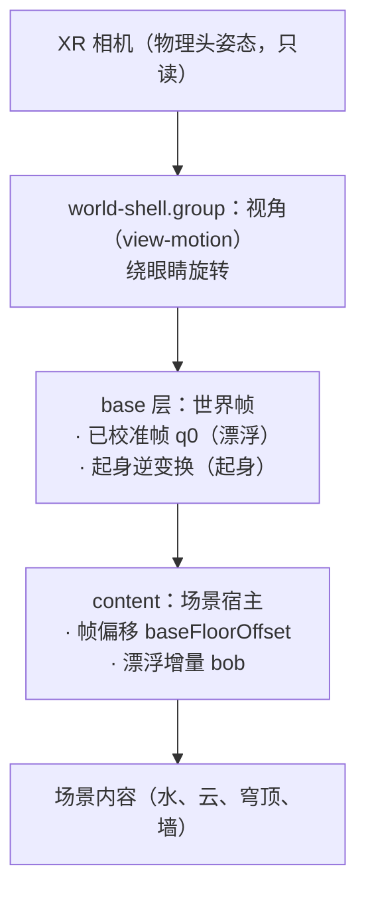

# 动画系统：漂浮、起身、俯仰修正

三个动画共用一个世界，谁写哪一层必须先说清楚，否则它们会互相覆盖——审查时正是这样。
本文记录分层、当前实现、本轮修掉的缺陷，以及尚未决定的两件场景侧事项。

## 1 分层与所有权

| 系统 | 所有者 | 写入 | 不写 |
| --- | --- | --- | --- |
| 俯仰修正 | `view-motion`（视角）+ `comfort.calibrate`（校准帧） | shell 的旋转；base 的 q0 | 不改相机，不写 content |
| 漂浮 | `src/app/floating.ts` | content 的 Y（帧偏移 + bob）、sway | 不写 base、不写 shell |
| 起身 | `situp-run`（时间轴）+ `situp-path`（变换） | base 的位姿 | 不写 content、不写 shell |

规则：**同一时刻只有一层写 base**。谁写 base 由会话模式决定，不由命令决定：

| 会话模式 | base | content 帧偏移 | 漂浮 |
| --- | --- | --- | --- |
| 漂浮 `float` | 已校准帧 `q0` | `-eyeHeight`（头显内） | 开 |
| 起身 `posture` | 起身逆变换 | `0` | 关 |

## 2 关键约束：漂浮沿"视觉竖直"

`docs/research-standing-sensation.md` §2.1 的结论是运动应沿体轴（患者视角的上下）。
这条只在**已校准帧**下等于场景的 +Y：一旦 base 换成起身路径，场景 +Y 指向视线方向，
同一段位移会变成朝患者推过来的逼近流，而不是上下起伏。所以：
`buoyancyAllowed()` 只在 `mode=float` + 已校准帧 + 会话进行中 + 不在取帧窗口 时为真。

## 3 本轮修掉的缺陷

| # | 现象 | 根因 | 影响 | 修法 |
| --- | --- | --- | --- | --- |
| A1 | 会话一开始世界跳 1.7 m | 校准把 content 偏移设为 0，漂浮第一帧又按旧约定写 `-eyeHeight` | 场景整体位移一个眼高：卫生间的地面与立便器掉到脚下；湖面沿视线前移 | 偏移归帧所有：`baseFloorOffset` + `contentOffsetFor()`，漂浮只加 delta |
| A2 | 起身一开始漂浮位移冻结，随后瞬跳归零 | `updateFloat` 在 `!lying` 时提前 return，残留位移不再重算；振幅衰减到 0 的瞬间才统一清零 | 起身首秒里世界停在半个浪的位置，然后突然落回 | 移除 `!lying` 分支；关闸后振幅衰减、位移逐帧跟随衰减，落地即停 |
| A3 | 起身模式里"上下起伏"变成"朝脸推来" | 漂浮写在 content 空间，base 换成起身路径后 +Y 是视线方向 | 逼近流是晕动的强诱因 | 用帧闸门禁止漂浮在起身帧内运行 |
| A4 | 校准期间世界在漂 | 闸门只排除了 `stopping`/`idle` | 卡片要求"保持不动"，画面却在小幅起伏 | 闸门改为 `isActive()` + `capturePending` |
| A5 | 漂浮模式看不到校准帧 | 校准后无条件 `sitUpMode=true`，起身逆变换盖掉了 q0 | 平躺患者看到的是天花板（俯仰 −89°），"躺着有站立视野"没生效 | base 由会话模式决定；漂浮回到 q0 |
| A6 | 漂浮模式下按"起身"会跨帧硬切 | 起身命令在任意模式可用 | 从校准帧瞬跳到平躺帧，再开始 6 s 上升 | 起身命令只在起身模式内可用，否则明确拒绝 |

A5 的量化证据（复现栈 = comfort + world-shell + situp-path，头部为仰卧姿态）：

| 帧 | 地平线相对视线仰角 |
| --- | --- |
| 已校准帧（漂浮） | −0.9° |
| 起身帧 t=0 | −89.0°（朝天） |
| 起身帧 t=1 | +0.4°（站立） |

即：校准帧本身就是"躺着的站立视野"，起身帧是"先仰卧、再起身"。

## 4 代码归属（本轮）

| 之前 | 现在 |
| --- | --- |
| `App` 持有 8 个漂浮字段 + 两个写函数 | `src/app/floating.ts`：`createFloating()` 拥有等级、档位、包络、位移、sway 与写入 |
| `App` 里 13 处 `host.setFloorOffset(...)` | 全部经 `setBaseFloorOffset()` → `floating.setBaseOffset()` |
| 帧闸门写死在 `updateFloat` 内 | `src/core/xr/buoyancy-frame.ts`：纯函数，可测 |

验证：`tests/floating.test.ts`（12 例：包络、渐出、闸门、等级/档位夹紧、偏移叠加、reset）
与 `tests/animation-frame.test.ts`（10 例：闸门真值表、偏移合成、三种帧的地平线角度）。

## 5 场景侧字段：尚未对齐

审查中发现三个字段层面的缺口，都与上面 A5 的帧选择直接相关：

| 缺口 | 现状 | 后果 |
| --- | --- | --- |
| `SceneDefinition` 没有 `posture: 'standing' \| 'supine'` | `docs/calibration.md` §4 设计过（`R_extra(standing)`、`gazePitchDeg`），从未实现 | 场景无法声明自己是"按站立视角画的"还是"按仰卧视角画的"；漂浮模式对所有场景都套校准帧，于是 `shore` / `lightwell` 这两幅按"仰望"画出来的景，现在以站立视角出现 |
| `SceneBuildContext.eyeHeight` 无人读取 | 应用与镜像都传了，三个场景都没用 | 每个场景的"眼在哪"各自约定，应用只好用全局 `-eyeHeight` 补偿，这正是 A1 的来源 |
| `docs/core.md` §5 写"两个场景"，同表列三个 | 代码与 `SCENE_IDS` 都是三个 | 文档与实现不一致 |

推荐（待确认）：给 `SceneDefinition` 加 `posture`，漂浮模式下 `standing` 用校准帧、`supine` 用起身帧 t=0；
`supine` 场景的漂浮要么关掉（它本来就更适合"静止仰望"），要么把起伏改成沿场景 −Z。
同时把 `eyeHeight` 从 `SceneBuildContext` 移除，或在三个场景里真正用它定位眼高。

## 6 未覆盖

- 实机（PICO）视觉复核：`adb` 不在本机，只有桌面预览与单测。
- 起身过程的 1 s 内渐出观感：靠 `floating` 单测与帧角度断言，未在设备上看过。
