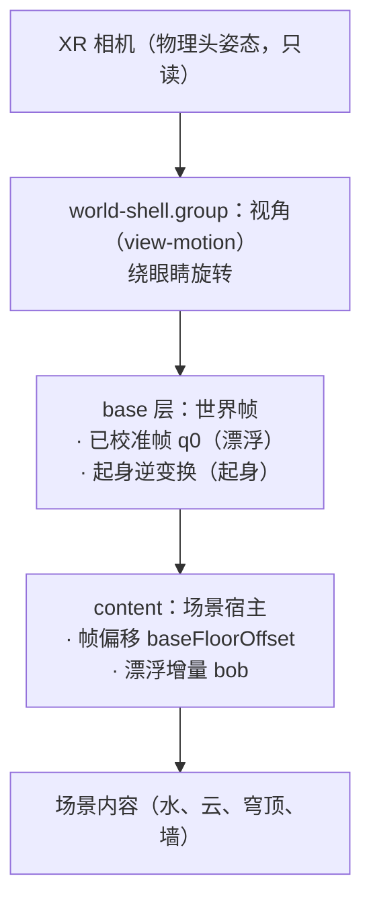

# 动画系统：漂浮、起身、俯仰修正

三个动画共用一个世界，谁写哪一层必须先说清楚，否则它们会互相覆盖——审查时正是这样。
本文记录分层、当前实现、本轮修掉的缺陷，以及尚未决定的两件场景侧事项。

## 1 分层与所有权

| 系统 | 所有者 | 写入 | 不写 |
| --- | --- | --- | --- |
| 俯仰修正 | `view-motion`（视角）+ `comfort.calibrate`（校准帧） | shell 的旋转；base 的 q0 | 不改相机，不写 content |
| 漂浮 | `src/app/floating.ts` | content 偏移（帧偏移 + 沿视觉竖直的 bob）、sway | 不写 base、不写 shell |
| 起身 | `situp-run`（时间轴）+ `situp-path`（变换） | base 的位姿 | 不写 content、不写 shell |

规则：**同一时刻只有一层写 base**。谁写 base 由会话模式决定，不由命令决定：

| 会话模式 | base | content 帧偏移 | 漂浮 |
| --- | --- | --- | --- |
| 漂浮 `float` | 已校准帧 `q0` | `-eyeY`（场景声明） | 开 |
| 起身 `posture` | 起身逆变换 | `视点高度 - eyeY` | 关 |

漂浮模式对所有场景都用已校准帧：校准就是患者说"这是我的前方"，只有这一帧能让画面
落在视线中央。早期的"按场景体位选帧"会用头部倾角旋转画面，对称的光井因此偏到一侧、
看起来像贴在视线上。校准期间 `world.hold(true)` 冻结所有世界运动。

## 2 关键约束：漂浮沿"视觉竖直"

`docs/research-standing-sensation.md` §2.1 的结论是运动应沿体轴（患者视角的上下）。
这条只在**已校准帧**下等于场景的 +Y：一旦 base 换成起身路径，场景 +Y 指向视线方向，
同一段位移会变成朝患者推过来的逼近流，而不是上下起伏。所以：
`buoyancyAllowed()` 只在 `mode=float` + 已校准帧 + 会话进行中 + 不在取帧窗口 时为真。

## 3 本轮修掉的缺陷

| # | 现象 | 根因 | 影响 | 修法 |
| --- | --- | --- | --- | --- |
| A1 | 会话一开始世界跳 1.7 m | 校准把 content 偏移设为 0，漂浮第一帧又按旧约定写 `-eyeHeight` | 场景整体位移一个眼高：卫生间的地面与立便器掉到脚下；湖面沿视线前移 | 偏移归帧所有：`baseFloorOffset` + `contentOffsetFor()`，漂浮只加 delta |
| A2 | 起身一开始漂浮位移冻结，随后瞬跳归零 | `updateFloat` 在 `!lying` 时提前 return，残留位移不再重算；振幅衰减到 0 的瞬间才统一清零 | 起身首秒里世界停在半个浪的位置，然后突然落回 | 移除 `!lying` 分支；关闸后振幅衰减、位移逐帧跟随衰减，落地即停 |
| A3 | 起身模式里"上下起伏"变成"朝脸推来" | 漂浮写在 content 空间，base 换成起身路径后 +Y 是视线方向 | 逼近流是晕动的强诱因 | 用帧闸门禁止漂浮在起身帧内运行 |
| A4 | 校准期间世界在漂 | 闸门只排除了 `stopping`/`idle` | 卡片要求"保持不动"，画面却在小幅起伏 | 闸门改为 `isActive()` + `capturePending` |
| A5 | 漂浮模式看不到校准帧 | 校准后无条件 `sitUpMode=true`，起身逆变换盖掉了 q0 | 平躺患者看到的是天花板（俯仰 −89°），"躺着有站立视野"没生效 | base 由会话模式决定；漂浮回到 q0 |
| A6 | 漂浮模式下按"起身"会跨帧硬切 | 起身命令在任意模式可用 | 从校准帧瞬跳到平躺帧，再开始 6 s 上升 | 起身命令只在起身模式内可用，否则明确拒绝 |

A5 的量化证据（复现栈 = comfort + world-shell + situp-path，头部为仰卧姿态）：

| 帧 | 地平线相对视线仰角 |
| --- | --- |
| 已校准帧（漂浮） | −0.9° |
| 起身帧 t=0 | −89.0°（朝天） |
| 起身帧 t=1 | +0.4°（站立） |

即：校准帧本身就是"躺着的站立视野"，起身帧是"先仰卧、再起身"。

## 4 代码归属

| 层 | 模块 | 职责 |
| --- | --- | --- |
| 帧选择 | `core/xr/world-frame.ts` | `planFrame()`：由场景声明 × 会话模式算出 base 与偏移；`visualUpInContent()` |
| 世界帧运行器 | `app/world-runtime.ts` | 校准帧、起身路径、偏移落地；唯一写 base 的地方 |
| 漂浮 | `app/floating.ts` | 等级/档位/包络/位移/sway，沿视觉竖直写 content |
| 命令语法 | `app/commands.ts` | 字符串 → 类型化命令或错误；无副作用 |
| 编排 | `app/App.ts` | XR 会话、音频、UI、快照；不含帧与漂浮的状态 |

重构前后（同一份行为，测试从 223 增到 265）：

| 文件 | 行数 |
| --- | --- |
| `App.ts` | 1799 → 1549 |
| `floating.ts` | 新增 227 |
| `world-runtime.ts` | 新增 226 |
| `commands.ts` | 新增 197 |
| `buoyancy-frame.ts` / `world-frame.ts` | 新增 69 / 110 |

`App` 里漂浮与起身的 12 个字段、5 个写入点、13 处 `setFloorOffset`、330 行命令分支都已迁出；
`resetWorldToRest()` 是"没有会话"的唯一形状，`enterStage()` 是"有画面"的唯一入口。

## 5 场景侧字段（已对齐）

场景不再"猜帧"，而是声明两件事，应用据此选帧：

| 字段 | 含义 | 取值 |
| --- | --- | --- |
| `eyeY` | 作者把眼睛放在内容坐标的哪个高度（米） | washroom 1.70；shore 0.45；lightwell 1.70 |

`planFrame()`（`src/core/xr/world-frame.ts`）是唯一的选帧处：

| 场景 | `eyeY` |
| --- | --- |
| `washroom` | 1.70（地面在眼下方 1.7 m） |
| `shore` | 0.45（水面在眼下方 0.45 m） |
| `lightwell` | 1.70（环带中心） |

选帧只由模式决定：漂浮 → 已校准帧、偏移 `-eyeY`；起身 → 起身路径、偏移 `视点高度 - eyeY`。

同时删掉了两个错位来源：

- `SceneBuildContext.eyeHeight`：三个场景一次都没读过；眼高改由场景自己声明，应用不再用全局 `-eyeHeight` 补偿。
- 漂浮的固定 −Y：起伏现在沿**视觉竖直**（`visualUpInContent()`），仰卧帧里它等于内容 +Z，因此"上下起伏"在两种帧里都成立，不再变成朝脸的逼近流。

验收：`tests/animation-frame.test.ts`（11 例：选帧表、视觉竖直、两种帧下的地平线角度与位移方向）、
`tests/scenes.test.ts`（声明值固定）与 `tests/floating.test.ts`（12 例）。

## 6 未覆盖

- 实机（PICO）视觉复核：`adb` 不在本机，只有桌面预览与单测。
- 起身过程的 1 s 内渐出观感：靠 `floating` 单测与帧角度断言，未在设备上看过。
