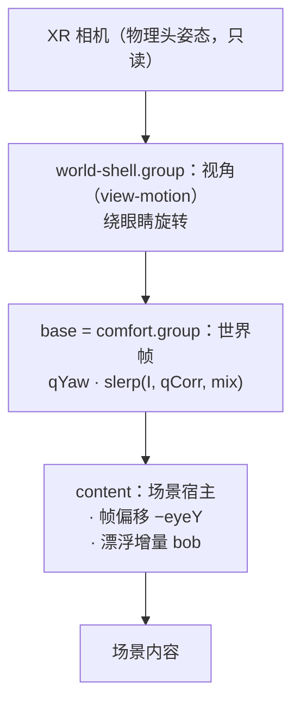

# 动画系统：漂浮、起身、俯仰修正

三个动画共用一个世界，谁写哪一层必须先说清楚，否则它们会互相覆盖——审查时正是这样。
本文记录分层、当前实现、本轮修掉的缺陷，以及尚未决定的两件场景侧事项。

## 1 分层与所有权



| 系统 | 所有者 | 写入 |
| --- | --- | --- |
| 视角 | `view-motion` | shell 的旋转（绕眼点） |
| 世界帧 | `comfort` + `app/world-runtime` | base 的旋转：`qYaw · slerp(I, qCorrection, mix)` |
| 漂浮 | `app/floating` | content 的位置（帧偏移 + bob） |
| 起身 | `app/world-runtime` | **mix 的斜坡**，0↔1 |

`comfort` 只有一个通道：**修正量 mix**。

| mix | 患者看到 | base |
| --- | --- | --- |
| 0 | **天花板就是真实的天花板**；房间只按头部朝向（yaw）转正 | `qYaw` |
| 1 | 患者舒适体位**面向前方墙壁**（站立视野） | `q0 = qYaw · qCorrection` |
| 中间 | 平滑过渡（slerp + smootherstep） | 部分修正 |

会话**从 mix = 0 开始**：进入 XR 后不做俯仰修正。起身 = 把 mix 从 0 升到 1 的斜坡（时长由平板设定 4–14 s，默认 6 s，smootherstep，首末速为 0）；
回躺 = 反向斜坡；停住 = 冻结在当前 mix。旧的「90° 翻滚 + 眼高位移」的 `SitUpPath` 已删除——起身不再改变眼高，只改变"前方"。

合成顺序 **shell ∘ base ∘ content**：任何"世界里的方向"都要先过这两层旋转。漂浮的起伏轴用
`visualUpInContent(headUp, (shellQ × baseQ)⁻¹)`——只反解 base 会在操作员把视角抬到 30° 时把起伏斜推 28.6°（实测）。

帧的推进顺序（render 管线）：`view-motion` → `world-motion`，无相位滞后。

## 2 关键约束

- **地平线永不倾斜**：没有摆动通道，世界只平移不旋转。
- **起伏沿视觉竖直**：`floating` 只写沿轴的位移，轴由"头向上"经父链反解得到。
- **校准期间冻结**：`world.hold(true)`，任何世界运动都不许动。

## 3 时序

```text
进入 XR → 校准（保持 1.8 s + 3 s 取样）→ mix = 0（真实天花板）
        → 平板「修正朝前」→ mix 0→1 → 面向前方
        → 「回天花板」→ mix 1→0
```

## 4 代码归属

| 层 | 模块 | 职责 |
| --- | --- | --- |
| 帧选择 | `core/xr/world-frame.ts` | `planFrame()`：由场景声明 × 会话模式算出 base 与偏移；`visualUpInContent()` |
| 世界帧运行器 | `app/world-runtime.ts` | 校准帧、起身路径、偏移落地；唯一写 base 的地方 |
| 漂浮 | `app/floating.ts` | 等级/档位/包络/位移/sway，沿视觉竖直写 content |
| 命令语法 | `app/commands.ts` | 字符串 → 类型化命令或错误；无副作用 |
| 编排 | `app/App.ts` | XR 会话、音频、UI、快照；不含帧与漂浮的状态 |

重构前后（同一份行为，测试从 223 增到 265）：

| 文件 | 行数 |
| --- | --- |
| `App.ts` | 1799 → 1549 |
| `floating.ts` | 新增 227 |
| `world-runtime.ts` | 新增 226 |
| `commands.ts` | 新增 197 |
| `buoyancy-frame.ts` / `world-frame.ts` | 新增 69 / 110 |

`App` 里漂浮与起身的 12 个字段、5 个写入点、13 处 `setFloorOffset`、330 行命令分支都已迁出；
`resetWorldToRest()` 是"没有会话"的唯一形状，`enterStage()` 是"有画面"的唯一入口。

## 5 场景侧字段（已对齐）

场景不再"猜帧"，而是声明两件事，应用据此选帧：

| 字段 | 含义 | 取值 |
| --- | --- | --- |
| `eyeY` | 作者把眼睛放在内容坐标的哪个高度（米） | washroom 1.70；shore 0.45；lightwell 1.70 |

合成顺序是 **shell（视角）∘ base（帧）∘ content（偏移）**。任何"世界里的方向"都要先过这两层旋转：
漂浮的起伏轴用 `visualUpInContent(headUp, (shellQ × baseQ)⁻¹)`——只反解 base，在操作员把视角抬到 30° 时
会把起伏斜推 28.6°（实测），看起来像侧向滑动而不是起伏。

帧的推进顺序（`App` 的 render 管线）：`view-motion` → `world-motion`。视角先落定，同一帧里漂浮再读
`shell` 的旋转算轴，因此没有一帧滞后。

`planFrame()`（`src/core/xr/world-frame.ts`）是唯一的选帧处：

| 场景 | `eyeY` |
| --- | --- |
| `washroom` | 1.70（地面在眼下方 1.7 m） |
| `shore` | 0.45（水面在眼下方 0.45 m） |
| `lightwell` | 1.70（环带中心） |

选帧只由模式决定：漂浮 → 已校准帧、偏移 `-eyeY`；起身 → 起身路径、偏移 `视点高度 - eyeY`。

同时删掉了两个错位来源：

- `SceneBuildContext.eyeHeight`：三个场景一次都没读过；眼高改由场景自己声明，应用不再用全局 `-eyeHeight` 补偿。
- 漂浮的固定 −Y：起伏现在沿**视觉竖直**（`visualUpInContent()`），仰卧帧里它等于内容 +Z，因此"上下起伏"在两种帧里都成立，不再变成朝脸的逼近流。

验收：`tests/animation-frame.test.ts`（11 例：选帧表、视觉竖直、两种帧下的地平线角度与位移方向）、
`tests/scenes.test.ts`（声明值固定）与 `tests/floating.test.ts`（12 例）。

## 6 未覆盖

- 实机（PICO）视觉复核：`adb` 不在本机，只有桌面预览与单测。
- 起身过程的 1 s 内渐出观感：靠 `floating` 单测与帧角度断言，未在设备上看过。
