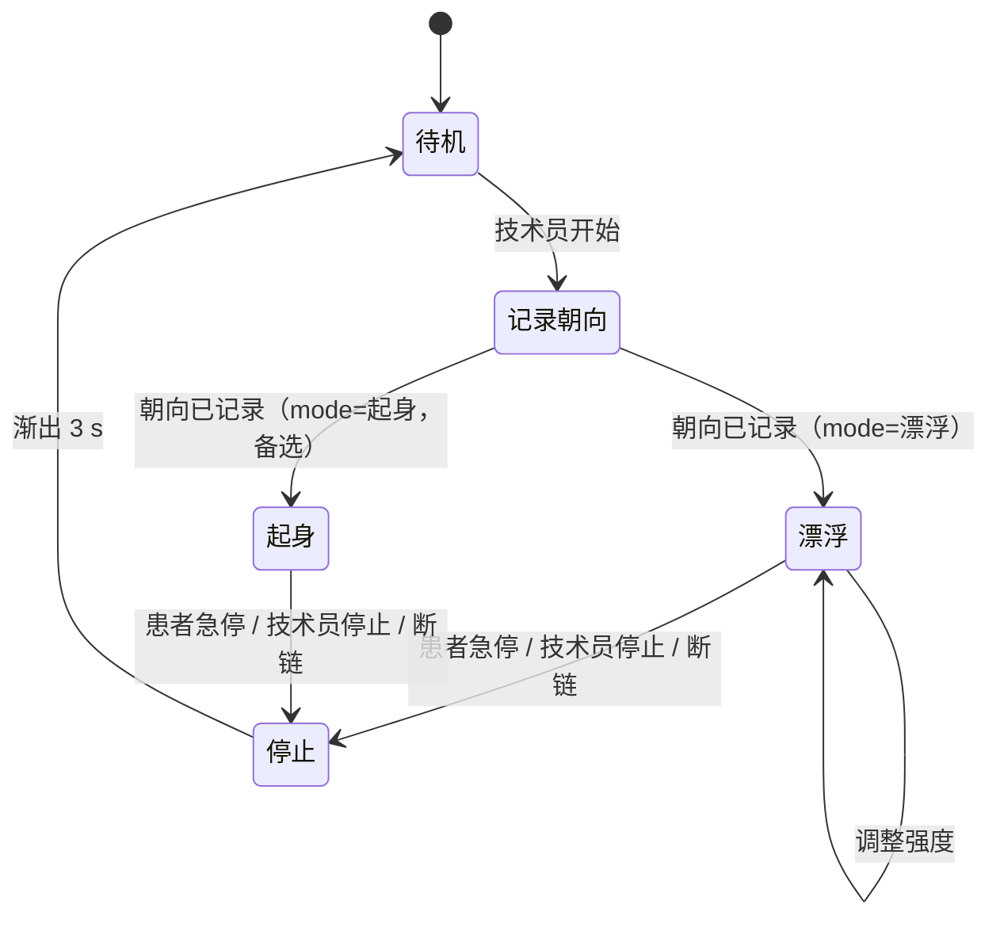

# 核心口径（权威）

本文是产品范围与场景约定的唯一权威来源。与其他文档冲突时以本文为准。代码现状与本文的差距见根目录 `TODO.md`。

## 1. 目标

让需要站立排尿的男性患者在真实尺度的卫生间场景中放松下来，降低排尿的心理负担。

这是产品假设，尚无医学依据。系统只提供体验，不做疗效宣称。

## 2. 非目标

- 不宣称治疗尿潴留、失禁，不替代护理评估。
- 默认路径不做强烈失重、快速移动、大角度旋转。
- **不做快速闪烁**：画面里不存在 ≥3 Hz 的全屏明暗变化；光井的环间距 10 m、流速 0.35 m/s（约 28 s 一道），
  亮度上限压到中灰，避免"白环扫过黑井"的高对比刺激。光敏史患者按机构常规要求评估。
- 不录屏、不存储画面、不在界面出现排尿相关文字或计时。
- 不让患者独自使用；技术员在场。

## 3. 使用方式

技术员携带头显与平板到患者处。



- 记录朝向：技术员在平板触发（患者也可按一次确认键）。卡片要求患者保持不动 1.8 s，随后 3 s 取样取平均；超过 9 s 强制落地。**卡片期间世界完全静止**（`world.hold(true)`）。
- 停止：患者确认键、技术员停止、平板断链、头显摘下、姿态丢失，任一发生即渐出，不等待。停止对两种模式一视同仁。

## 4. 模式

会话开始前由技术员选定，会话中不切换。

| 模式 | 默认 | 内容 | 验收 |
| --- | --- | --- | --- |
| 漂浮 | 是 | 世界沿视觉竖直缓慢平移加微粒上飘；**地平线永不倾斜**（无摆动通道） | 计入核心验收（§8） |
| 起身 | 否 | 不起伏；用于只做"视角修正"的场景（见下） | 与漂浮共用同一套帧 |

**世界帧**：会话从"天花板就是真实的天花板"开始（`mix = 0`，只按头部朝向转正），校准完成后**自动 8 s** 把 mix 升到 1，
患者从仰面看天花板过渡到"舒适体位面向前方墙壁"。技术员可随时「修正朝前 / 回天花板 / 停住」接管；手动斜坡用平板时长（4–14 s）。
smootherstep 首末速为零，起身不改变眼高。详见 `docs/animation.md`。

约束：

- 患者确认键在两种模式下语义相同，只有“开始 / 停止”。不存在“短按切换起身”。
- 起身沿用现有速率上限（15 / 30 °/s），不放宽。
- 起身模式只能在平板声明 `CAP_POSTURE` 能力的头显上选择；能力缺失时选项不显示。
- 起身模式的停止要求与漂浮相同：1 s 内停止并渐出。

## 5. 场景

三个场景，**由技术员在平板选择**，会话开始前切换；页面拒绝会话中的切换。
每个场景的边界、画面、用途与选择规则见 `docs/scenes.md`。

| id | 名称 | 用途 | 预算 |
| --- | --- | --- | --- |
| `washroom`（默认） | 洁净立便间 | 站立、面向立便器的真实尺度单间 | 10 draw / 568 三角形 / 0 透明 |
| `shore` | 仰望湖面 | 仰卧视角的清晨湖面（穹顶、云、水面、木桩与芦苇） | 6 draw / 626 三角形 / 3 透明 |
| `lightwell` | 光井 | 18 m 直径 / 120 m 高竖井，二十道自发光环状构件自下而上掠过；两端各在 60 m 外，看不到盖 | 5 draw / 2.6 k 三角形 / 0 透明 |

切换链路：平板 `scene:<id>` → 头显校验并存入启动参数 → 转发给页面 → 页面在会话外重建场景；平板与镜像都从 state 回读已加载的场景，不各自记一份选择。

- 场景内不出现人物；不出现病床、监护仪与任何文字标牌。
- 环境音随场景声明（`stream` / `lake`），音量低于护理人员说话声；**默认不启动**，由平板的水声开关开启。
- 环境音播放器是双路交叉淡化：两路同一片段以 ±0.6% 的速率错开循环，每 11–19 秒随机交换一次并重新取随机起点，叠加 6–15 秒一次的短片段细节（0.14–0.28 电平），避免 16 秒片段被听出循环。
- 没有画质挡位：三个场景共用同一套渲染参数（`XR_SCALE = 1.25`、AA 开）。

### 5.1 场景接口约定

场景是内容单元，不是应用状态机。应用负责会话、头显姿态、控制权和音频引擎；场景只声明自己需要什么并构建自己的内容。

```ts
interface SceneDefinition extends SceneSummary {
  eyeY: number;                     // 作者把眼睛放在内容坐标的哪个高度
  build(ctx: SceneBuildContext): SceneHandle;
}

interface SceneBuildContext {
  registry: ResourceRegistry;       // 只注入资源注册表；眼高由场景自己声明
}

interface SceneHandle {
  root: THREE.Object3D;
  selectables: THREE.Object3D[];   // 当前 MVP 不使用注视选择，为空
  settings: SceneSettings;         // background / fog
  update(dt: number, elapsed: number): void;
  dispose(): void;
  budget?: SceneBudget;
}
```

- 没有画质挡位：渲染参数写死在 `src/core/xr/renderer.ts`。
- 场景声明 `eyeY`，应用据此放置画面（见 `docs/animation.md`）；不再向下传眼高。
- 音频在场景定义中声明；场景构建器不直接调用音频 API；App 不按场景 ID 选择音频。
- `root` 只含场景内容，不含相机、HUD、准星或控制对象。
- `update` 不读写会话状态，不做网络或 BLE。
- `dispose` 只释放场景拥有的资源。
- `SceneHost` 负责切换与释放；注册表是 `src/scenes/registry.ts` 的 `SCENES` 数组，`SCENE` 是默认项，`getSceneDefinition(id)` 是唯一查找入口。
- 场景 id 顺序即 BLE state byte 11 的线上契约（`ControlProtocol.SCENE_IDS`），只能追加。
- 每个场景的 `budget` 由 `tests/scenes.test.ts` 断言：≤ 10 draw calls、≤ 3 k 三角形。

## 6. 功能

### 6.1 患者端（头显）

- 确认键：短按开始 / 停止。停止语义永远可用，平板不能屏蔽。
- 入口只有一张确认卡：场景名、开始按钮、提示。无设置、无菜单、无性能开关。
- 唯一可作答的空间面板是 SUS 量表：由平板打开，一张卡片内装标题、题干、五点选项与翻页；患者注视选项 **8 秒**即作答，答案随完成或关闭上报平板归档。
- 翻到新的一题时所有选项**锁定 2 秒**（题目阅读期），锁定内注视不计时；面板打开期间准星常驻。
- 题干默认**语音朗读**（平板可用 `sus:voice:off` 关闭）；「SUS 5/10」计数为小号，题干为大号正文。
- 漂浮强度 0–3 档，由技术员设置；**未设置时取 3 档**（标准档位 a=55 mm / b=75 mm / c=100 mm 峰值的满包络，呼吸层按 16% 叠加在同一包络内）。1 档只有 25 mm，头显里读作“完全没动”，所以默认值不走 1 档。

### 6.2 技术员端（平板）

- 连接状态与会话时长。
- 模式选择：漂浮（默认）/ 起身（仅 `CAP_POSTURE` 可用时显示）；只能在会话开始前选。
- 开始 / 停止。
- 强度 0–3 与档位 a/b/c。
- 场景选择（会话开始前）。
- SUS：打开/关闭头显面板、逐题显示、目视选择开关、代患者作答；完成后归档。
- 水声开关，**默认关**（语音不受它影响）。
- 紧急停止，常驻可见，不依赖界面层级。

平板不显示患者 3D 镜像，不录屏，不显示排尿相关字样。

## 7. 决策记录

| 编号 | 问题 | 当前结论 | 状态 |
| --- | --- | --- | --- |
| D1 | 临床侧是否需要“起身” | 保留为备选模式，默认关闭，并行于漂浮；不进入核心验收 | 采用，待你书面确认 |
| D2 | 平板是否必要 | 保留，仅含 §6.2 列出的控制项 | 采用，待你书面确认 |
| D3 | 确认键语义 | 只做开始 / 停止，不做模式切换 | 采用 |

决定变化时先更新本表，再改其他文档与代码。

## 8. 验收：可用基线（漂浮模式）

同时满足方可称为可用基线：

- 技术员上机到患者开始 ≤ 3 min（计时）。
- 连续 10 min 无中止；中止均有原因记录。
- 5 名同意的健康志愿者：无头晕、无恶心；主观“漂”的程度有记录。
- 断链、摘下头显、急停后，漂浮在 1 s 内停止并渐出（实测）。
- 患者前后紧张度 0–10 分有记录。

正式用于患者前需要伦理审批与护理主管确认。

## 9. 设计原则

- 一个场景、一个默认动作、一个停止。新增功能需先说明为何不能用现有命令表达。
- 高频运动必须有速率上限与停止语义；离散命令必须有回执。
- 患者界面只做确认，不做选择。
- 文档只写当前事实；过时内容直接删除，历史见 git。

## 10. 现状事实（以代码为准）

- 场景：三个 —— `washroom`（洁净立便间）、`shore`（仰望湖面）、`lightwell`（光井），见 `src/scenes/`。
  每个场景声明 `eyeY`（作者把眼睛放在内容坐标的哪个高度），应用据此放置画面。
- 场景预算：`washroom` 10 draw / 568 三角形 / 0 透明；`shore` 6 draw / 626 三角形 / 3 透明；`lightwell` 5 draw / 2.6 k 三角形 / 0 透明。上限由 `tests/scenes.test.ts` 断言。
- 世界帧：漂浮模式一律用已校准帧（偏移 `-eyeY`），起身模式用起身路径（偏移 `视点高度 - eyeY`）；
  选帧只有 `src/core/xr/world-frame.ts` 一处，`src/app/world-runtime.ts` 是唯一写 base 的地方。详见 `docs/animation.md`。
- 校准：保持不动 1.8 s + 3 s 取样；世界在卡片期间冻结。
- 漂浮：`src/app/floating.ts` 拥有等级、档位、包络、位移与 sway；起伏沿患者视觉竖直（`visualUpInContent()`），
  只在漂浮模式、会话进行中、非取帧窗口、非起身过程中运行。
- 起身：`posture:rise|lower|stop` 驱动修正斜坡（0↔1），两种模式下都可用；`anim:duration` 设斜坡时长。
- 命令：`src/app/commands.ts` 把字符串解析成类型化意图，`App` 只执行；语法有 9 组单测。
- SUS：头显单卡片、注视 5 s 作答；结果经 JSON socket → 头显 `sus` 特征（UTF-8 JSON）→ 平板计分并持久化（最近 50 份）。
- 音频：环境声默认关，由平板水声开关开启；语音独立音量，不受水声开关影响。
  环境声播放器双路交叉淡化（±0.6% 速率错开、11–19 s 随机交换），叠加 6–15 s 一次的短片段细节。
- 协议：state v11（28 B，MTU 不足时回落 v10 20 B）；能力位含 `CAP_SCENE`、`CAP_POSTURE`；新增 `sus` 特征。
- 验证：`tsc`；vitest 29 文件 / 276 用例；web 构建 + standalone；`:protocol:test`；两个 APK 构建。实机：0.9.31 待烧录验证。
