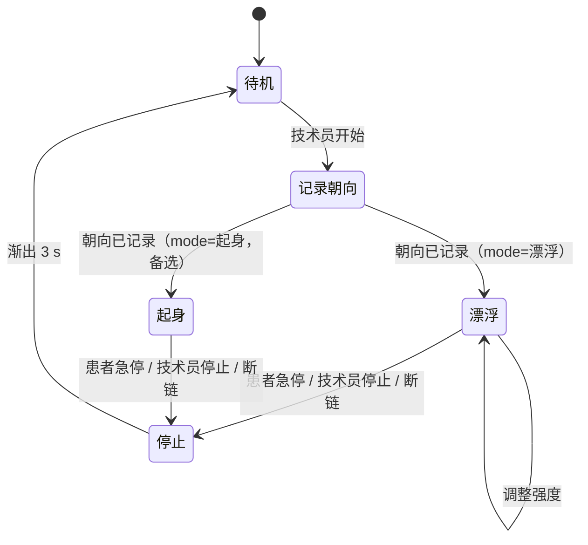

# 核心口径（权威）

本文是产品范围与场景约定的唯一权威来源。与其他文档冲突时以本文为准。代码现状与本文的差距见根目录 `TODO.md`。

## 1. 目标

让仰卧患者在床上获得缓慢的失重感，降低男性患者床上排尿的心理负担。

这是产品假设，尚无医学依据。系统只提供体验，不做疗效宣称。

## 2. 非目标

- 不宣称治疗尿潴留、失禁，不替代护理评估。
- 默认路径不做强烈失重、快速移动、大角度旋转。
- 不录屏、不存储画面、不在界面出现排尿相关文字或计时。
- 不让患者独自使用；技术员在场。

## 3. 使用方式

技术员携带头显与平板到患者处。



- 记录朝向：患者平视正前方，由技术员在平板触发（患者也可按一次确认键）。替代 1.2 s 稳定检测与两步校准。
- 停止：患者确认键、技术员停止、平板断链、头显摘下、姿态丢失，任一发生即渐出，不等待。停止对两种模式一视同仁。

## 4. 模式

会话开始前由技术员选定，会话中不切换。

| 模式 | 默认 | 内容 | 验收 |
| --- | --- | --- | --- |
| 漂浮 | 是 | 世界竖向缓慢漂移加微粒上飘；地平线固定；无整体旋转 | 计入核心验收（§8） |
| 起身（备选） | 否 | 6 s 世界旋转轨迹（站立眼高 1.70 m，峰值 ≈40 °/s）加粒子流 | 单独验收，不计入核心验收；未通过前只能作为技术员手动选择且需记录的选项 |

约束：

- 患者确认键在两种模式下语义相同，只有“开始 / 停止”。不存在“短按切换起身”。
- 起身沿用现有速率上限（15 / 30 °/s），不放宽。
- 起身模式只能在平板声明 `CAP_POSTURE` 能力的头显上选择；能力缺失时选项不显示。
- 起身模式的停止要求与漂浮相同：1 s 内停止并渐出。

## 5. 场景

单一场景，暂定名“仰望湖面”。

- 视线默认朝上：云缓慢流动，近场水面光影晃动，少量微粒上飘。
- 禁止出现病床、马桶、监护仪、人体轮廓。
- 水声为场景自带音轨，音量低于护理人员说话声。
- 备选方向（仅在志愿者测试后考虑）：水下焦散光影，失重线索更强，但部分人会不适。

### 5.1 场景接口约定

场景是内容单元，不是应用状态机。应用负责会话、头显姿态、控制权和音频引擎；场景只声明自己需要什么并构建自己的内容。

```ts
interface SceneDefinition extends SceneSummary {
  audio: SceneAudio;
  build(ctx: SceneBuildContext): SceneHandle;
}

interface SceneSummary {
  id: string;
  name: LocalizedText;
  tagline: LocalizedText;
  description: LocalizedText;
  audio: SceneAudio;
}

interface SceneAudio {
  track: 'lake' | 'stream' | 'rain';
  volume?: number;
  fadeMs?: number;
  loop?: boolean;
}

interface SceneHandle {
  root: THREE.Object3D;
  selectables: THREE.Object3D[];   // 当前 MVP 不使用注视选择，可为空
  settings: SceneSettings;         // 仅 background / fog
  update(dt: number, elapsed: number): void;
  dispose(): void;
  budget?: SceneBudget;
}
```

- 音频在场景定义中声明；场景构建器不直接调用音频 API；App 不按场景 ID 选择音频。
- `root` 只含场景内容，不含相机、HUD、准星或控制对象。
- `update` 不读写会话状态，不做网络或 BLE。
- `dispose` 只释放场景拥有的资源。
- `SceneHost` 负责切换与释放；`SceneRegistry` 负责组合；App 只通过 `getSceneDefinition` 与 `SceneHost` 读场景，不写 `switch (sceneId)`。
- 新场景接入：`src/scenes/<id>/` 建构建器 → `index.ts` 导出 → 声明元数据、音频、build → 注册到 `src/scenes/registry.ts` → 必要时加预算与测试。
- 候选扩展（`capabilities`、`interaction`、`telemetry`、`preload`）当前不实现，避免空抽象。

## 6. 功能

### 6.1 患者端（头显）

- 确认键：短按开始 / 停止。停止语义永远可用，平板不能屏蔽。
- 界面仅一张确认卡：场景名、开始按钮、提示。无设置、无菜单、无性能开关、无量表、无注视选择。
- 漂浮强度 0–3 档，由技术员设置。

### 6.2 技术员端（平板）

- 连接状态与会话时长。
- 模式选择：漂浮（默认）/ 起身（仅 `CAP_POSTURE` 可用时显示）。
- 开始 / 停止。
- 强度 0–3。
- 水声开关。
- 紧急停止，常驻可见，不依赖界面层级。

平板不显示患者 3D 镜像，不录屏，不显示排尿相关字样。

## 7. 决策记录

| 编号 | 问题 | 当前结论 | 状态 |
| --- | --- | --- | --- |
| D1 | 临床侧是否需要“起身” | 保留为备选模式，默认关闭，并行于漂浮；不进入核心验收 | 采用，待你书面确认 |
| D2 | 平板是否必要 | 保留，仅含 §6.2 列出的控制项 | 采用，待你书面确认 |
| D3 | 确认键语义 | 只做开始 / 停止，不做模式切换 | 采用 |

决定变化时先更新本表，再改其他文档与代码。

## 8. 验收：可用基线（漂浮模式）

同时满足方可称为可用基线：

- 技术员上机到患者开始 ≤ 3 min（计时）。
- 连续 10 min 无中止；中止均有原因记录。
- 5 名同意的健康志愿者：无头晕、无恶心；主观“漂”的程度有记录。
- 断链、摘下头显、急停后，漂浮在 1 s 内停止并渐出（实测）。
- 患者前后紧张度 0–10 分有记录。

正式用于患者前需要伦理审批与护理主管确认。

## 9. 设计原则

- 一个场景、一个默认动作、一个停止。新增功能需先说明为何不能用现有命令表达。
- 高频运动必须有速率上限与停止语义；离散命令必须有回执。
- 患者界面只做确认，不做选择。
- 文档只写当前事实；过时内容直接删除，历史见 git。

## 10. 现状事实（以代码为准，本轮改造后）

- 场景：注册表保留数组形态（`SCENES`），只装一个 `landscape`；`ward`/`bathroom`/`lab` 已删除。
- 场景选择：TS 的 `scene-select.ts`、平板 `SceneCards`、头显控制台场景页、协议 `scene:` 命令与 `CAP_SCENE` 均已删除。state 帧 byte 1 保留为场景索引（当前恒 0）。
- 会话：`src/app/session.ts` 纯 reducer 驱动；确认键只做开始/停止；所有停止路径经 `App.dispatch` 收口，进入 `stopping` 后 1 s 转 `idle`。
- 校准：无稳定检测、无倒计时、无卡片；会话开始后的第一帧直接记录当前朝向（`captureHeading`）。`src/ui/calibration.ts` 已删除。
- 漂浮：`src/core/xr/float.ts`，三档参数 `float:profile:a|b|c`（温和 22 mm/14 s、标准 35 mm/11 s、沉浸 45 mm/9 s + 1.5° 地平线微摆），`float:level:0-3` 在档位内线性缩放；停止时 tau 0.25 s 渐出，偏移与地平线摆角都归零。粒子流由实际振幅驱动。
- 起身：备选模式，仅在 `mode:posture` 且 `CAP_POSTURE` 时启用；`mode:` 只能在会话前设置。
- 平板：3D 镜像、录像、场景卡、全屏、帧率开关相关代码已删除（`ControllerWebViewHost`、`ViewportRecorder`、`ControllerViewport`、`RecordingControls`、`ViewModeToggle`、`src/controller/`）。平板当前只剩控制栏与状态面板，单屏重做见 TODO。
- 患者页：性能开关、SUS、6 s 注视选择、`spin` 调试项已删除；`SpatialInput` 的注视子系统因此无注册目标，清理列入后续结构阶段。
- 协议：state 20 字节 v10；命令新增 `mode:`、`float:level:`、`float:profile:`；`HELLO/WELCOME` 版本号为 2。
- 验证：`tsc` 通过；vitest 18 文件 / 179 用例；`:protocol:test`、`:headset:assembleDebug`、`:control:assembleDebug` 通过。未在 PICO 实机验证。
