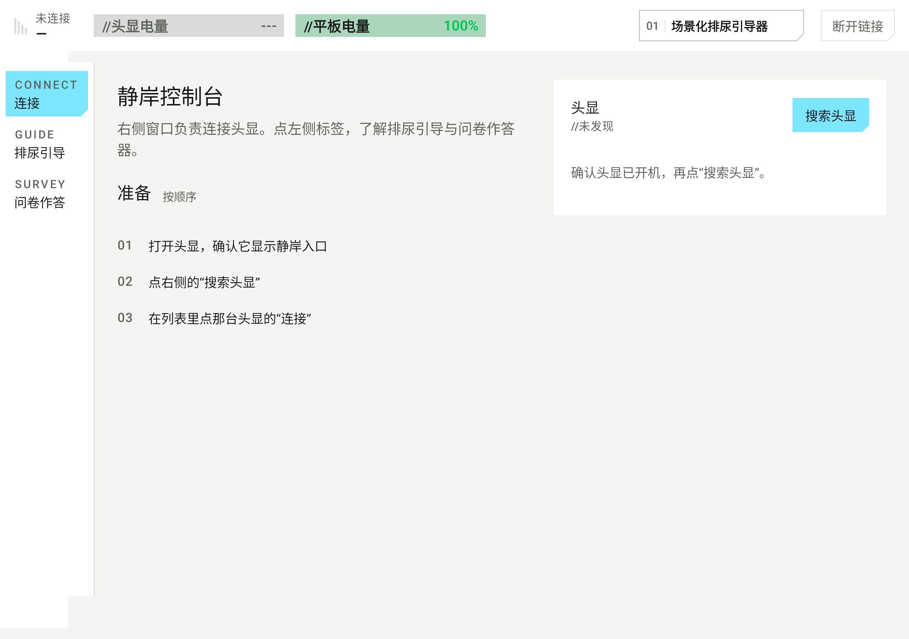
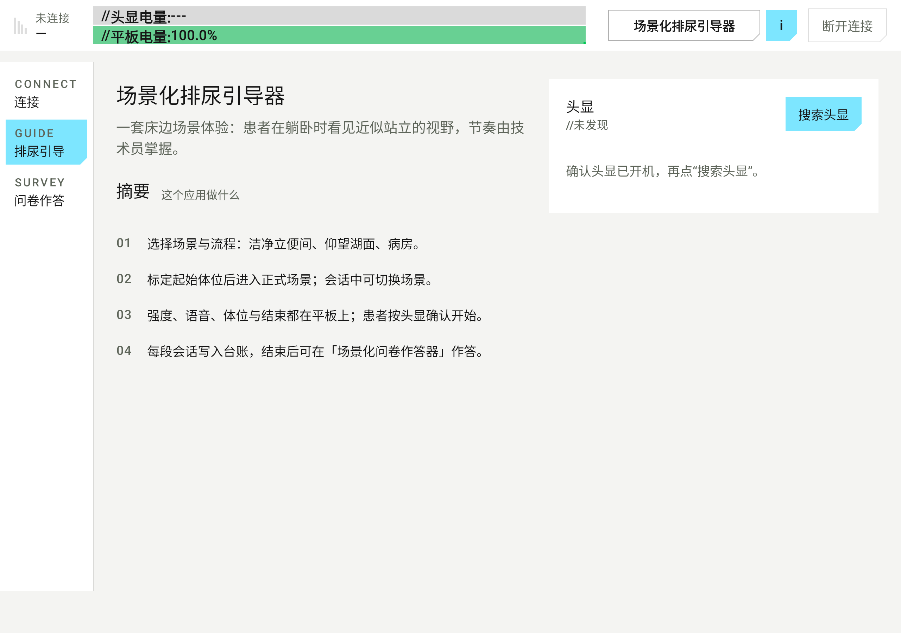
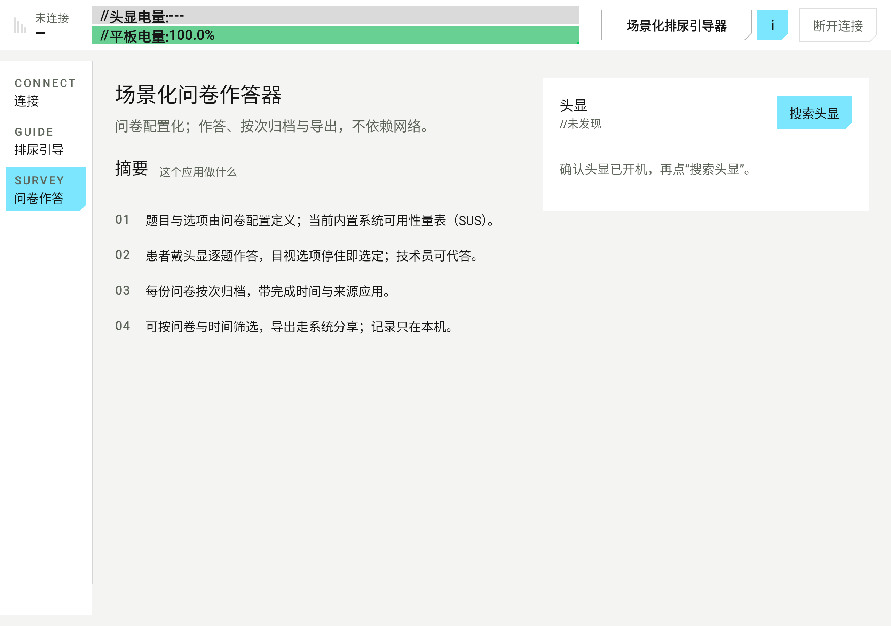
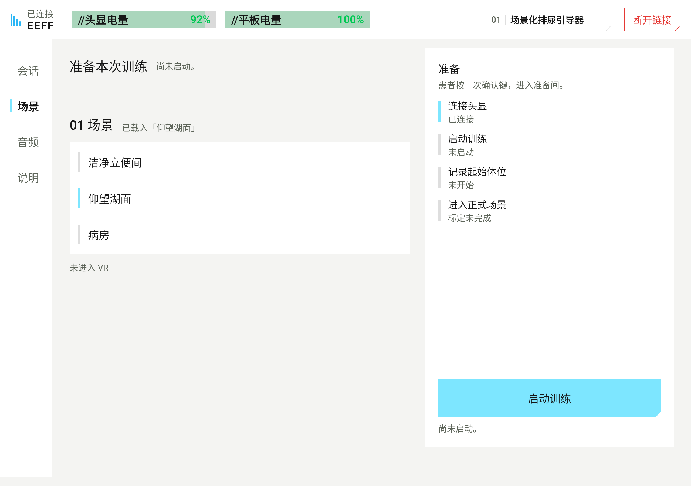
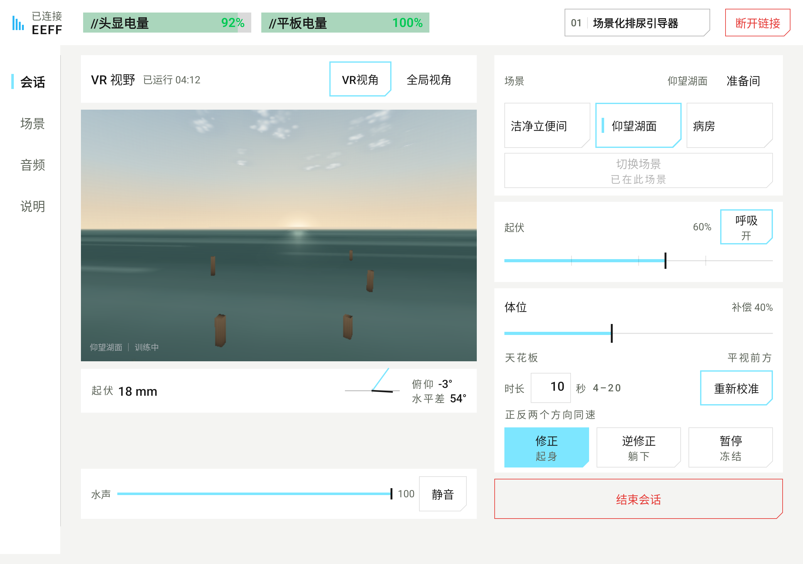
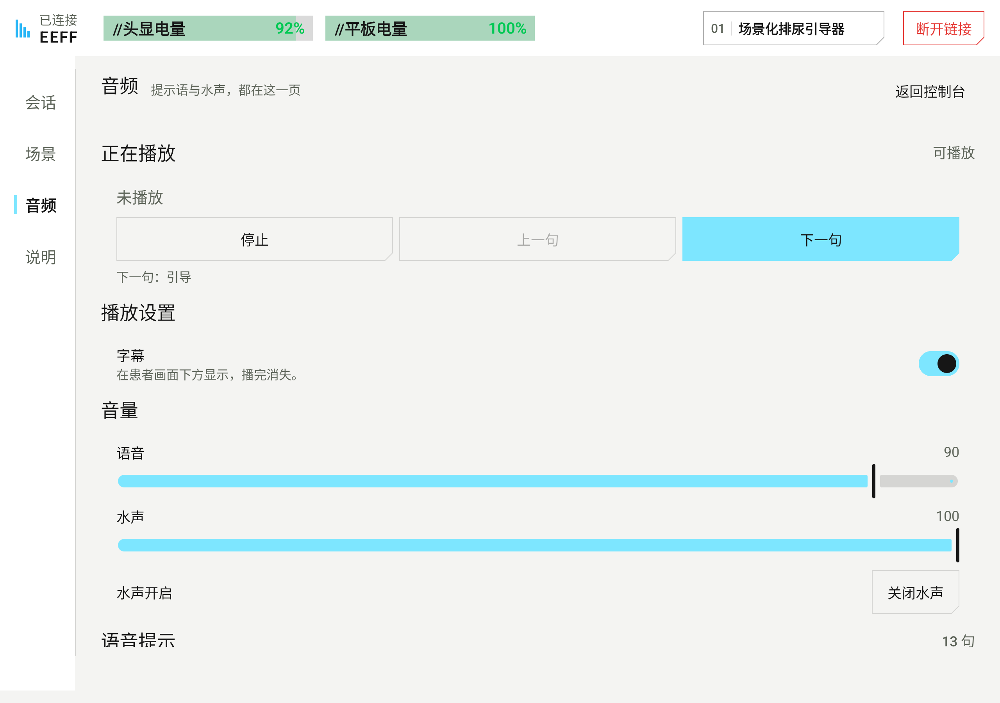
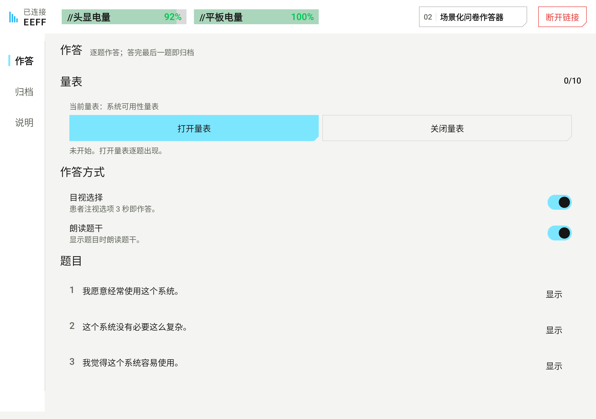
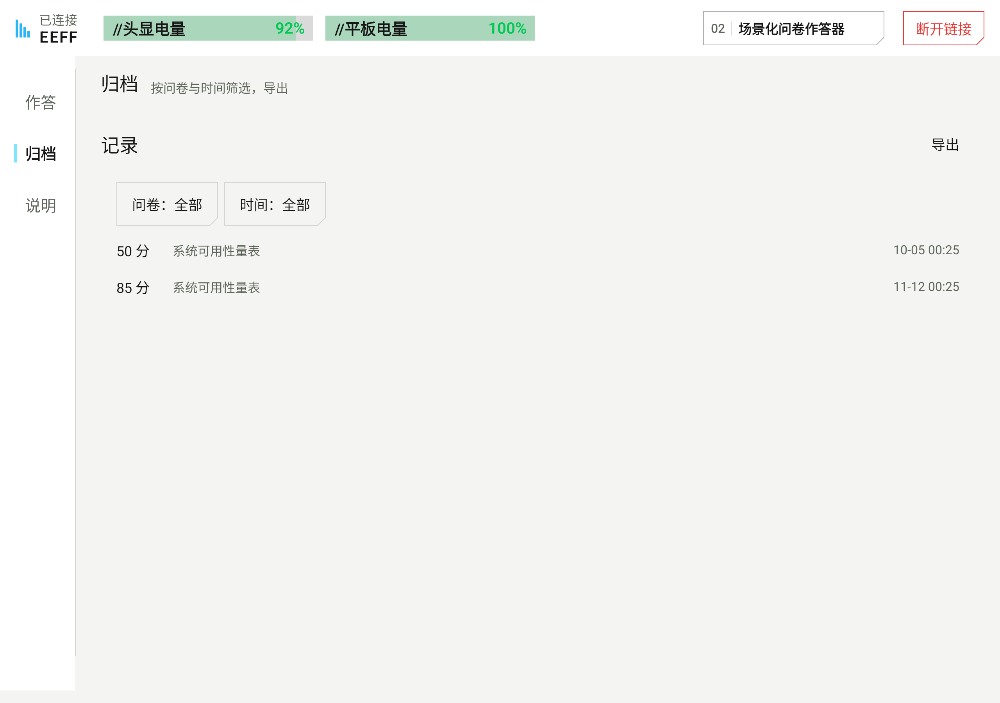
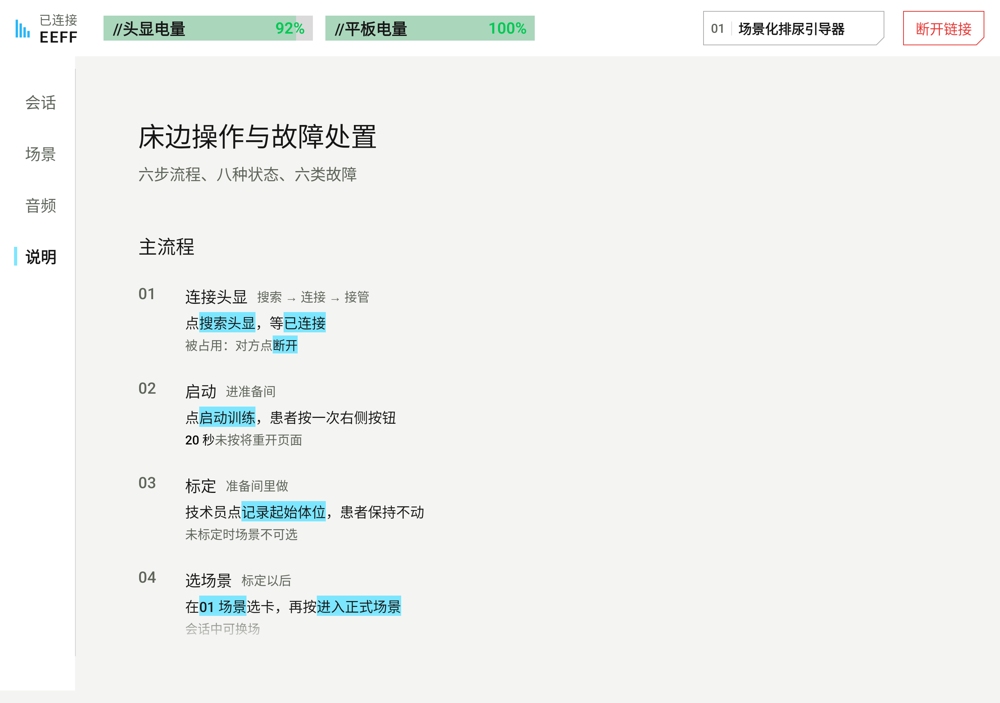
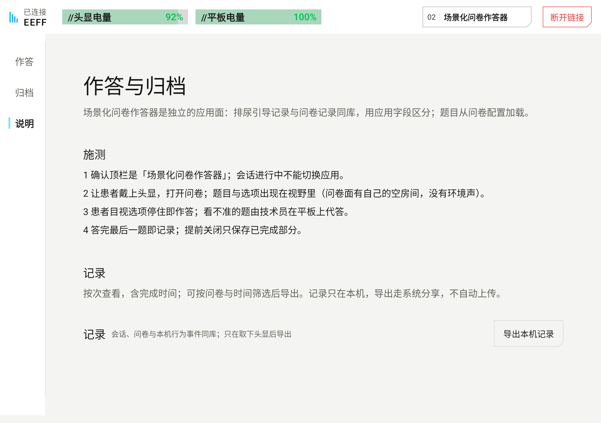

QUIET SHORE VR

<h1>静岸 · 操作说明书</h1>

场景化排尿引导器 场景化问卷作答器

v2.1 · 2026-11-14

读者：床边操作的技术员

PICO G2 4K 头显 ＋ 10 英寸 Android 平板

# 一页速查

| 要做的事 | 在哪里 |
| --- | --- |
| 连接头显 | 首页右侧「头显」窗口 → 搜索头显 → 连接 |
| 切换应用 | 顶栏当前应用名；会话中锁定 |
| 看当前应用的说明书 | 左侧 `说明` 页签 |
| 开始训练 | 场景化排尿引导器 → 场景页右侧「启动训练」 |
| 结束会话 | 会话页底部「结束会话」 |
| 断开链接（急停） | 顶栏右侧；立即冻结，5 秒未重连则头显退出场景回首页 |
| 作答与归档 | 顶栏切到「场景化问卷作答器」 |
| 导出记录 | 场景化问卷作答器 → 归档 → 导出 |
| 导出体验 CSV | 场景化排尿引导器 → 体验 → 导出 CSV |

**患者只做一件事：戴上头显后，按一次头显右侧按钮进入画面。** 开始、停止、体位与场景都由平板操作员控制。

# 1 这套系统怎么用

静岸是一套床边的场景体验。患者躺卧或半躺时，头显呈现近似站立时的视野；画面与声音节奏由床边的技术员掌握。

系统有两个并列的应用面，由顶栏的应用选择器切换：

| 应用 | 用途 |
| --- | --- |
| **场景化排尿引导器** | 选场景、标定体位、运行会话、调节起伏与体位、看患者的视野 |
| **场景化问卷作答器** | 加载问卷、在头显内作答、按次归档、筛选与导出 |

顶栏从左到右是：连接与电量、**当前应用名**、**断开链接**。应用名是一个带细边框的按钮，点开可在两个应用之间切换；会话进行中不能切换。说明书不再放在顶栏，而是各应用左栏的最后一项。

> 平板与头显只通过本地蓝牙连接，不依赖互联网。问卷记录保存在平板本机，导出使用系统分享。

# 2 第一屏：连接头显

{.shot}

首页左侧是三个纵向标签，样式与场景化排尿引导器的左侧栏一致：

- **CONNECT 连接**：连接步骤。
- **GUIDE 排尿引导**：场景化排尿引导器摘要。
- **SURVEY 问卷作答**：场景化问卷作答器摘要。

标签只用于了解两个应用，不会切换应用。右侧的头显窗口始终留在原位。真正切换应用在顶栏。

## 2.1 连接步骤

1. 打开头显，确认它显示静岸入口，并停在前台。
2. 平板右侧点「搜索头显」。
3. 在「头显」列表里找到设备，点该行的「连接」。
4. 顶栏出现 **已连接**，并显示头显与平板的电量。

如果设备被另一台平板占用，先在对方平板上点「断开链接」，再在这台平板上连接。

{.shot}

{.shot}

# 3 场景化排尿引导器

## 3.1 场景页：准备本次训练

{.shot}

进入应用后默认在 **场景 页**。会话没开始的时候，这一页只有一件事要做：**启动**。

1. **01 场景**：三张正式场景的清单。
   - **洁净立便间**：站立视角，目标是站立排尿。
   - **仰望湖面**：平躺、抬头看天时最自然。
   - **病房**：仰卧视角，目标是安静地看着天花板与监护仪。
   - 标定完成前它们只列出名字，不能点；页头写明当前载入的是哪一个。
2. **右侧「准备」**：连接头显 → 启动训练 → 记录起始体位 → 进入正式场景，四步成链；链的脚下就是「启动训练」，那是这一页唯一的按钮。

## 3.2 启动与标定

| 步 | 动作 | 说明 |
| --- | --- | --- |
| 1 | 右侧点「启动训练」 | 头显页面被拉起 |
| 2 | 患者按一次头显右侧按钮进入画面 | 这是浏览器强制手势；20 秒未按会重开页面 |
| 3 | 患者进入准备间 | 调整躺姿与头显位置 |
| 4 | 技术员点「记录起始体位」 | 记录期间世界静止，患者保持不动 |
| 5 | 场景卡解锁，选卡后点「进入正式场景」 | 校准帧保留，只换世界内容 |
| 6 | 填「时长」，点「修正 · 起身」 | 整数秒 4–20，默认 10；正反两个方向同速 |

## 3.3 会话中

{.shot}

左列从上到下：标题卡 → 患者画面（占三分之二）→ 读数卡 → 水声卡。右列三块：场景、起伏、体位。

- **标题卡**：`VR 视野` 是头显当前画面，`全局视角` 是操作员俯瞰；右侧是本次会话时钟。
- **患者画面**：镜像，约两秒延迟之内跟手。
- **读数卡**：`起伏` 是当前竖直位移；旁边的小盘画两条水平线 —— 灰的是患者身下真实世界的水平，冰蓝的是场景被放进去的水平。**两条线的夹角就是还没补偿完的角度**，右侧写作「水平差」。盘上的墨针是患者头部的实际俯仰。
- **水声**：一条 0–100 的音量条和「静音」。只关水声，不动语音。
- **场景**：会话中可换场景。先点卡片选中，再点「切换场景」执行；选中的就是当前场景时按钮置灰并写「已在此场景」。页头的「准备间」把人送回中性空房（见下）。
- **起伏**：0–100% 的滑条，「呼吸」开关决定这份起伏是自然呼吸还是等幅机械。场景可以声明自己不动，那时这一行显示「本场景无起伏」。
- **体位**：一条滑条 + 一个「时长」+ 三个键。
  - 滑条左端是「天花板」（患者的真实俯仰），右端是「平视前方」（场景声明的前方）。**按下滑条就是接管**：正在跑的斜坡与视线动画会停在原地，之后由手的移动决定目标，页面按自己的限速跟随，不会瞬移。填充是页面已施加的值，竖线是手指的位置。
  - 「时长」是斜坡长度，正反同速。
  - 「修正 · 起身」「逆修正 · 躺下」「暂停」：暂停把斜坡就地冻结。
- **重新校准**：在「时长」右侧。需要重做起始体位时用；它跳过稳定等待，直接进入 3 秒取样。
- **结束会话**：页面底部整宽的红色细框键。

**换场会有约四分之一秒的黑幕**：淡到黑、换内容、淡回。声音随场景切换；尽量在语音之间换场，别在一句话中途切。

## 3.3.1 回到准备间

点场景块页头的「准备间」，再确认切换，就会回到开场那间灰房：

- 水声、语音、起伏一起停；世界按场景声明回到「真实天花板」，眼位也回床上。
- **会话不会结束**，时钟继续走；台账里这一段记为独立的一段。
- 校准帧保留，所以从准备间再进正式场景不需要重新标定。

这个房间的用途是"停一下"：患者需要缓一缓、要换体位、或者技术员想先收走声音再说话。

## 3.4 语音页

{.shot}

- **正在播放**：显示当前句；可「停止」或「下一句」。
- **字幕**：在患者画面下方显示，播完消失。
- **连续播放**：开始 / 想象 / 放松 / 收束，一次运行整段脚本。
- **音色**：女声 / 男声；切换会短暂停顿。
- **声音**：水声开关、语音音量、水声压低级数。
- **语音提示**：按组展开单句清单，逐句播放。

语音播放时环境声自动压低 12 dB。问卷题干的朗读开关在场景化问卷作答器里，不在训练语音页。

## 3.5 体验记录

左栏新增 **体验** 页，用于会话结束后的床边访谈。

1. 点「填写体验表」。场景、日期与会话时长自动带入，不需要手填。
2. 受试者编号可选；不填则记录为匿名。
3. 八项 0–10 评分：失重强度、方向感错乱、场景真实感、身体对齐、舒适度、头晕、恶心、再次体验意愿。
4. 漂浮方向四选一：上升、下沉、漂浮、无明显方向。
5. 备注可选，可记录患者原话、体位或设备异常。
6. 点「保存记录」。记录立即出现在下方列表，可展开查看全部字段。
7. 点「导出 CSV」生成表格文件，UTF-8 BOM，中文列名，可直接用 Excel 打开。

CSV 一行一份体验记录。受试者编号和备注允许为空，其余评分按 0–10 归档。

## 3.6 结束与断开

1. 会话页底部点「结束会话」。
2. 画面淡出，头显结束会话；平板保留本次记录。
3. 帮患者摘头显，先让其躺一会儿再起身。

**结束会话**是正常停止。**断开链接**是急停：头显立即冻结，等待 5 秒重连；5 秒内没有连回，头显退出场景回到首页。

患者不操作头显。患者说停或直接取下头显时，技术员在平板点「结束会话」。本版本没有独立急停按钮。

# 4 场景化问卷作答器

会话结束后，在顶栏把应用切到「场景化问卷作答器」。会话进行中不能切换。

## 4.1 作答

{.shot}

进入后左侧是 **作答**、**归档**、**说明** 三栏，和排尿引导的左侧栏同构。作答页：

1. 「当前量表」先写明本次加载的问卷；本版本内置 **系统可用性量表（SUS）**。
2. 点「打开量表」，题目出现在头显里。
3. 患者目视选项，停住约 3 秒即选定；技术员也可以在平板上按 1–5 代答。
4. 「朗读题干」在题目出现时同步播放该题语音。
5. 答完最后一题即记录；中途关闭只保存已完成的部分。

量表切换是下一版的骨架：题目与选项来自问卷配置，新增量表时增加配置与对应语音资源，作答页会显示新的当前量表；作答与归档的入口不变。

## 4.2 归档、筛选与导出

{.shot}

- 每份完成或部分完成的问卷按次归档，带完成时间与来源应用。
- 「问卷：全部」循环筛选量表；「时间：7 天」循环筛选时间窗。
- 「导出」走系统分享，生成 JSON；不自动上传。
- 记录只在本机。换平板或卸载应用前先导出。

# 5 说明

两个应用左栏的最后一项都是 **说明**，打开的是 **当前应用** 的说明书，显示在右侧主区域（不是弹窗，所以可以一边看一边操作）：

- 场景化排尿引导器：连接、启动、标定、会话中的每一个控制块、故障处置。
- 场景化问卷作答器：施测、作答、归档与导出。

{.shot}

{.shot}

首页左侧的三个标签只是摘要，不等同于说明。

# 6 记录与会话台账

| 记录 | 位置 | 内容 |
| --- | --- | --- |
| 会话摘要 | 本机 | 时长、场景、起伏、语音使用情况 |
| 分段台账 | 本机 | 段序号、场景、实际秒数、峰值（换场与回准备间各成一段） |
| 问卷记录 | 本机 | 题目答案、完成时间、来源应用、是否完整 |
| 导出 | 场景化问卷作答器 → 归档 | JSON，经系统分享 |

记录用于复盘与交接，不用于诊断。需要带走记录时，先导出，再清理平板。

# 7 常见情况

| 现象 | 怎么做 |
| --- | --- |
| 搜不到头显 | 确认头显已开机、停在静岸入口；再点「搜索头显」 |
| 一直连不上 | 看是否被另一台平板占用；让对方先「断开链接」 |
| 页面没打开 | 点「启动训练」重新拉起页面，等 10 秒 |
| 头显里一直黑屏 | 让患者保持不动；仍黑则重新「启动训练」 |
| 患者说看不到场景 | 检查当前段与场景卡；必要时重新校准 |
| 患者不适 | 立即点「结束」，再帮患者摘头显 |
| 语音没声音 | 检查头显音量与耳机；点「下一句」重试 |
| 想切换应用但按钮不可用 | 会话进行中；先「结束」，再切 |
| 断开后头显没回来 | 等约 5 秒；仍未回则重新连接或重启头显应用 |
| 问卷没有新记录 | 确认答完最后一题；检查归档筛选条件 |
| 导出没有反应 | 系统分享没有可用目标；先在系统里登录/配置文件应用 |

# 8 安全与边界

- 患者不适、头晕、恶心：先「结束」，再摘头显。
- 患者在佩戴期间，技术员不离开床边。
- 本系统是体验性工具，不用于诊断或治疗。
- 场景切换当前是硬切；避免在语音中途切换，优先在段边界换场。
- 平板与头显只走本地蓝牙；问卷记录留在本机，导出由操作员发起。
- 头显电量低于 20% 先充电；平板电量低时先接电源再开始。

# 9 班前 / 班后检查

**班前**

- [ ] 头显与平板安装的是同一版本。
- [ ] 头显电量 ≥ 50%，平板电量足够一次会话。
- [ ] 头显停在静岸入口，蓝牙可见。
- [ ] 平板能搜到头显并连接。
- [ ] 试一句语音，确认耳机有声。
- [ ] 让患者按一次头显按钮，确认入口正常。
- [ ] 与患者说明：随时可以说停。

**班后**

- [ ] 会话已「结束」，患者已摘头显。
- [ ] 需要时完成问卷。
- [ ] 导出本次记录。
- [ ] 「断开链接」，头显放回充电位。

# 10 版本与验证

**v2.1 的主要变化**

- 体位：一条 0–100% 的补偿滑条（按即接管、限速跟随、松手保持）+ 整数秒的时长填空 + 修正 / 逆修正 / 暂停三个键。起身与躺下共用同一个时长。
- 起伏：0–3 级改成 0–100%，并多一个「呼吸」开关；场景可以把上限声明为 0（准备间即如此），这时整块控制不可用并写明原因。
- 会话页左列：标题卡、画面（三分之二）、读数卡（含双水平盘）、水声卡；右列：场景 / 起伏 / 体位 / 结束会话。
- 读数卡的小盘同时画真实水平与虚拟水平，给出还没补偿完的角度。
- 场景块常驻「切换场景」，选中项与实机一致时置灰；页头「准备间」可以把人送回中性空房，会话不结束、校准保留。
- 换场过四分之一秒黑幕，不再硬切。
- 导航：左栏单行中文，当前项用冰蓝游标；两个应用的最后一项都是 **说明**，说明书显示在右侧主区域。
- 顶栏：电量改为并排的两个短字段；说明书按钮移出顶栏；`结束会话` 与 `断开链接` 分开命名与着墨。
- 手动重新校准跳过稳定等待；取样期头部偏转超过 12° 会从当前姿态重开窗口。

**验证范围**

- 平板界面截图来自 2560 × 1800 模拟器；本册中的图按此比例。
- TypeScript 测试与 Kotlin 协议/控制端单测通过。
- 真机 BLE、头显 WebXR 与现场手感需在设备上按第 9 节复验；本机没有真实头显可连。
