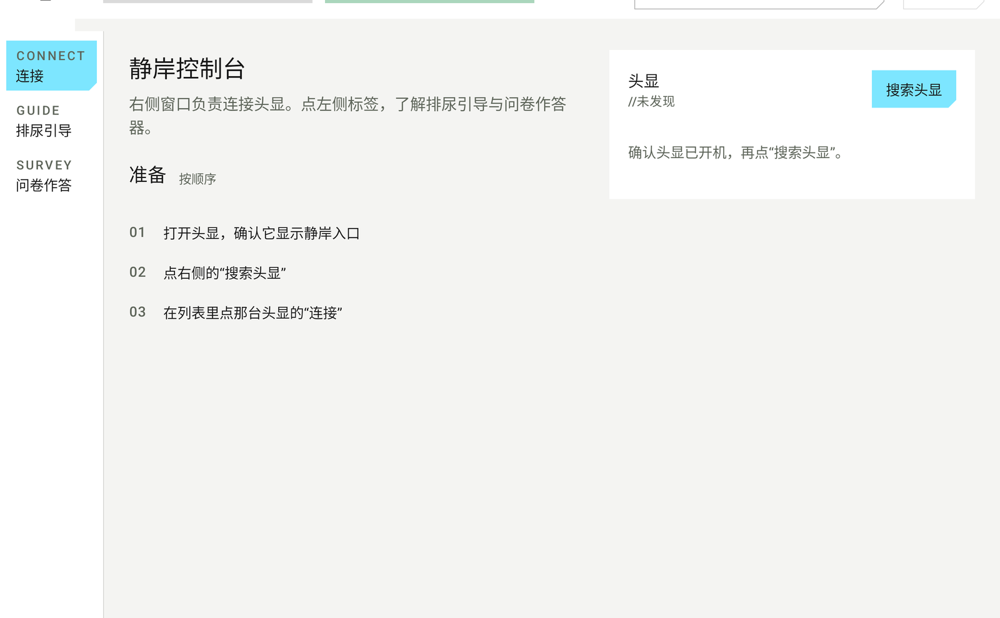
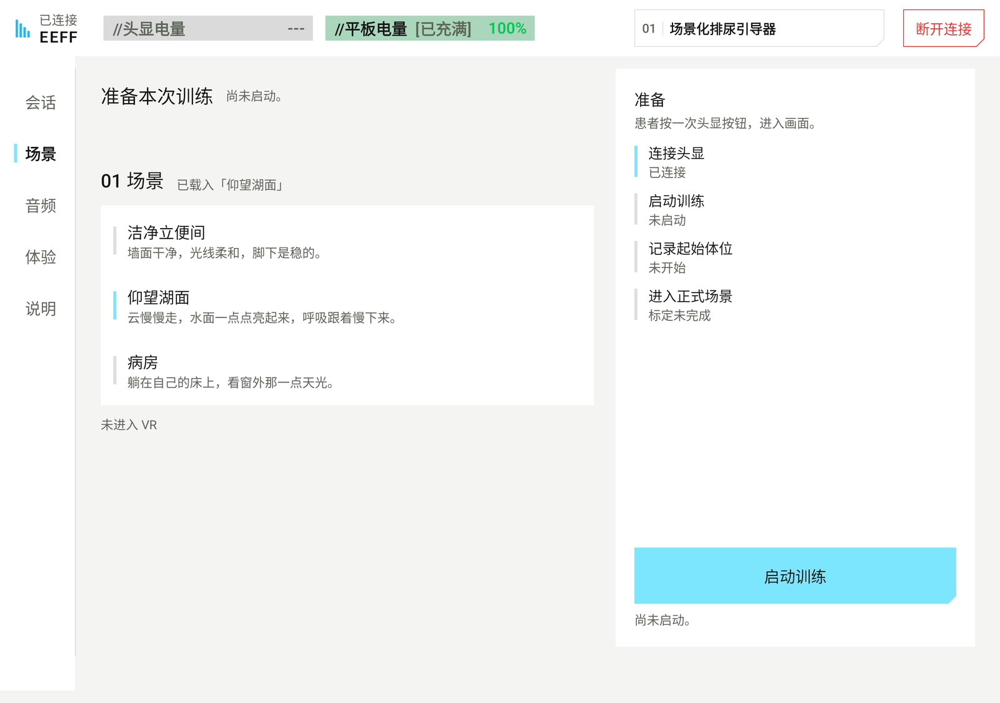
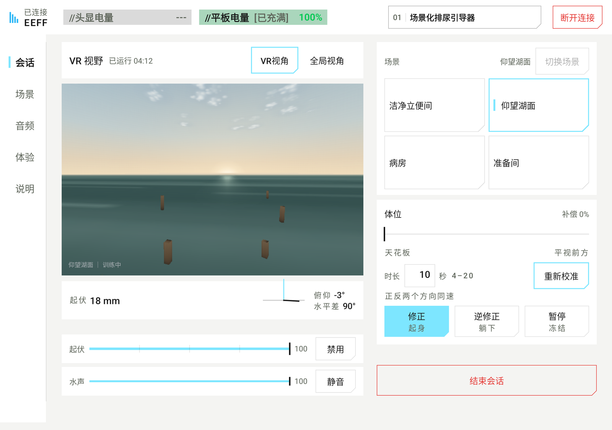
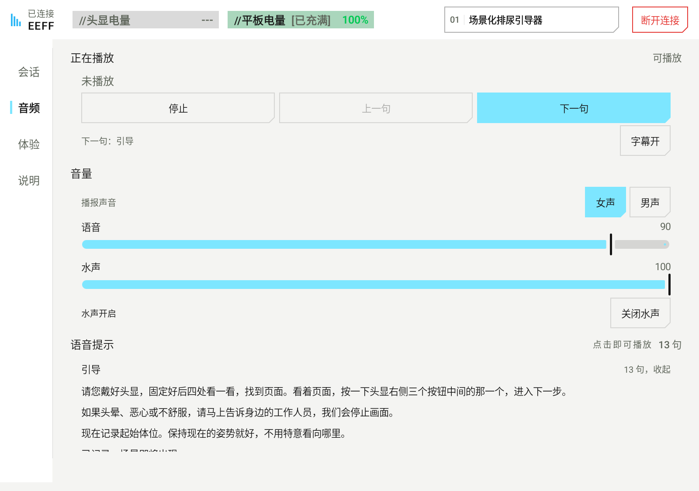
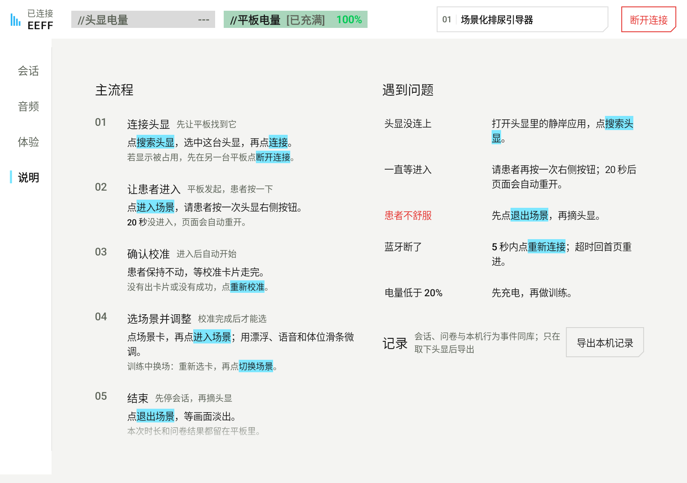
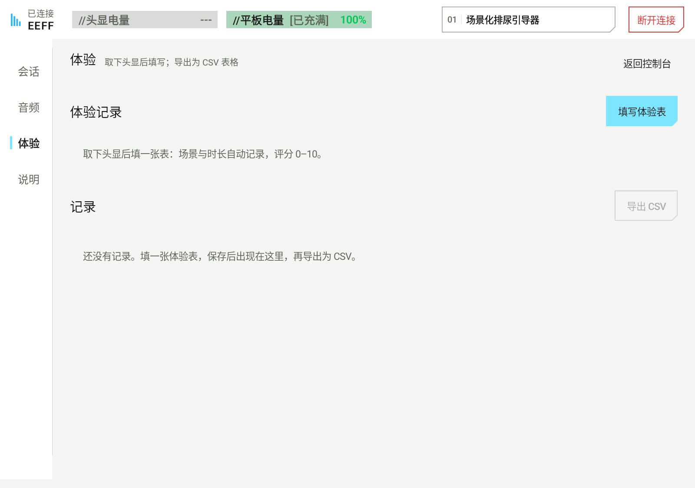
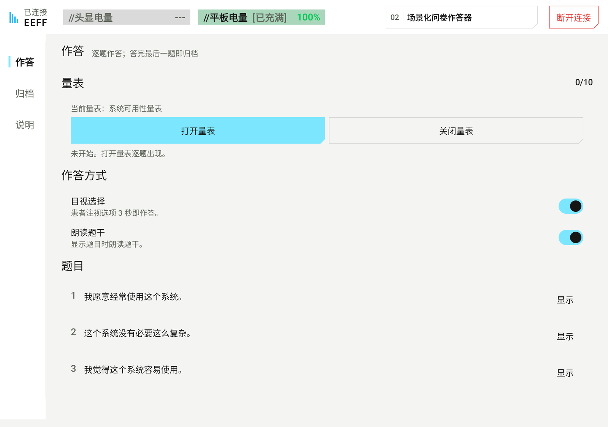
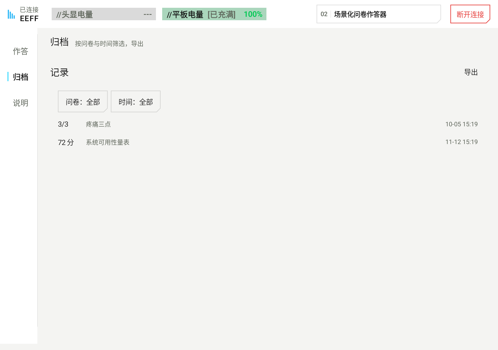

QUIET SHORE VR

<h1>静岸 · 系统操作手册</h1>

APP1 场景化排尿引导器 APP2 临床问卷作答原型

QS2 · 2026-11-14

读者：床边操作员

PICO G2 4K 头显 ＋ Android 平板

# 一页速查

| 要做的事 | 操作 |
| --- | --- |
| 连接头显 | 首页右侧「头显」窗口，搜索并连接 |
| 进入场景 | 会话页右下「进入场景」 |
| 患者进入画面 | 患者按头显右侧三个按钮中间的那一个 |
| 校准 | 进入后自动记录；失败点「重新校准」 |
| 选择正式场景 | 右侧场景卡 → 「切换场景」 |
| 调整体验 | 起伏、水声、语音、体位；站立眼高可即时改 |
| 正常结束 | 右下「退出场景」 |
| 断开连接 | 顶栏右侧「断开连接」；离线时同一按钮变「返回配对」 |
| 填写感受 | APP1 → 体验 → 「填写体验表」 |
| 导出体验记录 | APP1 → 体验 → 「导出 CSV」 |

患者只按一次头显按钮进入 WebXR，之后全部由平板操作员控制。

# 1 系统与分工

系统由三部分组成：

- 头显：PICO G2 4K，运行 Firefox Reality 10 和患者页面。
- 平板：运行静岸控制台，是唯一操作端。
- 头显服务：在头显本机提供页面、蓝牙控制和状态转发，不依赖互联网。

| 角色 | 职责 |
| --- | --- |
| 患者 | 佩戴头显，保持体位，观看，口头说停或直接取下头显 |
| 操作员 | 连接、进入场景、确认校准、选场景、调参数、播放语音、退出、记录体验 |
| 观察员 | 可选；负责计时、询问不适、停止判定和记录 |

没有独立急停按钮。平板断开连接就是急停。头显立即冻结运动与语音，等待 5 秒重连；5 秒内连回可继续会话，超时退出到首页。

# 2 上机前准备

## 2.1 设备

1. 头显和平板安装同一版本的应用。
2. 头显电量至少 50%，平板电量足够完成一次会话。
3. 头显停在静岸入口，Firefox Reality 已安装。
4. 平板蓝牙已开启，位置权限已授予。

## 2.2 连接

1. 在平板首页右侧点「搜索头显」。
2. 在列表中找到设备并点「连接」。
3. 顶栏显示「已连接」，头显和平板电量条出现数值。
4. 未连接时，顶栏右侧按钮是「返回配对」；已连接时才显示「断开连接」。
5. 若提示头显被另一台平板占用，先让对方点「断开连接」。

## 2.3 声音

1. 在 APP1 的「音频」页先选女声或男声。
2. 点任意一句「语音提示」试播，确认耳机有声；列表标题旁写着「点击即可播放」。
3. 音量分语音与水声两条；关水声不影响语音。

## 2.4 患者沟通

开始前向患者说明三件事：

1. 戴好头显后只需要按一次右侧三个按钮中间的那一个进入画面，之后不用操作。
2. 有任何头晕、恶心或不舒服，直接说停或取下头显。
3. 全程有工作人员在床边，可以随时结束。

# 3 APP1 完整会话流程

**本质。** APP1 让躺卧患者看到一个按站立眼高构图、随头部稳定的真实尺度空间。患者只负责佩戴和观看，技术员在平板上控制场景、体位与声音。

**原理。** 页面用真实尺度渲染房间，校准把患者头部坐标系对到场景坐标系，让躺姿下的视野获得稳定的“前方”和“地面”。场景按站立眼高构图，漂浮只做缓慢的视觉竖直位移，地平线不倾斜。安全动作直接写进系统：患者只按一次头显进入，之后不承担操作；任何停止源立即生效；平板断链 5 秒内可重连，超时头显退出。

**与常见方案相比的亮点。**

- 比音频放松多一层经过躺姿校准的空间视觉，患者看到的是与身体对位后的房间，不是一段通用全景视频。
- 比通用 VR 放松视频少一层患者操作：不交控制器、不交菜单，患者只按一次进入。
- 比临床 VR 暴露系统更轻：平板就是操作端，场景、体位、语音和记录在一套界面里完成，可本地离线运行。
- 比纸面引导多一层可回读的状态：平板显示头显实际执行的场景、强度与连接状态，不靠操作员猜。

**边界。** 系统提供体验，不替代护理评估或治疗；疗效需要独立研究验证。

APP1 左栏有四个页面：会话、音频、体验、说明。默认停在会话页；进入场景前，左栏是四阶段指示器，进入后同一位置切为患者镜像。

## 3.1 进入场景

1. 确认顶栏是「已连接」。
2. 点会话页右下角大按钮「进入场景」。头显页面被拉起。
3. 请患者戴好头显，四处找到页面，按一下头显右侧三个按钮中间的那一个。
4. 患者进入 WebXR 后落在内置准备间 `prep`：灰色空房，无陈设、无环境声。
5. 超过 20 秒没有进入画面时，系统会重新拉起页面；连续两次仍失败则改为人工处理。

## 3.2 自动校准

1. 患者进入画面后，系统自动开始记录起始体位。
2. 患者保持不动 1.8 秒，随后 3 秒取样取平均。
3. 卡片期间世界完全静止。超过 9 秒未完成时，系统使用当前体位落地。
4. 没有出卡片或记录失败时，点右侧「重新校准」。

校准只测量患者当前头部朝向与体位，不要求患者看向任何方向。

## 3.3 选择正式场景

自动校准完成后，场景卡解锁。右侧始终显示四张：三个正式场景加准备间。

| 场景 | 体验 | 初始姿态 |
| --- | --- | --- |
| 洁净立便间 | 站立尺度的单间，面向立便器 | 直接站立视角 |
| 仰望湖面 | 仰卧看天、水面与芦苇 | 真实天花板，随后排定起身 |
| 病房 | 仰卧在病床上，看被面、窗户与监护仪 | 真实天花板，随后排定起身 |
| 准备间 | 灰色空房，可随时返回 | 不自动起身 |

操作：先点场景卡；如果当前是准备间，按钮显示「进入场景」，其他情况下显示「切换场景」。准备间常驻，不再时有时无。

站立眼高：

1. 在场景卡下方找到「站立眼高」。
2. 输入 120–190 cm，按键盘完成或点走焦点。
3. 即时生效；头显同时保存，下次启动继续使用。

- 会话中换场会先出现短暂黑幕，校准帧与视线偏移保留。
- 准备间不会被自动转成立姿。起身只在进入正式仰卧场景后安排。
- 仰卧场景的起身先播放提示语音；语音未成功播放时不会自动转世界。
- 技术员可随时停止或反向调整起身。

## 3.4 会话页

进入后，左栏从四阶段指示器切成患者镜像；右侧是场景与体位。

- 患者画面有两种视角：`VR 视野` 和 `全局视角`。
- 读数包含会话时长、已应用起伏、水平差与头部俯仰。
- 场景：2×2 卡片，准备间在第四格；按钮按状态显示「进入场景」或「切换场景」。
- 起伏：左下连续滑条，旁为「启用 / 禁用」呼吸开关。
- 水声：左下连续滑条，旁为「静音 / 恢复」。
- 体位：滑条给绝对目标，下方有「时长」「修正 · 起身」「逆修正 · 躺下」「暂停」。
- 重新校准：需要重做体位时使用。
- 退出场景：右下大按钮，正常结束，画面渐出。

起伏强度是全局 0–100%，所有场景同一上限；准备间只是没有位移，也可以先预置。拖动滑条后世界会按速度和加速度限制跟随，不会瞬移。停止只冻结当前动作，不自动回正。

## 3.5 音频页

音频页管理患者听到的全部声音。

- 正在播放：显示当前句，可「停止」「上一句」「下一句」；字幕开关在同一区域。
- 音量：先选「女声」或「男声」，再调语音与水声；两者独立。
- 语音提示：标题旁提示「点击即可播放」；按组展开，点句子立即播放。

问卷题干的朗读属于 APP2，不在 APP1 音频页。

## 3.6 结束与断链

正常结束：

1. 技术员在会话页点「退出场景」。
2. 画面渐出，会话结束，记录写入。
3. 让患者保持躺姿片刻，再协助取下头显。

断开连接即急停：

1. 头显立即冻结画面与声音。
2. 头显保留会话 5 秒。
3. 5 秒内点「重新连接」成功，会话继续。
4. 超时未重连，头显结束会话并退出到首页；顶栏右上角此时显示「返回配对」。

## 3.7 说明页

左栏「说明」只保留主流程与故障处置：

- 左侧五步：连接、进入、校准、选场景、退出。
- 右侧：常见问题与「导出本机记录」。
- 不再列状态表，也不再重复协议术语。

# 4 体验记录与 CSV

会话结束后，操作员在 APP1 的「体验」页填写床边观察。

## 4.1 填写

1. 点「填写体验表」。
2. 受试者编号可选，最多 8 个字符。
3. 场景、日期、会话时长自动带入，不需要手填。
4. 按 0–10 评分：失重强度、方向感错乱、场景真实感、身体对齐、舒适度、头晕、恶心、再次体验意愿。
5. 选择漂浮方向：上升、下沉、漂浮、无明显方向。
6. 备注可选，可记录患者原话、体位或设备异常。
7. 点「保存记录」。

保存后，记录立即出现在同页列表。点记录可展开查看全部字段。

- 删除单条：展开记录，点「删除」，再点「确认删除」。
- 清空全部：点记录区右上角「清空」，再点「确认清空」。
- 本机最多保留 200 条；超出后最旧的记录自动移除。

## 4.2 导出

1. 点「导出 CSV」。
2. 系统分享面板打开，选择文件应用、邮件或即时通讯工具。
3. 文件名为 `静岸体验记录_YYYY-MM-DD.csv`。

CSV 使用 UTF-8 BOM、中文表头与 CRLF，可直接用 Excel 打开。一行一份体验记录。受试者编号和备注允许为空。

# 5 APP2 临床问卷原型：现状与局限

**本质。** APP2 把临床问卷从“工作人员逐条朗读、逐条询问”移到头显里：系统读出题干，患者看着选项作答，工作人员在平板上启停和兜底。它瞄准的是不便操作电子问卷、又需要完成主观量表的人。

**原理。** 问卷一次只呈现一道题，题干由语音播出，选项以大字显示。患者注视选项约 3 秒即完成选择，不需要控制器、触摸或精确点选。平板负责打开和关闭问卷、查看进度、必要时代答；答卷先落在平板本机，再按完成时间归档、筛选和导出。它复用 APP1 的外壳、连接与记录，但拥有独立的问卷场景与作答流程：背景是 v1 的清晨湖边，视线前方是一块传统空间面板，题干与选项都在这块面板上。

**设计要点。**

- **双手无需操作。** 患者只需听题和看选项，适用于躺卧、手部活动受限或不熟悉电子设备的人。
- **统一题干播报。** 题干由系统播出，减少工作人员逐条朗读的重复劳动，便于把注意力放在患者状态上。
- **降低隐私题作答压力。** 对较隐私的题目，头显的封闭视野与耳机播报减少当面朗读和追问带来的压力，为作答提供相对私密的空间。
- **保留人工接管。** 平板可随时启停、查看进度和代答，不要求患者独立完成整套问卷。
- **本机与聚合双闭环。** 作答、归档和系统分享可在平板与头显上完成；需要集中汇总时，记录还会单向上传到口令保护的管理页。

**方案差异。** 人工逐条朗读适应性强，但占用人力，朗读语气和追问口径容易随人变化，隐私题也会增加当面作答压力；平板或在线问卷要求患者读屏、触摸或点按；通用 VR 问卷常依赖手柄射线和手部菜单。APP2 将作答简化为“听题、看选项、注视确认”，患者双手保持不动，工作人员从逐条询问转为启停和接管。

**当前状态。** 已跑通 SUS 十题与 GAD-7 七题的完整闭环，是原型测试版本；时间点、随访和正式临床验收尚未展开。

**适用条件。** APP2 要求患者同时具备三项基础条件：

- **视力在头显适配范围内。** 戴上头显后能看清题干和选项；矫正视力也应落在这台设备的光学适配范围内。
- **具备一定的颈部肌力与耐受度。** 能负担头显重量，并在作答期间保持头部稳定，让视线停留在选项区域。
- **具备基础信息素养。** 能理解题目与选项，能按语音提示用“注视停留”完成选择；不要求会用手柄或触屏。

不满足时，不应让患者独立使用头显问卷；可由工作人员逐条朗读并代答，或改用平板、纸笔等替代方式。

## 5.1 当前定位

APP2 是独立的「临床问卷作答原型」，与 APP1 共用外壳、连接和本机记录，但拥有自己的问卷场景、作答页与归档页。

验证目标：在人工逐条朗读的临床场景中，头显播报加注视作答能否减少朗读与操作负担，并让患者更容易完成作答。会话进行中不能切换应用；需要切换时先结束 APP1 会话。

## 5.2 当前可用能力

当前已实现最小闭环：

- 左栏三页：`作答`、`归档`、`说明`。
- 顶栏应用选择器可在未连接时切到 `02 场景化问卷作答器`，连接后自动补发。
- 当前内置量表：系统可用性量表（SUS，十题）与广泛性焦虑障碍量表（GAD-7，七题）。GAD-7 在线上用 1–4 作答以匹配注视按键，归档时恢复标准 0–21 分；结果只作筛查提示，不构成诊断。
- 平板可选择问卷；患者进入画面后，点「显示问卷」按需出题，可关闭或重读当前题。
- 患者注视选项约 3 秒作答，技术员也可在平板代答。
- 可开关题干朗读与目视选择。
- 答卷按完成时间归档，可按问卷与时间筛选。
- 记录保存在平板本机，可通过系统分享导出。

## 5.3 集中查看与 CSV

1. 在浏览器打开 `https://205716.xyz/vrdata/admin/`。
2. 输入初始口令 `MORE`。口令只保存在服务器的受限环境文件中，不写进平板或题目包。
3. 按问卷、设备或时间筛选，打开一条记录可查看完整 JSON。
4. 点「导出 CSV」，下载当前筛选结果。CSV 使用 UTF-8 BOM，可用 Excel 打开；匿名访问记录和 CSV 都会被拒绝。
5. 使用后点「退出」。临时聚合端不提供记录修改或删除功能，服务器内数据由运维通过 SSH 读取 SQLite。

## 5.4 挑战与局限

- **量表覆盖有限。** 当前只有 SUS 与 GAD-7 两份内置量表，题库在构建时固定：加量表要改 JSON 并重新出两个 APK，没有运行时配置、版本管理和常模。
- **注视作答受条件影响。** 校准误差、头显佩戴位置、患者视力与注意力都会影响停留判定；3 秒阈值可能误触发，也可能让部分患者觉得慢。
- **语音只覆盖题干。** 选项目前是视觉呈现，低视力或阅读困难的人仍可能需要工作人员辅助；题干语速和停顿也还没有按人群调优。
- **缺少与人工询问的对照。** 尚未证明头显播报加注视作答在完成率、缺失率、评分一致性和人工耗时上不劣于逐条朗读。
- **适用人群有门槛。** 视力超出设备适配范围、颈部肌力不足以稳定负担头显，或缺乏基础信息素养的人，无法独立完成注视作答。
- **隐私收益尚未量化。** 封闭视野能降低当面开口的压力，但诊室仍有他人在场，耳机漏音、患者对头显的信任程度和题目敏感度都会影响实际感受，需要访谈与量表验证。
- **量表授权与版本未固定。** 正式使用前需要确认量表许可、固定版本、明确计分和缺失值处理。
- **集中聚合仍是临时链路。** 本机记录与集中管理页已经打通，但没有多中心同步、审计追踪和集中备份；口令需要定期轮换，正式采集前还需补齐权限与保留策略。
- **临床流程尚未验收。** 头显佩戴耐受、单次问卷时长、工作人员培训和无障碍流程都还需要现场测试。

## 5.5 下一步

1. 在目标人群里做小样本对照：人工逐条朗读与头显播报加注视作答，比较完成率、缺失率、耗时、评分一致性和患者偏好。
2. 选定一到两套有明确授权的量表，补齐版本、计分和缺失值规则。
3. 改进注视校准、选项朗读和语速设置，覆盖低视力与注意力易分散的人。
4. 建立作答、归档、导出的验收标准，再决定是否纳入 APP1 预实验或正式临床采集。

长期看，APP2 应成为可配置的问卷平台，支持多量表、多个时间点、随访和受试者纵向记录；训练会话与问卷记录自动关联，主要导出为面向非技术人员的 CSV，完整结构化备份保留 JSON。

# 6 故障处理

| 现象 | 处理 |
| --- | --- |
| 搜不到头显 | 确认头显开机并停在静岸入口；确认平板蓝牙与定位权限 |
| 一直连不上 | 检查是否被另一台平板占用；让对方断开后重试 |
| 页面没有打开 | 点会话页右下「进入场景」重新拉起，等待 20 秒 |
| 患者按了没反应 | 提醒按头显右侧三个按钮中间的那一个；仍无反应则重开页面 |
| 准备间停留 | 正常；校准完成后选正式场景卡，再点切换 |
| 校准未开始或失败 | 点右侧「重新校准」，患者保持不动 |
| 场景画面不对 | 回准备间，检查场景选择，再重新校准 |
| 患者头晕、恶心或不适 | 立即点「退出场景」，协助取下头显 |
| 平板失联 | 5 秒内点「重新连接」可继续；超时后头显退出，点顶栏「返回配对」再开始 |
| 语音没有声音 | 检查耳机、头显音量和平板语音音量；试播下一句 |
| 体验记录导出失败 | 确认平板有可接收分享的应用；记录仍保存在本机 |
| 电量低于 20% | 不开始新会话，先充电 |

# 7 班前与班后

## 7.1 班前

- 头显与平板同版本。
- 头显电量至少 50%。
- 蓝牙、定位权限正常。
- 头显停在静岸入口。
- 试播一句语音，确认耳机有声。
- 确认患者知道只需按一次按钮进入画面。
- 确认患者知道不适时直接说停或取下头显。

## 7.2 班后

- 会话已正常结束，患者已取下头显。
- 体验记录已填写并核对。
- 需要交付时已导出 CSV。
- 点「断开连接」，等待头显回到首页。
- 头显放回充电位。

# 8 数据与边界

- 训练记录、问卷答卷和行为事件保存在平板本机。
- APP1 体验记录单独保存在平板本机，可导出 CSV。
- 记录会单向自动上传到固定聚合端 `https://205716.xyz/vrdata/`，服务器按记录 ID 去重，确认后平板才删本地待传副本；本机副本始终保留，导出仍通过系统分享，由操作员选择目标。
- 平板与头显只通过本地蓝牙通信，不依赖互联网。
- 本系统是体验性工具，不用于诊断或治疗。
- 患者使用前需要伦理审批与护理主管确认。
