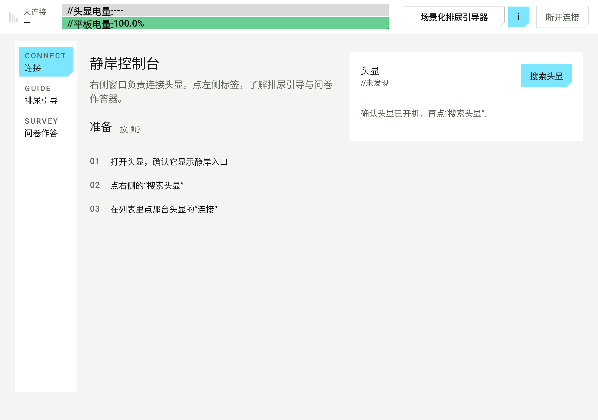
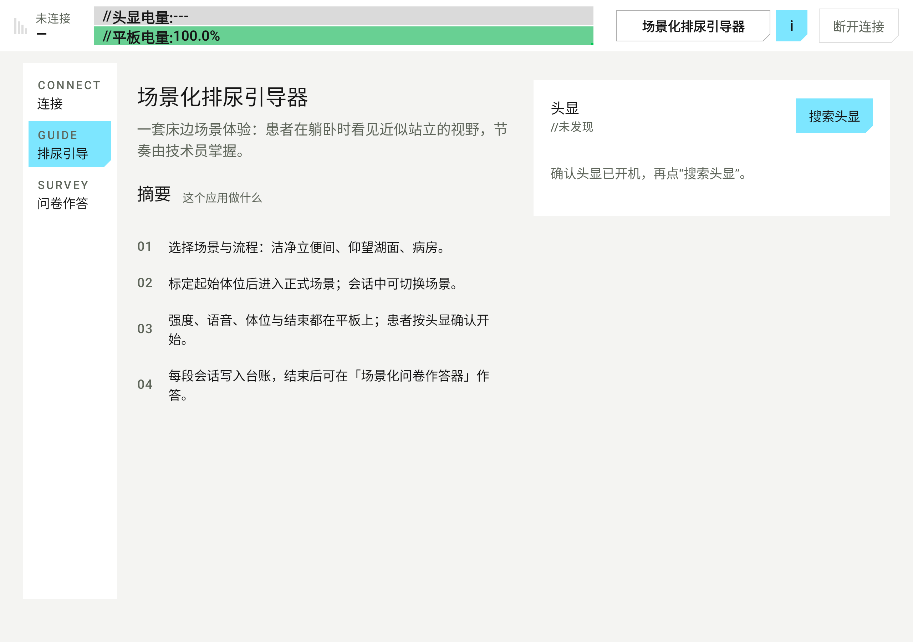
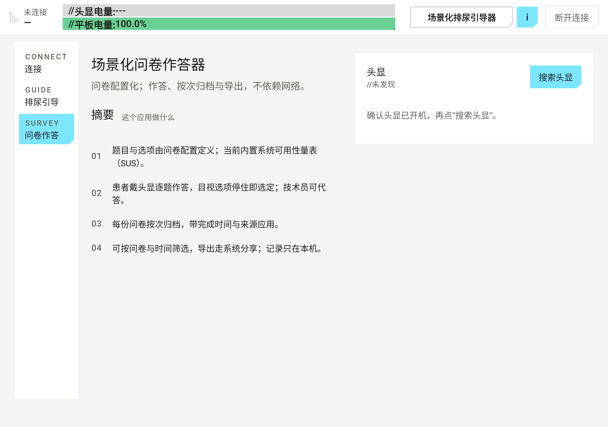
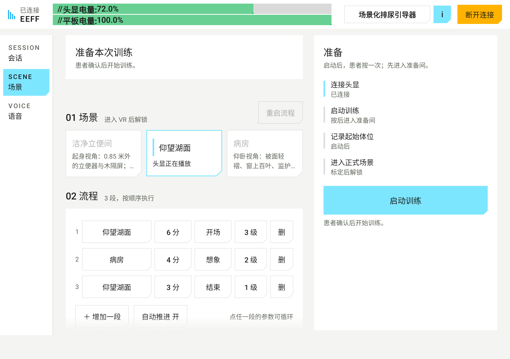
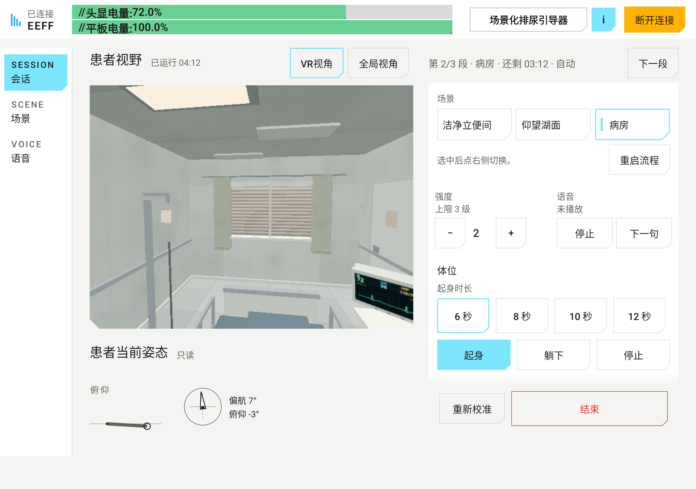
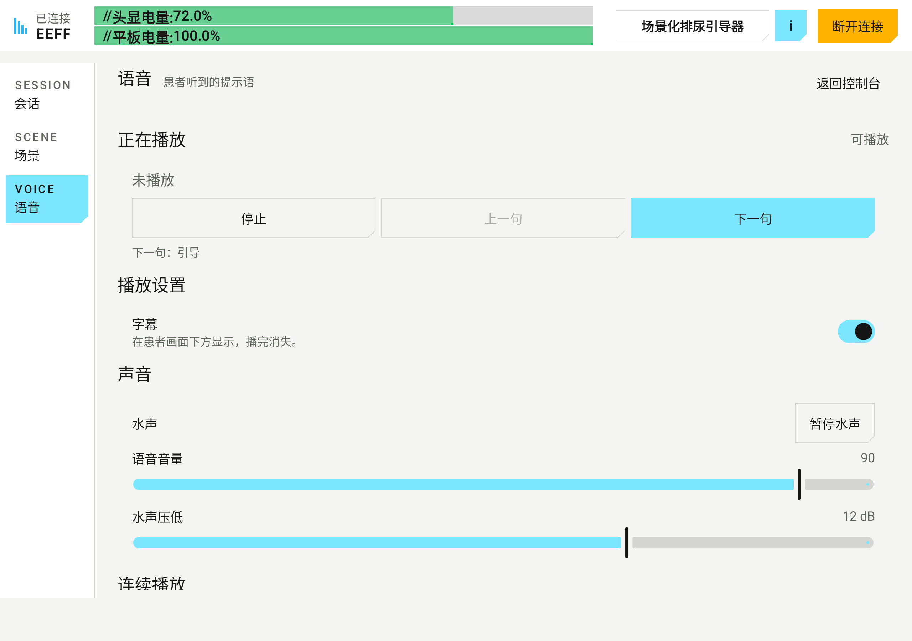
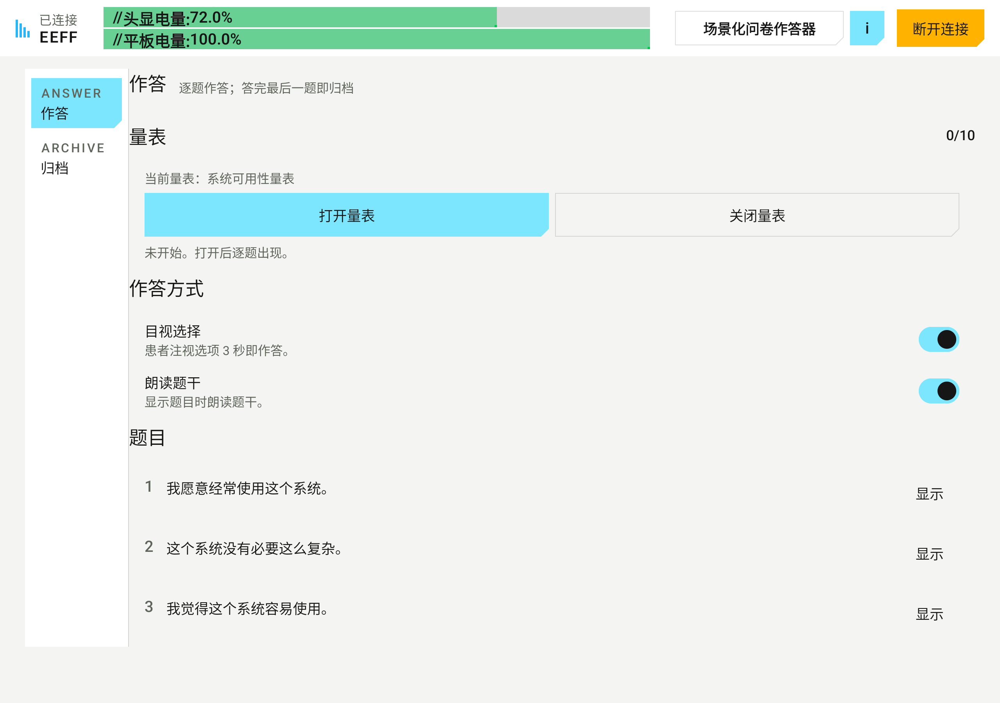
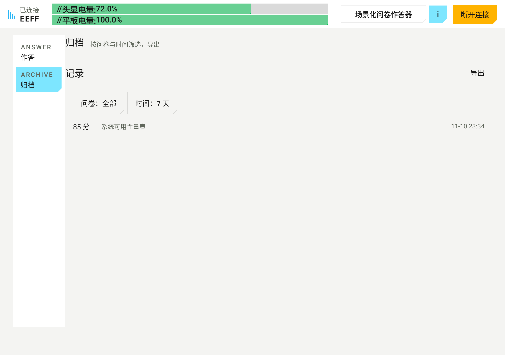
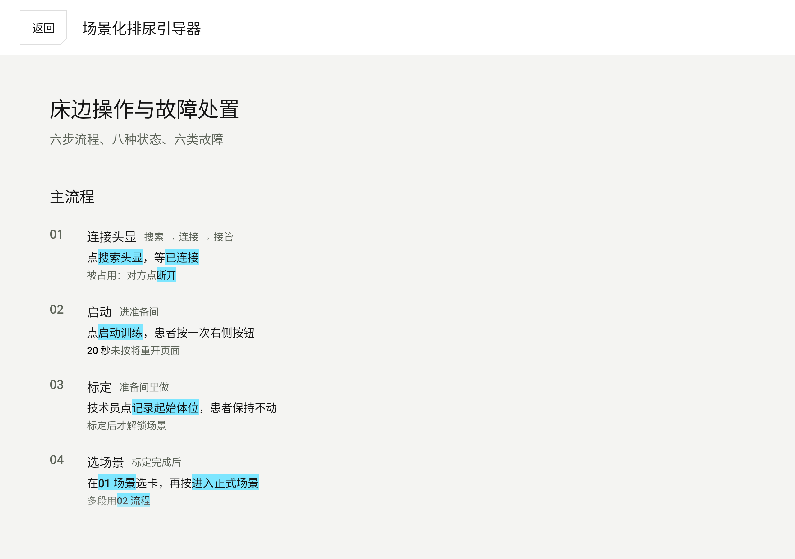
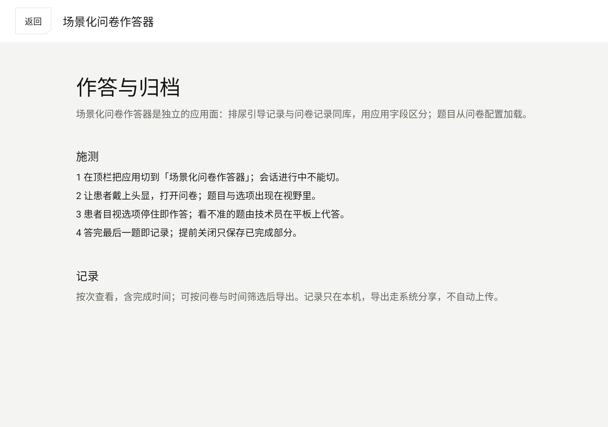

QUIET SHORE VR

<h1>静岸 · 操作说明书</h1>

场景化排尿引导器 场景化问卷作答器

v2.0 · 2026-11-12

读者：床边操作的技术员

PICO G2 4K 头显 ＋ 10 英寸 Android 平板

# 一页速查

| 要做的事 | 在哪里 |
| --- | --- |
| 连接头显 | 首页右侧「头显」窗口 → 搜索头显 → 连接 |
| 切换应用 | 顶栏当前应用名；会话中锁定 |
| 看当前应用的说明书 | 顶栏 `i` |
| 开始训练 | 场景化排尿引导器 → 场景页右侧「启动训练」 |
| 结束会话 | 会话页右下「结束」 |
| 断开连接 | 顶栏右侧「断开连接」；约 5 秒后头显回到静岸入口 |
| 作答与归档 | 顶栏切到「场景化问卷作答器」 |
| 导出记录 | 场景化问卷作答器 → 归档 → 导出 |

**患者只做一件事：戴上头显后，按一次右侧按钮确认开始。** 其余操作都在平板上。

# 1 这套系统怎么用

静岸是一套床边的场景体验。患者躺卧或半躺时，头显呈现近似站立时的视野；画面与声音节奏由床边的技术员掌握。

系统有两个并列的应用面，由顶栏的应用选择器切换：

| 应用 | 用途 |
| --- | --- |
| **场景化排尿引导器** | 选场景与分段流程、标定体位、运行会话、调节强度与语音 |
| **场景化问卷作答器** | 加载问卷、在头显内作答、按次归档、筛选与导出 |

顶栏从左到右是：连接与电量、**当前应用名**、`i`（当前应用说明书）、**断开连接**。应用名是一个带细边框的按钮，点开可在两个应用之间切换；会话进行中不能切换。

> 平板与头显只通过本地蓝牙连接，不依赖互联网。问卷记录保存在平板本机，导出使用系统分享。

# 2 第一屏：连接头显

{.shot}

首页左侧是三个纵向标签，样式与场景化排尿引导器的左侧栏一致：

- **CONNECT 连接**：连接步骤。
- **GUIDE 排尿引导**：场景化排尿引导器摘要。
- **SURVEY 问卷作答**：场景化问卷作答器摘要。

标签只用于了解两个应用，不会切换应用。右侧的头显窗口始终留在原位。真正切换应用在顶栏。

## 2.1 连接步骤

1. 打开头显，确认它显示静岸入口，并停在前台。
2. 平板右侧点「搜索头显」。
3. 在「头显」列表里找到设备，点该行的「连接」。
4. 顶栏出现 **已连接**，并显示头显与平板的电量。

如果设备被另一台平板占用，先在对方平板上点「断开连接」，再在这台平板上连接。

{.shot}

{.shot}

# 3 场景化排尿引导器

## 3.1 场景页：准备本次训练

{.shot}

进入应用后默认在 **SCENE 场景** 页。页面分四块：

1. **01 场景**：三张正式场景卡。
   - **洁净立便间**：站立视角，目标是站立排尿。
   - **仰望湖面**：平躺、抬头看天时最自然。
   - **病房**：仰卧视角，目标是安静地看着天花板与监护仪。
   - 准备间 `prep` 不显示为场景卡；它只用于标定。
2. **02 流程**：默认是一段「按当前场景、手动结束」。点「＋ 增加一段」可把单段变成多段计划；每段可循环修改场景、分钟数、语音提示与强度上限。
3. **体位与起伏**：起身时长与竖直起伏。
4. **右侧「准备」**：连接 → 启动训练 → 记录起始体位 → 进入正式场景。

## 3.2 启动与标定

| 步 | 动作 | 说明 |
| --- | --- | --- |
| 1 | 右侧点「启动训练」 | 头显页面被拉起 |
| 2 | 患者按一次头显右侧按钮 | 20 秒未按会重开页面 |
| 3 | 患者先进入准备间 | 调整躺姿与头显位置 |
| 4 | 技术员点「记录起始体位」 | 记录期间世界静止，患者保持不动 |
| 5 | 场景卡解锁，选卡后点「进入正式场景」 | 校准帧保留，只换世界内容 |
| 6 | 按需选起身时长，点「起身」 | 6 / 8 / 10 / 12 秒 |

## 3.3 会话中

{.shot}

- **顶部分段带**：`第 x/y 段 · 场景 · 还剩 mm:ss · 自动/手动`。右侧「下一段」立即推进。
- **患者视野**：`VR视角` 是患者当前看到的画面；`全局视角` 是操作员俯瞰。
- **患者当前姿态**：俯仰侧视图与偏航/俯仰读数，只读。
- **场景**：会话中可换场景；换场保留校准帧与视线偏移，强度上限按新场景夹紧。
- **强度**：0–3 级，上限由场景声明；步进器不会越过上限。
- **语音**：停止当前句，或播放下一句。
- **体位**：选起身时长，点「起身」「躺下」「停止」。
- **重新校准**：需要重做起始体位时使用。
- **结束**：红色细框键，结束本次会话。

> 当前版本换场景是硬切，声音会随场景切换。尽量在段与段之间换场，避免在语音中途切换。

## 3.4 语音页

{.shot}

- **正在播放**：显示当前句；可「停止」或「下一句」。
- **字幕**：在患者画面下方显示，播完消失。
- **连续播放**：开始 / 想象 / 放松 / 收束，一次运行整段脚本。
- **音色**：女声 / 男声；切换会短暂停顿。
- **声音**：水声开关、语音音量、水声压低级数。
- **语音提示**：按组展开单句清单，逐句播放。

语音播放时环境声自动压低 12 dB。问卷题干的朗读开关在场景化问卷作答器里，不在训练语音页。

## 3.5 结束与断开

1. 会话页右下点「结束」。
2. 画面淡出，头显结束会话；平板保留本次记录。
3. 帮患者摘头显，先让其躺一会儿再起身。

**断开连接**：顶栏右侧「断开连接」。头显会留出约 5 秒的重连窗口；期间重新连上会取消返回。5 秒内没有连回，头显回到静岸入口。

本版本没有「退出系统」或「离开系统」按钮。需要离开时用「断开连接」，不要直接强退头显应用。

# 4 场景化问卷作答器

会话结束后，在顶栏把应用切到「场景化问卷作答器」。会话进行中不能切换。

## 4.1 作答

{.shot}

进入后左侧是 **ANSWER 作答** 与 **ARCHIVE 归档** 两栏，和排尿引导的左侧栏同构。作答页：

1. 「当前量表」先写明本次加载的问卷；本版本内置 **系统可用性量表（SUS）**。
2. 点「打开量表」，题目出现在头显里。
3. 患者目视选项，停住约 3 秒即选定；技术员也可以在平板上按 1–5 代答。
4. 「朗读题干」在题目出现时同步播放该题语音。
5. 答完最后一题即记录；中途关闭只保存已完成的部分。

量表切换是下一版的骨架：题目与选项来自问卷配置，新增量表时增加配置与对应语音资源，作答页会显示新的当前量表；作答与归档的入口不变。

## 4.2 归档、筛选与导出

{.shot}

- 每份完成或部分完成的问卷按次归档，带完成时间与来源应用。
- 「问卷：全部」循环筛选量表；「时间：7 天」循环筛选时间窗。
- 「导出」走系统分享，生成 JSON；不自动上传。
- 记录只在本机。换平板或卸载应用前先导出。

# 5 说明书 `i`

顶栏的 `i` 只打开 **当前应用** 的说明书：

- 在场景化排尿引导器里，打开六步流程、状态与故障处置。
- 在场景化问卷作答器里，打开施测与归档说明。

{.shot}

{.shot}

首页左侧的三个标签只是摘要，不等同于说明书；真正的工作指引在顶栏 `i`。

# 6 记录与会话台账

| 记录 | 位置 | 内容 |
| --- | --- | --- |
| 会话摘要 | 本机 | 时长、场景、强度、语音使用情况 |
| 分段台账 | 本机 | 段序号、场景、实际秒数、峰值 |
| 问卷记录 | 本机 | 题目答案、完成时间、来源应用、是否完整 |
| 导出 | 场景化问卷作答器 → 归档 | JSON，经系统分享 |

记录用于复盘与交接，不用于诊断。需要带走记录时，先导出，再清理平板。

# 7 常见情况

| 现象 | 怎么做 |
| --- | --- |
| 搜不到头显 | 确认头显已开机、停在静岸入口；再点「搜索头显」 |
| 一直连不上 | 看是否被另一台平板占用；让对方先「断开连接」 |
| 页面没打开 | 点「启动训练」重新拉起页面，等 10 秒 |
| 头显里一直黑屏 | 让患者保持不动；仍黑则重新「启动训练」 |
| 患者说看不到场景 | 检查当前段与场景卡；必要时重新校准 |
| 患者不适 | 立即点「结束」，再帮患者摘头显 |
| 语音没声音 | 检查头显音量与耳机；点「下一句」重试 |
| 想切换应用但按钮不可用 | 会话进行中；先「结束」，再切 |
| 断开后头显没回来 | 等约 5 秒；仍未回则重新连接或重启头显应用 |
| 问卷没有新记录 | 确认答完最后一题；检查归档筛选条件 |
| 导出没有反应 | 系统分享没有可用目标；先在系统里登录/配置文件应用 |

# 8 安全与边界

- 患者不适、头晕、恶心：先「结束」，再摘头显。
- 患者在佩戴期间，技术员不离开床边。
- 本系统是体验性工具，不用于诊断或治疗。
- 场景切换当前是硬切；避免在语音中途切换，优先在段边界换场。
- 平板与头显只走本地蓝牙；问卷记录留在本机，导出由操作员发起。
- 头显电量低于 20% 先充电；平板电量低时先接电源再开始。

# 9 班前 / 班后检查

**班前**

- [ ] 头显与平板安装的是同一版本。
- [ ] 头显电量 ≥ 50%，平板电量足够一次会话。
- [ ] 头显停在静岸入口，蓝牙可见。
- [ ] 平板能搜到头显并连接。
- [ ] 试一句语音，确认耳机有声。
- [ ] 让患者按一次头显按钮，确认入口正常。
- [ ] 与患者说明：随时可以说停。

**班后**

- [ ] 会话已「结束」，患者已摘头显。
- [ ] 需要时完成问卷。
- [ ] 导出本次记录。
- [ ] 「断开连接」，头显放回充电位。

# 10 版本与验证

**v2.0 的主要变化**

- 顶栏应用选择器：显示完整应用名；会话中锁定。
- 两个应用面：场景化排尿引导器 / 场景化问卷作答器。
- 首页左侧三个说明标签；右侧连接窗口固定。
- 场景流程分段：段场景、时长、语音、强度上限；会话中常驻分段带与「下一段」。
- 场景化问卷作答器：作答 / 归档双栏骨架；配置化题目、按次归档、按问卷与时间筛选、导出。
- 多量表目录与切换、页面端按问卷重建卡片，列入下一轮（`todotree.md` H7/H8）。
- `i` 只打开当前应用说明书。
- 断开连接后约 5 秒回到静岸入口；移除「退出系统」。
- 电量读数统一为等宽、半粗的同一行字段。

**验证范围**

- 平板界面截图来自 2560 × 1800 模拟器；本册中的图按此比例。
- TypeScript 测试与 Kotlin 协议/控制端单测通过。
- 真机 BLE、头显 WebXR 与现场手感需在设备上按第 9 节复验；本机没有真实头显可连。
