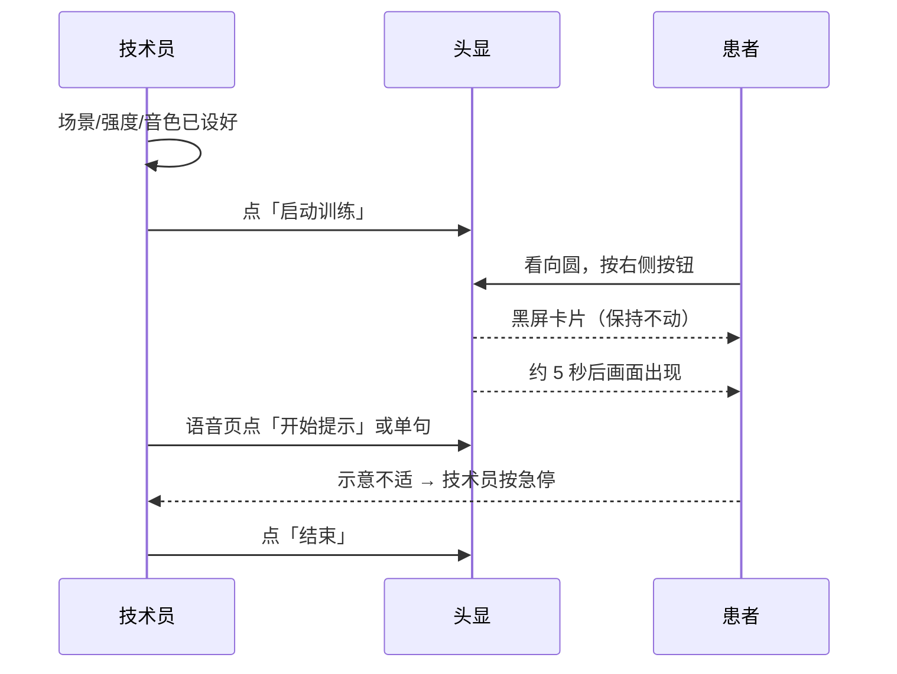

# 静岸 Quiet Shore VR · 操作手册

适用版本：头显与平板 0.9.22　读者：床边操作的技术员（无需技术背景）

## 1 这套系统做什么

患者躺着或半躺着戴上头显，看到一片缓慢移动的景物（湖面、光井或病房立便间），身体随画面轻轻起伏，配合水声与语音提示，帮助其放松。技术员用平板设置、引导，并随时停止。

## 2 谁做什么

| 角色 | 负责 |
| --- | --- |
| 技术员 | 连接设备、选场景、开停会话、播放语音、观察患者、记录量表 |
| 患者 | 戴好头显，看向画面中间的圆并按一次头显右侧按钮；想停就说话 |

**唯一需要患者操作的只有"进入"这一步。** 其余全部由技术员完成。

## 3 上机前（约 2 分钟）

1. 头显电量 ≥ 50%，已安装当前版本；平板已打开本应用。
2. 平板点「搜索头显」，等到顶栏显示 **已连接**。
3. 在「场景」页选场景：
   - 仰望湖面：平躺、抬头看天时最自然
   - 光井：喜欢抽象、安静的光线
   - 洁净立便间：目标是站立排尿
4. 在「控制」页设强度（建议从 1 起）与档位（标准即可）。
5. 在「语音」页选音色，试听一句，确认耳机有声音。

对患者说三句话：

> "待会儿会看到一片湖，身体会轻轻起伏，很慢。"
> "不舒服随时说停，我马上停。"
> "戴上以后，看向画面中间的圆，按一下头显右边的按钮就能进去。"

## 4 一次会话

| 步 | 动作 | 时间点 | 注意 |
| --- | --- | --- | --- |
| 1 | 「场景」页点"启动训练" | 0:00 | 患者此时还在戴头显 |
| 2 | 患者看向圆，按头显右侧按钮 | 0:10 | 只在第一次需要 |
| 3 | 保持不动 | 0:10–0:15 | 画面会先黑、卡片有进度条 |
| 4 | 画面出现 | 约 0:15 | 若仍是黑的，见 §7 |
| 5 | 语音页播放"开始提示" | 0:15 | 水声会自动变小 |
| 6 | 会话中按需调整强度与语音 | 全程 | 一次只改一项，观察反应 |
| 7 | 结束 | 10:00 前后 | 「场景」页点"结束" |

## 5 会话中看什么

- **患者表情与呼吸**：变快、皱眉、抓床单，先把强度降一档。
- **画面朝向**：患者说"看不到湖"，通常是头动过，回「场景」页点"朝向"重做一次校准。
- **声音**：语音应清楚压过水声；听不清就把「语音」页的音量调高、水声压低加大。
- **患者说停**：立刻在「控制」页底部按 **急停**，不要先去点"结束"。

## 6 结束与收尾

1. 「场景」页点"结束"，头显画面淡出，页面显示"训练已结束"。
2. 帮患者摘头显，先让其躺一会儿再起身。
3. 需要量表时进「SUS」页：打开 → 逐题点"播放" → 患者回答后点 1–5 记录，题目会自动翻页。
4. 退出：「退出场景」回控制台；「退出系统」会弹确认框，确认后头显回桌面。
5. 记录：时长、场景、强度、是否使用语音、患者主诉、异常。

## 7 常见情况怎么办

| 现象 | 怎么办 |
| --- | --- |
| 黑屏但有水声 | 眼镜里停在旧画面：摘头显，平板重进"启动训练"，仍不行则重启头显应用 |
| 一直黑屏没有卡片 | 页面没打开：平板点"启动训练"会把页面重新拉起，等 10 秒 |
| 进度条不动 | 让患者保持不动；超过 10 秒系统会用当前朝向直接进场景 |
| 顶栏显示"连接受限" | 头显睡着了或不在前台：唤醒头显、回到应用，必要时重新搜索连接 |
| 按钮提示"页面未连接" | 同上，页面掉线；系统会自动重开，再点一次即可 |
| 语音没声音 | 看头显入口页那行小字：会写明是"清单未加载"还是"播放被拒绝"；先确认耳机与音量 |
| 患者想停但不会按键 | 头显按键在沉浸模式不可靠，**停止统一由平板完成**；开前就要说明 |

## 8 安全底线

- 患者不适、头晕、恶心：先停，再摘头显。
- 患者在佩戴期间，技术员不离开床边。
- 急停按钮常驻在「控制」页底部，任何页面都能一眼找到。
- 不要在患者仍佩戴时"退出系统"（会把头显直接踢回桌面）。
- 本系统是体验性工具，不用于诊断或治疗。

## 9 记录表（每例一份）

| 项 | 内容 |
| --- | --- |
| 日期 / 患者编号 | |
| 场景 / 强度 / 档位 | |
| 会话时长 | |
| 语音使用（序列 / 单句） | |
| 患者主诉（0–10 漂感、头晕、恶心） | |
| 异常与处置 | |
| SUS 是否完成 | |

## 10 版本

0.9.22。校准无需按键；结束后页面不再引导进入；停止与退出都在平板上完成。
