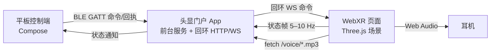
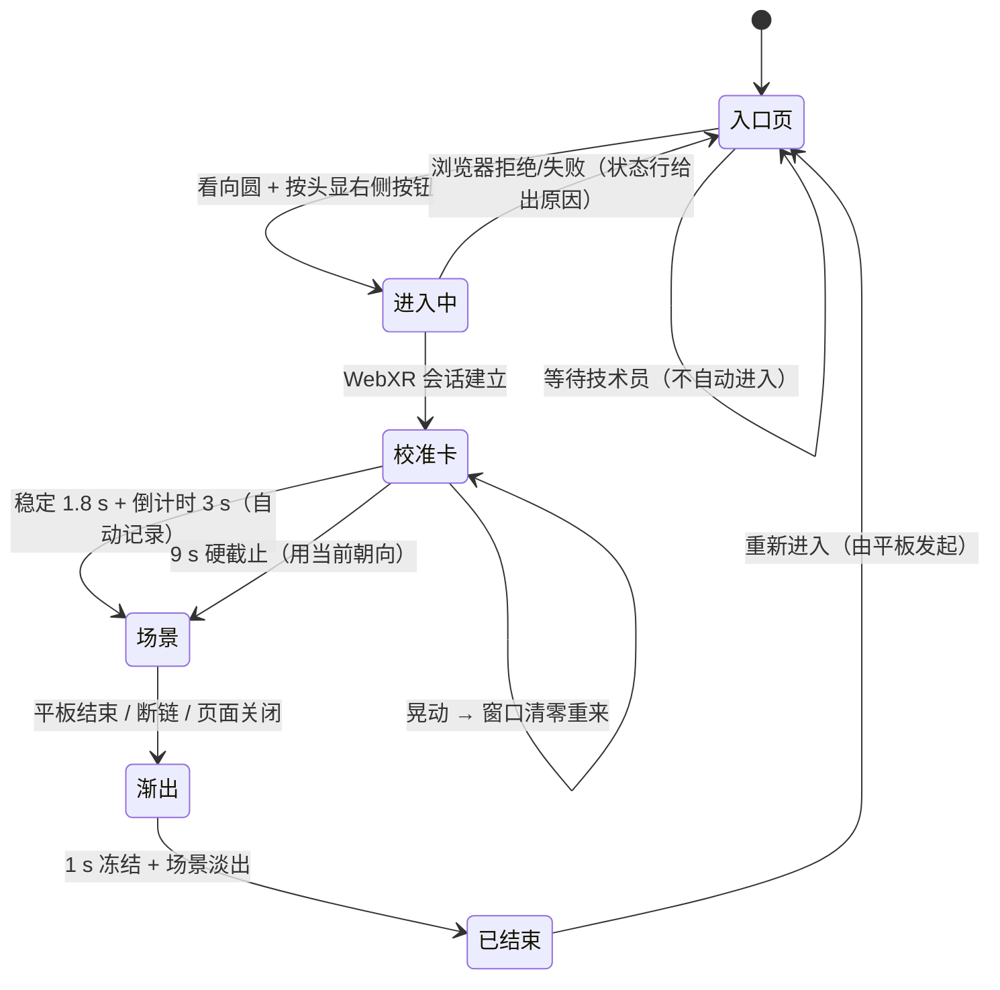
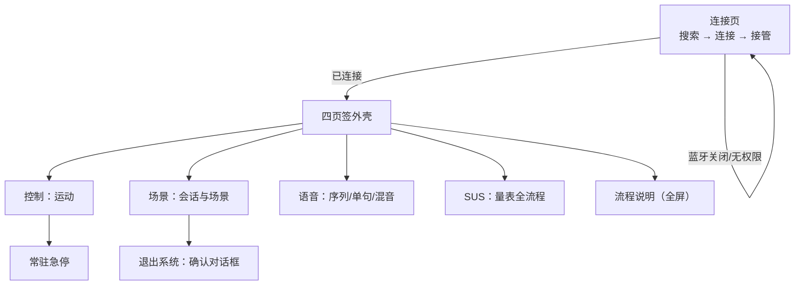

# 静岸 Quiet Shore VR · 信息系统说明书

| 项 | 值 |
| --- | --- |
| 适用版本 | 头显 0.9.22 / 平板 0.9.22（协议 state v11） |
| 文档性质 | 交付物：系统说明书 + 标准操作规程（SOP） |
| 读者 | 操作技术员、研究人员、维护人员 |
| 依据 | 本文所有行为均可在代码中定位到文件与常量，非描述性承诺 |

## 1 系统定位与边界

静岸是一套**引导式放松体验系统**：患者平卧或半卧佩戴 3DoF 头显，看到一片缓慢移动的景物，身体随世界轻轻起伏，配合水声与语音提示；技术员用平板设置、引导、随时停止。

- 交付内容：沉浸场景体验、语音引导、量表（SUS）采集、操作控制台。
- 不做：诊断、治疗、疗效声明、生命体征监测、图像或会话记录。
- 数据：状态帧只在本机回环（127.0.0.1）与 BLE 上传输，不落盘、不上传。

## 2 组成与数据流

| 组件 | 职责 | 关键文件 |
| --- | --- | --- |
| 平板控制端 | 意图、会话启停、运动参数、语音点播、SUS | `android/control/**` |
| 头显门户 App | 拉起页面、回环服务、BLE 桥、命令白名单、页面存活判定 | `android/headset/**/PortalService.kt` |
| WebXR 页面 | 场景渲染、校准、运动、语音播放、SUS 面板 | `src/app/App.ts`、`src/ui/**` |
| 协议库 | 命令语法、状态帧编解码、能力位 | `android/protocol/**/ControlProtocol.kt` |

## 3 VR 端 UX 可行树

| 屏幕 | 内容 | 出口 |
| --- | --- | --- |
| 入口页 | 场景名、目标圆、链路状态行、页脚提示 | 唯一入口是"看向圆 + 按钮"；空白处不响应 |
| 校准卡 | 标题、三行说明、进度条（稳定段 / 倒计时段） | 自动；无需按键 |
| 场景 | 场景内容；HUD 默认关闭 | 平板停止、断链、会话结束 |
| 已结束 | "训练已结束" + 目标圆变暗禁用 | 平板重新发起 |

失败分支均有可见反馈：入口页状态行显示"已连接控制端 / 控制端未连接"；校准失败用当前朝向并在卡面写"使用当前朝向"；页面异常由 `window.onerror` 写到状态行。

## 4 CTRL 端 UX 可行树

| 页签 | 只承载 | 不承载 |
| --- | --- | --- |
| 控制 | 模式、强度、呼吸层、档位、起身、俯仰修正、常驻急停 | 会话启停、退出、语音、SUS |
| 场景 | 会话状态与时钟、启动/结束、朝向、退出场景、退出系统、三张场景卡 | 运动参数 |
| 语音 | 停止、四条序列、27 句分组、水声开关、语音音量、水声压低 | 会话控制 |
| SUS | 打开/关闭、目视选择、量表说明 + 10 题、逐题播放、1–5 作答 | 混音 |

左侧镜像常驻（只读）；左下角为朝罗盘 + 侧视俯仰图；顶栏胶囊在 2.5 s 无状态帧时显示"连接受限"。

## 5 可观测性与状态语义

| 观察点 | 位置 | 含义 |
| --- | --- | --- |
| 顶栏胶囊 | 平板 | 已连接 / 连接受限 / 重连中 / 连接失败 |
| 状态条（平板） | 控制页上方 | 最近一次命令结果；页面离线时明确写"页面未连接" |
| 入口页状态行 | 头显页面 | 设备就绪、控制端连接、语音清单状态、异常原因 |
| `/status`（维护） | `127.0.0.1:8130/status` | `session`、`calibrating`、`pendingSeq`（页面未消费的命令数） |
| 页面存活判定 | 门户 App | 2 s 无状态帧视为离线；离线时页面类命令直接拒绝并触发一次重开（30 s 节流） |

## 6 标准操作规程（SOP）

### 6.1 准备（上机前）

1. 头显电量 ≥ 50%，应用为当前版本；平板已授予蓝牙与定位权限。
2. 平板连接页 → "搜索头显" → 胶囊显示**已连接**（"连接受限"说明头显不在前台）。
3. 在「场景」页选择场景；「控制」页设强度、档位；「语音」页选音色（男/女）。
4. 告知患者三件事：会看到什么、可以随时说停、戴好后需要按一次头显右侧按钮。

### 6.2 上机

5. "启动训练" → 患者戴好头显 → 看向圆 → 按右侧按钮进入。
6. 校准自动进行（保持不动约 1.8 s + 倒计时 3 s），不要在此期间调整头显。
7. 场景出现后确认：画面朝向正确、水声存在、幅度设置与预期一致。

### 6.3 会话

8. 语音在「语音」页手动点播（序列或单句）；播放时水声自动压低 12 dB。
9. 全程保持在患者身旁；患者示意不适时先按"急停"（控制页底部常驻），再摘头显。

### 6.4 收尾

10. 「场景」页点"结束"；页面转入"训练已结束"。
11. 需要时在「SUS」页逐题播放并记录答案（目视选择可开关）。
12. "退出场景"回到控制台；"退出系统"需在对话框确认。

### 6.5 记录

- 会话时长、场景、强度/档位、语音使用情况、SUS 答案、异常事件（时间 + 现象）。

## 7 故障处置

| 现象 | 判定 | 处置 |
| --- | --- | --- |
| 平板点按钮提示"页面未连接" | 头显页面不在或失联 | 系统会自动重开页面；仍失败则手动"启动训练" |
| 胶囊"连接受限" | 2.5 s 未见状态帧 | 检查头显是否在前台、是否休眠；必要时重连 |
| 头显黑屏但有水声 | 旧版本的校准遮罩残留 | 升级到 ≥0.9.20；仍出现则停止会话并重进 |
| 校准条不走 | <0.9.19 的阶段判定缺陷 | 升级到 ≥0.9.19（改为卡片可见性驱动） |
| 语音无声 | 页面未连 / 清单未加载 / 解码被拒 | 看入口页状态行：会写明"清单 404""音频 404""播放被拒绝" |
| 患者无法自己停止 | 本机型沉浸模式不透传头显按键 | 停止由平板承担；知情同意中写明 |
| 场景朝向不对 | 校准参考取错 | 平板"朝向"重做一次校准 |

## 8 验收清单（干跑 10 项）

- [ ] 配对成功，胶囊"已连接"
- [ ] 三个场景均可选、可切换（会话中禁用切换）
- [ ] 进入 XR 后 4.8 s 内自动出画面
- [ ] 摇晃头部时校准条清零重来，静止后走满
- [ ] 湖面/光井/立便间的朝向符合预期（患者看到的是景，不是墙）
- [ ] 单句语音可播放，水声自动压低并恢复
- [ ] "暂停水声/开始水声"即时生效
- [ ] SUS：显示第 n 题 → 头显定位 → 作答 → 翻页
- [ ] 结束 → 页面"训练已结束"；退出系统 → 出现确认对话框
- [ ] 任意时刻急停 ≤1 次点击可达（无需滚动）

## 9 版本与变更

| 版本 | 变更 |
| --- | --- |
| 0.9.19 | 校准改为卡片可见性驱动、未读姿态防护、9 s 硬截止 |
| 0.9.20 | 结束态页面、页面暗掉后回门户 App |
| 0.9.21 | 文案去重、急停固定底部、退出系统确认 |
| 0.9.22 | 退出系统改为确认对话框；本文档定稿 |
