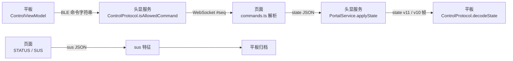

# 协议一致性：两侧实现对照

协议有四个参与者，两侧各两份实现：

任何一段的口径漂移都会表现为"命令被静默丢弃"或"状态读回不对"。本文是两侧的对照表，
以及本轮收紧的三条语法。

## 1 命令语法对照

| 命令 | 平板发送 | 头显允许（Kotlin） | 页面解释（TypeScript） | 口径 |
| --- | --- | --- | --- | --- |
| `view:orient:<yaw>,<pitch>` | `%d,%d`，≤10 Hz | 两段十进制，\|yaw\|≤180、\|pitch\|≤90 | 同 | 一 |
| `view:anim:<name>` | `up/down/recenter/breathe` | 名字白名单，无参数 | 同 | 一 |
| `view:stop` | 冻结 | 允许 | `stop()` 保持 | 一 |
| `mode:<float\|posture>` | 会话前 | `MODE_NAMES` | `float/posture` | 一 |
| `scene:<id>` | `SCENE_IDS` 之一 | `SCENE_LABELS` 键 | 注册表校验，未知报错 | 一（头显更早拒绝） |
| `float:level:<0-3>` | 0–3 | 0–3 | 0–3，再按档位/场景夹紧 | 一 |
| `float:profile:<a\|b\|c>` | 三选 | 白名单 | 同 | 一 |
| `anim:duration:<ms>` | 4000–20000 | 4000–20000 | 同 | 一 |
| `cue:intensity:<0..1>` | — | **本轮收紧**：十进制且 0–1 | **本轮收紧**：同一正则 | 一 |
| `sus:show:<1-10>` | 1–10 | **本轮收紧**：整数 1–10 | **本轮收紧**：整数 1–10 | 一 |
| `sus:answer:<1-5>` | 1–5 | 单个数字 | **本轮收紧**：单字符 `[1-5]` | 一 |
| `settings:eyeheight:<m>` | `%.2f` | **本轮收紧**：`1\.\d{1,3}` 且 1.2–1.9 | `^1\.\d{1,3}$` 且 1.2–1.9 | 一 |
| `audio:on\|off\|toggle` | 水声开关 | 允许 | 只切环境声 | 一 |
| `voice:*` | 逐条/序列 | `parseVoice` | 目录校验 | 一 |
| `sus:open\|close\|next\|prev` | 量表流程 | 允许 | 面板操作 | 一 |
| `posture:rise\|lower\|stop` | 起身 | 允许 | 仅起身模式生效 | 一（页面再判） |

本轮收紧的三条，意义相同：**两端必须接受同一份语法**，否则会出现"平板发出、头显放行、页面丢弃"
或反之。改动点：

1. `cue:intensity:` 头显原先只检查非空后缀 → 现在与页面同一正则、同一 0–1 区间。
2. `sus:show:` / `sus:answer:` 接受任意后缀 → 现在只接受 1–10 / 单个 1–5 数字（`"01"` 是畸形帧，不是 1）。
3. `settings:eyeheight:` 头显原先接受 `01.7`、`1.7000` → 现在与页面同为 `1\.\d{1,3}` 且 1.2–1.9。

镜像测试：`android/protocol/src/test/.../CommandGrammarTest.kt`（6 例）与 `tests/commands.test.ts`（10 例）
一一对应；一侧新增规则，另一侧补同一组用例。

## 2 state 帧对照

| 字段 | 页面（`stateFromSnapshot`） | 头显（`applyState`） | 单位/范围 |
| --- | --- | --- | --- |
| `scene` | 场景 id | 非 `SCENE_IDS` 回落默认 | 字符串 |
| `session` / `calibrating` | 布尔 | 布尔 | — |
| `audio` | **水声关**（`!sceneBedOn`） | → `audioMuted` → state bit2 | 布尔 |
| `floatLevel` / `floatProfile` | 已应用 | 夹紧 0–3 / a,b,c | — |
| `viewPitch` / `viewYaw` | 已应用角度 | 原样透传（不在头显侧夹紧） | 度，页面是唯一夹紧点 |
| `worldYaw/Pitch/Roll` | 外壳 × 基座 | 原样 | 度 |
| `floatMm` | 已应用 | ±127 | mm |
| `swayDeg` | 恒为 0（摆动通道已退役） | ±12.7 | 度 |
| `elapsedSec` | 会话秒 | 0–65535 | s |
| `voiceId` | 目录索引 | −1..63 | — |
| `viewAnim` / `viewPreset` | 枚举串 | 未知值按 idle/none | — |

头显把 `ControlState` 编成 **v11（28 B）**；MTU < 31 时回落 **v10（20 B）**。平板两份都解，
`StateFrameTest` 用金向量锁住字段偏移。bit2 的语义是"环境声关"，与语音无关（语音有独立总线）。

## 3 反向通道

| 消息 | 页面 → 头显 | 头显 → 平板 |
| --- | --- | --- |
| 状态 | `{"type":"state","data":{…}}` | state 特征（二进制帧） |
| 遥测 | `{"type":"telemetry",…}` | telemetry 特征 |
| 应答 | `{"type":"ack","seq":N}` | status 特征（`OK:<cmd>`） |
| SUS | `{"type":"sus","data":{answers,filled,complete,scene,sessionSec,completedAt}}` | `sus` 特征（UTF-8 JSON） |

`view:orient` 是唯一免 seq/ack 的连续通道：平板队列只保留最新样本，页面侧按 10 Hz 重定向且无 TTL。

## 4 已知的不对称（有意保留）

| 项 | 不对称 | 原因 |
| --- | --- | --- |
| 白名单 vs 语义校验 | 头显只做语法与枚举校验；会话态（是否校准中、是否起身模式）由页面判定并回一行状态 | 头显不持有页面状态机 |
| `scene` 未知值 | 头显直接拒绝；页面也会拒绝，但保留状态文案 | 双保险，不是冲突 |
| `viewPitch` 夹紧 | 只在页面（±90 协议、±30 平板滑杆） | 头显若再夹紧，坏值会被改写成"合法"的错值 |
| `sus` 答卷 | 页面不重发；平板按到达追加 | 重连补发可能重复记账，已登记在 `TODO.md` |
