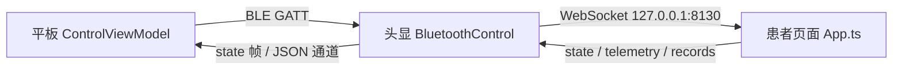

# QS2 协议

本文描述当前线上事实。命令与字节的真值在 `ControlProtocol.kt` 及其测试；本文不复制整份白名单。

## 1 身份与边界

- 协议代际：`QS2`。state schema：`1`。
- 握手：平板发送 `HELLO QS2 1`；头显返回 `WELCOME QS2 1 <capMask>`。
- 代际或 schema 不一致返回 `PROTOCOL_MISMATCH QS2 1`，平板停止驱动。
- 不存在 QS1 兼容模式，不解析旧帧，不保留旧未序号命令。
- 头显与平板同批发布、一起升级。部署边界是一台头显对一台平板。

## 2 拓扑

平板不直接访问回环 HTTP。头显服务是 BLE 与页面之间的唯一桥。

## 3 GATT

| 用途 | UUID 后缀 | 属性 |
| --- | --- | --- |
| service | `0001` | Primary |
| command | `0002` | Write |
| status | `0003` | Read, Notify |
| telemetry | `0004` | Read, Notify |
| state | `0005` | Read, Notify |
| JSON channel | `0006` | Read, Notify |

UUID 前缀统一为 `7a1e0001-6f3c-4f9a-9d2b-2f6a1c`。

## 4 控制权

- 控制权是头显内存中的单值，用 BLE 地址标识。
- `CLAIM` 先到先得，重复 `CLAIM` 幂等并刷新 20 秒租约。
- 其他设备发命令得到 `CONTROL_REQUIRED`；`CLAIM` 冲突得到 `CONTROL_BUSY`。
- `RELEASE`、租约超时、断链、GATT teardown 都清空控制者。
- 租约丢失只入队一条 `posture:stop`，视角不回正。
- WebSocket 断链时头显冻结运动与语音，会话保持 running 5 秒；5 秒内重连继续会话，超时以 link-lost 结束并退出 XR。
- 页面上的唯一患者操作是进入 WebXR 的一次点击，之后所有控制来自平板。
- 平板收到 `CONTROL_BUSY` 不自动重试；非主动断链重连三次，每次都直连上次地址。

## 5 命令

- 状态命令统一写作 `#<seq> <command>`，头显回 `ACK <seq> <OK|REJECTED|BUSY|OFFLINE>`。
- `PING` 与 `HELLO` 不走序号。每条命令一次只写一条，停止优先。
- 头显按控制者保存有界 seq 结果窗口，重复 seq 只重发原 ACK，不重复执行。
- 命令是否合法以 `ControlProtocol.isAllowedCommand` 为唯一真值；`CAPABILITIES` 是 `/capabilities` 的人类可读镜像，并由测试校验不漂移。
- 当前命令族：
  - 壳层：`enter`、`exit`、`stop`、`calibrate`、`adapt:skip`。
  - 场景：`scene:<id>`。会话中允许热切换，过渡由页面遮幕和斜坡处理。
  - 音频：环境声开关与音量。
  - 运动：`float:level:0-100`、`float:breath:*`、`anim:duration:*`、`posture:rise|lower|stop`、`posture:mix:0-100`。
  - 视角：`view:anim:up|down|recenter`、`view:stop`。
  - 语音：播放、停止、序列、音量、duck、音色、字幕。
  - 问卷：`sus:open|close|show|answer|voice`，只在问卷应用前台生效。
  - 应用与记录：`app:training|questionnaire`、`record:outcome:*`。
- `settings:eyeheight`、`mode:*`、`float:profile:*`、`view:orient`、`sus:next|prev`、`program:*` 均不属于 QS2。

## 6 state 帧

固定 28 字节，小端。首字节是 schema，不是历史版本号。

| 偏移 | 字段 |
| --- | --- |
| 0 | schema `1` |
| 1 | flags：session, calibrating, audioMuted, moving；bit4–7 保留 |
| 2 | scene index 4b，bit4–5 保留，viewAnim 2b |
| 3 | eyeHeight，厘米 |
| 4 | mix，0–250 映射 0–100% |
| 5 | floatMm，有符号毫米 |
| 6 | viewPitch，有符号度 |
| 7 | viewYaw，有符号 ×2 度 |
| 8 | voiceId，0xFF 为无 |
| 9 | calibrationConfidence，0–100 |
| 10–11 | elapsedSec，u16 |
| 12–13 | tMs，u16 |
| 14–15 | seq，u16 |
| 16–21 | worldQuat xyz，i16 ÷ 32767，w 由读者推出 |
| 22–27 | worldT xyz，i16 厘米 |

长度或 schema 不符整帧拒收。姿态角度不单独传输，由 `mix` 推导。

## 7 遥测

固定 24 字节，小端 float32 六项：`x, y, z, yaw, pitch, roll`。无人接管时直接丢弃，不缓存。

## 8 JSON 通道

一个文档分片为 `[id][index][total][payload]`：

- 每片 payload 为 `MTU - 3 - 3` 字节。默认 MTU 23 时每片 17 字节。
- 最多 255 片，默认上限 4335 字节。
- 缺片、乱序或超时整份丢弃。
- 超限文档在产生副作用前拒绝；页面过大帧以 `1009` 关闭。
- 只有当前控制者接收 JSON 文档。SUS 补发同样只发给控制者，并复用相同 envelope 与分帧。

文档结构为 `{"t":topic,"d":data,"id":optional}`。当前 topic：

`sus`、`catalog`、`questionnaire`、`session`、`log`、`notice`、`flags`、`battery`。

`session`、`sus`、`log` 是可靠记录：

1. 页面本地 outbox 持久保存。
2. 头显成功送入 JSON 通道后回 `{"type":"recordAck","id":...}`。
3. 页面收到 ACK 才删除。
4. 断链或刷新后重发；平板按会话结束时间、SUS 稳定键、事件 id 去重。

## 9 WebSocket

- 端点：`ws://127.0.0.1:8130/ws?since=<seq>`。仅 loopback，无认证。
- 服务端先发 `ready`，再在同一个 `wsLock` 内完成电池和 `seq > since` 的整段补发，最后把订阅者加入实时广播。
- 页面回 `ack` 后头显删除保留命令。`view:anim:*` 是一次性命令，实时投递，不跨重连重放。
- 每个订阅者队列有界；离散命令不先丢。
- 服务端每 15 秒 ping，30 秒无 pong 关闭。页面指数退避重连并带 `since=lastSeq`。
- 页面发送 `state`、`telemetry`、`ack`、`session`、`sus`、`log`、`notice`。
- 页面到服务端单帧传输上限 8 KiB；语义上限更窄，见尺寸契约。

## 10 页面与入口

- 页面资源由 APK 的 `assets/index.html` 提供。
- 页面启动参数来自 `window.__QS_BOOTSTRAP__`，URL 只补时间戳与 `retry`。
- `enter` 是唯一拉起 Firefox Reality 的宿主命令。
- 入口监督有两条时限：页面 25 秒未上线，或上线后 20 秒未进会话，就重拉一次；最多两次后 `GIVE_UP`。
- 自动点按有独立总预算，持续失败最终进入重拉，不会无限补试。

## 11 HTTP

| 路径 | 用途 |
| --- | --- |
| `/`、`/index.html` | 患者页面 |
| `/ws` | 控制通道 |
| `/status` | 服务、控制权、入口监督、state 摘要 |
| `/capabilities` | `protocol`、`stateSchema`、命令清单、控制权 |
| `/command` | 本地诊断命令注入，仍走白名单 |

所有响应 `Cache-Control: no-store`，页面与诊断接口仅绑定 `127.0.0.1`。

## 12 不变式

- 一个视图姿态只有一个标量 `mix`，旋转与眼高同源。
- 停止优先于所有排队运动；会话动作只由平板操作员发起。
- 能推导的不发。
- 记录至少一次送达，平板幂等消费。
- 新字段进 JSON 通道，不改 state schema。
- 不跨代际兼容。协议身份变化就换 generation。
