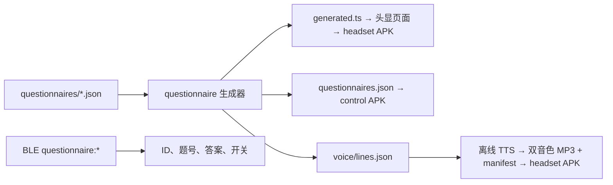

# APP2 问卷内容框架

APP2 是构建时内容固定的多问卷应用。题目、选项、文案和语音在开发机上准备，两个 APK 使用同一份生成目录。运行时不导入 JSON，不联网合成语音，也不通过蓝牙传题干全文。

## 数据流



控制端和头显必须同批构建安装。目录内容不进入 BLE，蓝牙只承担 `questionnaire:*` 命令、`questionnaire-state` 回读和 `questionnaire-result` 答卷。

## 新增问卷

复制 `questionnaires/gad7.json` 为 `<id>.json`。文件名必须与 `id` 相同。当前内置 SUS 和来自 CareHaven 公开发布版本的 GAD-7。GAD-7 在线上把标准 0–3 映射为 1–4，归档分数恢复为 0–21；题干把“过去两周”并入每题，保证逐题朗读不丢失时间范围。结果只作筛查提示，不构成诊断。

```json
{
  "id": "example",
  "order": 30,
  "name": { "zh": "示例问卷", "en": "Example" },
  "short": { "zh": "两题，示例", "en": "Two examples" },
  "completionVoiceId": "v-thanks-1",
  "options": [
    { "value": 1, "label": { "zh": "否", "en": "No" } },
    { "value": 2, "label": { "zh": "是", "en": "Yes" } }
  ],
  "questions": [
    {
      "id": "example-1",
      "text": { "zh": "第一道题。", "en": "第一道题。" },
      "voiceId": "v-example-1"
    },
    {
      "id": "example-2",
      "text": { "zh": "第二道题。", "en": "第二道题。" },
      "voiceId": "v-example-2"
    }
  ]
}
```

约束：

- 最多 16 份问卷，每份 1 到 100 题，每题 2 到 7 个选项。
- `order` 决定控制端顺序，数值最小的问卷是默认问卷。
- 选项值是 1 到 9 的整数，可以跳号。作答和归档保存实际值，不保存按钮位置。
- 题干 `text.zh` 最多 120 字，选项 `label.zh` 最多 12 字，超过时校验直接失败。这两个上限来自空间面板的排版：题干是前景面板的正文，选项是同一行里的按键标签。
- 题目 `voiceId` 必须以 `v-<问卷 id>-` 开头，防止跨问卷冲突。
- `completionVoiceId` 可以复用公共结束语。
- 评分规则放在 `src/app/scoring.ts`。SUS 声明 `scoring: { "type": "sus" }`（十题、选项 1–5），GAD-7 声明 `scoring: { "type": "gad7" }`（七题、选项 1–4）。未声明规则的问卷保留原始答案并写入 `score: null`。
- 全部语音线索最多 64 条，这是当前 QS2 六比特语音索引的上限。

## 生成与构建

```bash
# 只生成代码、目录和语音文本，不检查 MP3 是否已存在
npm run questionnaire:generate

# 生成内容，自动补齐缺失或文本变化的男女语音，再校验全部资产
npm run questionnaire:voice

# CI 检查源文件、生成物、语音文本、文件大小和 SHA-256
npm run questionnaire:check

# 一键内容生成与两个 APK 构建
npm run content:apk

# 语音已是最新时，直接构建两个 APK
npm run android
```

普通 `npm run build` 不访问 TTS。它会重新生成问卷内容并验证语音，缺失或过期时直接失败，避免把无声问卷打进 APK。

TTS 使用现有豆包配置。密钥只放 `.env.local`，新语音文本会发送给该服务，不得写入患者身份或答案。

## 运行闭环

1. 控制端选择 APP2 并启动，头显进入 `survey`，不进入 APP1 校准流程。`survey` 的背景是 v1 湖边（天穹、云、水面、近岸木桩），无环境声、无自身运动。
2. 控制端从 APK 内置目录选择问卷，发送 `questionnaire:select:<id>`。
3. 前景是一块传统空间面板：`SpatialSurface` 出标题与正文，`SpatialButton` 列出选项行，按数据创建题干、选项和分页，显示题目时播放对应 `voiceId`。
4. 患者注视选项 3 秒作答，技术员也可显示题目、代答或重读当前题。
5. 页面用 `questionnaire-state` 回传当前问卷、题号、答案和开关，控制端不依赖本地猜测。
6. 完整或部分答卷通过可靠 outbox 归档。答卷在页面端按声明的规则计分，未声明规则的问卷保留原始答案。

## 主要文件

| 路径 | 责任 |
| --- | --- |
| `questionnaires/*.json` | 唯一题目与选项来源 |
| `scripts/questionnaire/` | 校验、代码生成、目录生成、语音一致性检查 |
| `src/questionnaire/generated.ts` | 生成产物，不手改 |
| `src/ui/questionnaire-panel.ts` | 通用悬浮文本与注视选项 |
| `src/app/questionnaire-payload.ts` | 动态答卷和实时状态 |
| `src/app/scoring.ts` | 独立评分规则 |
| `android/control/.../QuestionnaireStore.kt` | 控制端内置目录读取与作答归档 |
| `android/control/.../QuestionnaireSheet.kt` | 通用控制端作答与归档面板 |
| `dist/questionnaires.json` | 注入控制 APK 的生成目录 |
