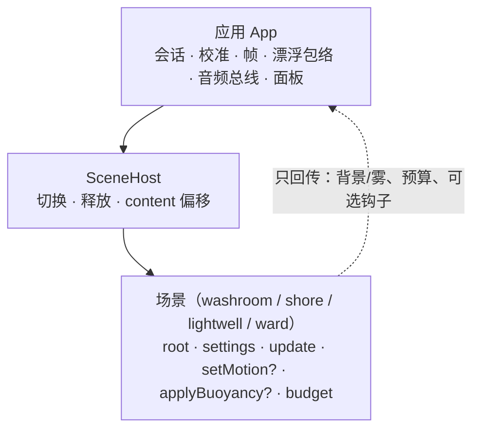

# 四个场景：边界、效果、用途与选择

本文是场景侧的唯一事实来源：每个场景在系统里**能碰什么**、画面与运动**是什么样**、
**什么时候该选它**。流程与文案见 `docs/guide.qmd`，帧与漂浮规则见 `docs/animation.md`，
场景接口见 `core/scene/contract.ts`。

## 1 场景在系统中的位置

场景是**内容单元**，不是应用状态机。它声明自己需要什么、构建自己的内容、每帧只做自己的动画；
世界帧、漂浮包络、音频总线、面板与量表全部属于应用。



| 场景**可以**做 | 场景**不可以**做 |
| --- | --- |
| 构建 `root` 下的几何、材质、纹理；声明 `settings.background/fog` | 读写相机、`renderer`、`scene` 本身 |
| 在 `update(dt, elapsed)` 里动自己的节点 | 读写会话状态、帧、`viewMotion`、`floating` |
| 用 `setMotion(0..1)` 接收"这个会话允许世界自走"的许可 | 自己起定时器或 audio context |
| 用 `applyBuoyancy({amountM, swayDeg, axis})` 决定搬哪一层 | 改 `content.position`（那是应用的） |
| 声明 `budget` 并在 `tests/scenes.test.ts` 里被断言 | 申请共享资源（没有跨场景注册表，释放按场景自足） |

`posture` 是场景对应用中最重要的一个声明：站立眼高（美术作者用的视点）＋身下支撑物（床 / 水面 / 是否垫枕）。
躺姿眼高由 `src/core/anatomy.ts` 按 1.70 m 男性推导；画面偏移随 `mix` 从 `-躺姿眼高` 过渡到 `-站姿眼高`（见 `docs/animation.md`）。

## 2 场景档案

### 2.1 洁净立便间 `washroom`（默认）

| 项 | 值 |
| --- | --- |
| 一句话 | 按站立尺度布置的卫生间单间，正前方是立便器 |
| 适合 | 与产品原始场景一致：需要"站到立便器前"的那类患者；也适合第一次使用、想先看一个明确房间的人 |
| 几何 | 2.4 × 2.4 × 2.55 m 单间；墙在 0.85 m 外，立便器口沿高 1.05 m、开口宽约 0.37 m，前开椭圆盆向前伸约 0.44 m；右侧浅橡木隔屏，头顶一条天光 |
| 画面 | 浅鼠尾草微水泥墙、低对比陶瓷背墙饰面、暖灰石材地面、白色挂壁陶瓷；无人物、无标牌、无外露冲水管 |
| 自身动画 | **无**。`update` 都不注册：房间里唯一的运动来自患者自己 |
| 漂浮 | 走应用的回退路径：整个 content 沿患者视觉竖直平移；地平线随世界一起动（室内没有远景地平线，可以接受） |
| 声音 | `stream`，vol 0.8，width 0.35（小房间的窄声场） |
| 眼睛 | 站立 1.70（地面在内容 y=0）；躺姿 0.66（床，解剖推导） |
| 成本 | ≤10 draw / ≤3000 三角形 / 0 透明 / 无雾（设备预算断言通过） |
| 风险 | 立便器已重做为宽口前开式陶瓷盆；PICO 实机上的辨识度与视线 framing 待确认 |

### 2.2 仰望湖面 `shore`

| 项 | 值 |
| --- | --- |
| 一句话 | 躺在水面上看天：水面在身下缓缓起伏，云在头顶漂 |
| 适合 | 房间太"像医院"、患者明显紧张时的替代；喜欢开阔视野、愿意看天的人 |
| 几何 | 90 m 半径天穹（一 draw）、300 m 水面（中心 z=−140）、3 根木桩 + 2 丛芦苇、34 m 高的云层（散布 175 m） |
| 画面 | 黎明渐变天空、低日与水面日道、雾 48–135 m，远景化进雾里 |
| 自身动画 | 云层缓慢漂移；湖面以 22 s 周期相对固定木桩 ±5 cm 涨落；其余静止 |
| 漂浮 | **自己分配**：天穹不动（地平线稳定），云按 0.4 倍、水面与近岸按 1.0 倍沿视觉竖直移动；独立涨落只动水面，不带动木桩 |
| 声音 | `lake`，vol 0.8，width 0.8（开阔声场） |
| 眼睛 | 站立 1.70；躺姿 0.08（水面，解剖推导） |
| 成本 | 6 draw / 626 三角形 / 3 透明（云、日道、芦苇）/ 有雾 |
| 风险 | 雾色与天穹渐变在 PICO 的 4K 屏上是否分层，未实机核对 |

### 2.3 光井 `lightwell`

| 项 | 值 |
| --- | --- |
| 一句话 | 一口 6 m 见方、240 m 高的方井，壁挂托架轮流上行，把身体"带上去" |
| 适合 | 对地平线类场景没反应、但需要更强自我运动感的人；愿意接受一段时间内视野里只有竖井的人 |
| 几何 | 6 m × 6 m、高 240 m 的方井，两端各在 120 m 外，看不到盖；**四角立柱 + 每壁竖向线槽**（静态，提供透视框），6 组壁挂托架（1.6 m 宽搁板 + 斜撑）轮流挂四面墙，环带 60 m |
| 画面 | 四面墙是**纯竖直光渐变**（无分段条纹、无斑块），由四块面片构成而非盒体（盒体的顶/底面会与天空盖片共面闪烁）；两端盖片取渐变端色；托架只在单侧出现，侧向视差强化"在结构里漂" |
| 自身动画 | 环带中心在**躺姿眼高**（0.66 m），不跟随站立眼：托架从眼前掠过才有下落感；托架沿体轴上移：速度按 `smootherstep` 用 2.2 s 加速到 `0.30 m/s` 终端速度（起步慢、中段加快、末端收敛，读作下落而非滑行）；停止是 `2.6 m/s²` 的刹车；约 33 s 掠过一组；另叠加 <0.1° 的身体摇摆 |
| 流动来源 | **场景自己的效果**，与起身/漂浮无关：`setMotion(1)` 就匀速下落，`setMotion(0)` 立即刹车。应用只按会话状态给这 0/1 许可（运行中或 2D 预览 → 1；停止、校准取帧、待机 → 0） |
| 声音 | **无**。场景设计为"听见自己的呼吸"，只有语音进入 |
| 眼睛 | 站立 1.70（环带中心）；躺姿 0.66（解剖推导） |
| 成本 | 8 draw / ~260 三角形 / 0 透明 / 无雾；光井内**不挂**运动提示粒子（絮状颗粒会盖住画面） |
| 风险 | 垂直光学流是四个场景里晕动风险最高的；档位 `c` 限 1 级，且本场景强度上限为 2 级（`comfortLevel`） |

### 2.4 病房 `ward`

| 项 | 值 |
| --- | --- |
| 一句话 | 仰卧在自己的病床上：被子、床尾板、窗外百叶的柔光，和床旁一台慢慢写心电的监护仪 |
| 适合 | 需要先认出"这就是病房"的人；躺在自己床上、不想被搬去别处的患者；第一次使用、想先看一个明确房间的人 |
| 几何 | 3.6 × 4.4 × 2.7 m 单间。床 0.98 × 2.06 m，床垫面 0.55 m；眼睛离地 0.85 m（床垫上方 0.30 m，头靠在枕头上），在床头内 0.50 m 处；床尾板顶 0.87 m、距眼 1.6 m；窗洞 1.9 × 1.04 m、窗台 1.04 m、距眼 3.3 m；监护仪屏 0.40 × 0.26 m，右前方 1.4 m，屏面用 `lookAt` 正对枕头；床头柜与输液架在左侧余光里（约 58° / 41°） |
| 画面 | 浅灰绿乳胶漆墙、灰塑胶地板、白色层压家具、白色床品与蓝灰被子、鼠尾草布帘；百叶不是十四块叶片，而是把明暗按行烘进窗面的顶点色（同一张面，画到 14 档） |
| 自身动画 | 心电条以 0.09 纹理单位/秒向左滚动（一个复合波约 5.5 s，慢到不像仪表、但仍能看出在写）；屏幕亮度 3% 的正弦呼吸；其余静止 |
| 漂浮 | 走应用的回退路径：整个 content 沿患者视觉竖直平移（室内没有远景地平线，可以接受） |
| 声音 | `rain`，vol 0.4：窗外的雨，室内只有这一个声源 |
| 眼睛 | 站立 1.70；躺姿 0.71（床垫 0.55 + 头 0.11 + 枕 0.05） |
| 成本 | 10 draw / 1670 三角形 / 1 透明（心电条）/ 5 张程序化贴图 / 无雾（4.4 m 的房间没有距离可藏，雾只会把近墙涂灰） |
| 风险 | 视线里第一次出现病床与监护仪本身——它靠"熟悉"起作用，也可能强化病房联想；0.85 m 构图的近场压迫感未实机核对；波形滚动速度是装饰性的，与屏上 72 的读数不同步 |

## 3 一屏对比

| | 洁净立便间 | 仰望湖面 | 光井 | 病房 |
| --- | --- | --- | --- | --- |
| 默认 | ✅ | | | |
| 场景自身运动 | 无 | 云漂移 + 湖面相对木桩涨落 | 环上行（跟随漂浮） | 心电波形滚动 |
| 漂浮如何落地 | 整体平移 | 分层（天穹不动） | 无位移，只有流动 | 整体平移 |
| 地平线 | 无远景 | 稳定（天穹固定） | 无 | 无远景 |
| 环境声 | 近场水声 | 开阔水声 | 无 | 窗外的雨 |
| `eyeY` | 1.70 | 0.45 | 1.70 | 0.85 |
| 成本 | 10 dc / 568 △ | 6 dc / 626 △ | 5 dc / 2.6 k △ | 10 dc / 1670 △ |
| 晕动风险 | 低 | 低 | 中（垂直流） | 低 |
| 与模式 | 漂浮默认；起身是它的原生表演 | 漂浮；起身是附加动作 | 漂浮（必须，流动靠它） | 漂浮默认；起身是附加动作 |

## 4 怎么选

**顺序固定**：场景 → 模式 → 水声 → 校准。四者在会话开始前定死，会话中不能改。

```text
患者第一次用，或需要"站到立便器前"的语境？
  └─ 是 → 洁净立便间（默认），漂浮
  └─ 否 ↓
需要先认出"这就是病房"（躺在自己的床上、窗外下雨）？
  └─ 是 → 病房，漂浮
  └─ 否 ↓
房间太像医院、患者明显紧张？
  └─ 是 → 仰望湖面，漂浮
  └─ 否 ↓
前两个场景里患者对"世界在动"没反应？
  └─ 是 → 光井，漂浮，档位 a/b，强度 ≤2
  └─ 否 → 回到默认
```

三条硬规则：

1. **光井不要和强度 3 + 沉浸档同时用**：垂直流叠满，是最容易晕的组合（应用已把沉浸档限到 1 级）。
2. **起身只对"想看站立高度"的目标有意义**：它是 6 s 的世界旋转，不改变场景本身；
   起身模式在湖面/光井里只是"从躺着到站着"的额外表演，不是必需。
3. **场景与模式都必须重启会话才能改**：中途切换会让画面整体跳 90°。

## 5 现状缺口

| 缺口 | 现状 | 建议 |
| --- | --- | --- |
| 场景文案曾有两份 | 平板 `SceneCatalog` 自己写了一份，洁净立便间被描述成"扶手与呼叫绳"（房间里没有） | **已修**：`SCENE_BLURBS` 移入 `ControlProtocol`，`SceneCatalog` 只做排序与查找；`SceneTableTest` 校验 id 集合一致 |
| `SceneSummary.description` 无人使用 | 入口卡片只显示 `name`，平板只显示 `name + blurb` | 二选一：在平板卡片上做"展开看更多"，或从类型里删掉 |
| 无场景的每帧成本断言 | 只有静态预算（draw/三角形/纹理/透明） | 给光井的 `writeRings()` 加一个上限断言（环数 × 2 个 InstancedMesh，每帧一次矩阵写） |
| 自运动线索曾经依赖声音 | `setBuoyancySwell` 只作用在环境声总线上，环境声默认关＝听觉线索为零 | **已按"只修运动、不加声音"处理**：0.9.33 移除 swell，环境声保持恒定；光井的线索来自壁面纹理上行与 6 组灯架（由漂浮包络驱动），湖面来自近场位移 |
| 三个场景的晕动风险只写在文档里 | — | **已修**：`SceneDefinition.comfortLevel`（光井 = 2，其余默认 3），`float:level` 与场景切换都按它夹紧，平板收到「本场景最高 N 级」 |

## 6 变更记录

- 2026-10-24：`posture` 字段删除，场景只声明 `eyeY`（见 `docs/animation.md` §5）。
- 2026-10-24：平板场景文案并入协议模块，修正洁净立便间的不实描述；新增场景能力与边界测试。
- 2026-10-24：新增 `comfortLevel`，光井在应用侧被限到 2 级，切场景时即时回落。
- 2026-10-24：新增病房 `ward`：从旧 ES5 训练病区移植并重写为仰卧构图（`eyeY = 0.85`），保留监护仪心电滚动与百叶/布帘柔光，去掉注视目标（`selectables` 恒空）与雾；`SCENE_IDS` 追加 `"ward"`（索引 3），平板出现第四张场景卡。
