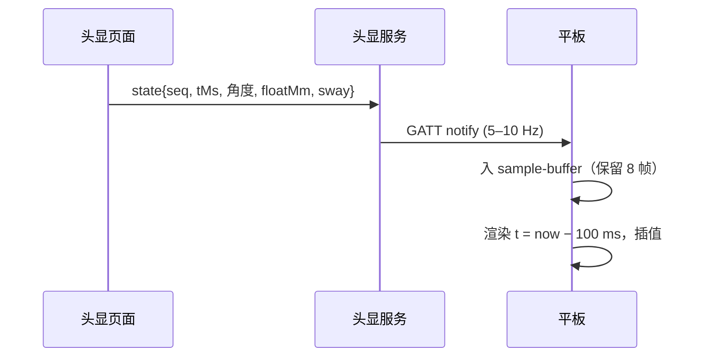

# state v11：协议分析与视角动画

状态：设计稿。v10 仍在跑（`ControlProtocol.stateVersion = 10`），本文只做分析与提案，不改代码。

## 1 v10 审查

### 1.1 布局与由来

20 字节是 **ATT 默认 MTU 23 − 3** 的结果，不是设计出来的预算。字段（`ControlProtocol.encodeState`）：

| 字节 | 字段 | 实际信息量 |
| --- | --- | --- |
| 0 | version | 8 bit 里只用 1 个值 |
| 1 | 漂浮强度 0–3 | **2 bit 用了 8 bit** |
| 2 | flags（session/calibrating/muted/cue/sitUp/posture/profile 2 bit） | 刚好满 |
| 3 | 眼高 cm | 7 bit |
| 4–5 | posturePitch/Roll（整度） | 各 8 bit |
| 6–7 | postureRise cm / progress % | 7 bit 各 |
| 8 | viewPitch | 8 bit |
| 9 | viewAnim | 3 个值占 8 bit |
| 10 | cueIntensity | 7 bit |
| 11 | scene index | 单一场景 = 死字段 |
| 12 | viewPreset | 5 个值占 8 bit |
| 13–16 | viewYaw / worldYaw / worldPitch（int16） | 够用 |
| 17 | worldRoll int8 | 够用 |

结论：**约 4 字节是纯浪费**（level、viewAnim、preset、scene index），而真正缺的字段一个都塞不进去。

### 1.2 缺什么（每条都能在代码里指出来）

| 缺口 | 后果 | 证据 |
| --- | --- | --- |
| 无时间戳 | 平板只能"贴最新值"，1–5 Hz 采样贴到 60 fps 就是台阶 | `docs/ux-plan.md` §3.1 |
| 无序号 | 丢帧/重发不可见，延迟无法测量 | 只有命令有 `ACK <seq>` |
| 无**已应用**浮沉量与地平线摆 | 镜像永远看不见起伏（只能看到朝向） | `SceneMirror.kt` 注释 |
| 无语音状态 | 平板不知道患者此刻听到哪一句、自动模式是否在跑 | 新增通道，无处上报 |
| 无会话时钟 | 平板用本地 `elapsedRealtime` 推断，断链后不可对齐 | `ControlViewModel.onControlState` |
| 无 hold（保持） | 冻结与停止在状态上无法区分 | 会话只有 session 位 |
| 强度只有 2 bit | 无级强度（0–100%）无处表达 | 本轮已改成无级，协议没跟上 |
| 速率绑在"是否在动" | 漂浮运行时只有 1 Hz | `App.isMotionActive` 只看 sit-up / viewAnim |

### 1.3 20 字节不是物理上限

ATT 默认 MTU 23 只是**初始值**：Android 5+ / PICO G2（Android 8.1）都支持 `requestMtu`，常见可到 517 字节。继续为 20 字节做设计，等于把自己锁在 2014 年的默认值上。

## 2 方案比较

| 方案 | 优点 | 代价 | 结论 |
| --- | --- | --- | --- |
| 固定 20 B + 位压缩 | 与现有平板完全兼容 | 缺的字段塞不下；可读性差 | 不选 |
| **固定 28 B + MTU 协商** | 可读、可测、够用；对齐简单 | 需要一次 `requestMtu`；旧平板需降级 | **采用** |
| TLV / protobuf | 可扩展 | 每帧解析成本、无固定对齐、抓包难读 | 不选（配置通道可用） |
| 增量/差分编码 | 省带宽 | 丢包恢复复杂，状态机易错 | 不选 |
| **双通道：state（快）/ config（慢）** | 各按各的节奏，config 不必挤进 20 B | 多一条 GATT 特性 | **采用** |
| **时间戳 + 序号** | 可插值、可测 RTT、可判乱序 | 4 字节 | **采用** |

原则：**快通道只放"每帧都变、且要插值"的量；配置类（阈值、语音集、场景）走慢通道，变化时发一次。**

## 3 v11 提案

### 3.1 state 帧（28 字节，固定长度，小端）

| 字节 | 字段 | 类型/范围 | 说明 |
| --- | --- | --- | --- |
| 0 | version | `11` | 不匹配直接丢弃并提示，不猜测 |
| 1 | flags | bit0 session · bit1 calibrating · bit2 muted · bit3 cue · bit4 sitUp · bit5 posture · **bit6 hold** · **bit7 autoVoice** | 保持与自动模式从此可见 |
| 2 | level | 0–100 % | 无级强度（取代 0–3） |
| 3 | eyeHeight | cm，120–190 | |
| 4 | **floatMm** | int8，±127 mm | **已应用**的竖直偏移，镜像直接加 |
| 5 | **swayDeg10** | int8，0.1°（±12.7°） | **已应用**的地平线摆 |
| 6 | **voiceId** | 0–31，255=none | 正在播的句子索引（顺序取 `voice/lines.json`） |
| 7–8 | posturePitch / postureRoll | int8 度 | 测得的世界倾角 |
| 9 | postureRise | cm | |
| 10 | postureProgress | % | |
| 11 | viewPitch | int8 度 | 已应用的视图仰角 |
| 12 | 打包 | viewAnim 2b · viewPreset 3b · envelope 2b（idle/attack/hold/release）· 保留 1b | 4 个枚举共 7 bit |
| 13–14 | viewYaw | int16 度 | |
| 15–16 | worldYaw | int16 度 | |
| 17–18 | worldPitch | int16 度 | |
| 19 | worldRoll | int8 度 | |
| 20–21 | **tMs** | uint16，发送端单调毫秒 mod 65536 | 插值与延迟测量 |
| 22–23 | **seq** | uint16 | 丢帧/乱序可见 |
| 24 | cueIntensity | % | |
| 25 | calibrationConfidence | % | |
| 26–27 | **elapsedSec** | uint16 | 会话时钟由头显给，平板不再猜 |

带宽：5 Hz × 28 B = 140 B/s，10 Hz = 280 B/s。连接间隔 15 ms 时单间隔可发 3 包，远未饱和。

### 3.2 config 通道（慢，变化时发一次）

TLV：`type:u8 len:u8 value`，总长 ≤64 B。承载 `eyeHeight`、`voiceSet`、`duckDb`、`voiceVolume`、`sessionLimitSec`、`sceneId`（若场景重新出现）。好处是以后加字段不必再升 state 版本。

### 3.3 速率与触发

| 场景 | 速率 |
| --- | --- |
| 无人接管 | 不发 |
| 待机 | 1 Hz |
| 会话运行 | 5 Hz |
| 视图动画 / 起身 / 保持切换中 | 10 Hz |
| 任一离散字段变化 | 立即补一帧 |

取消"是否在动"这个隐式条件：漂浮本身就是要被看见的运动，5 Hz 是底线。

### 3.4 兼容与降级

- `HELLO` 增加 `stateVersion`（现在是 `WELCOME <v> <capMask>`，把 state 版本编码进 capMask 的保留位）。
- MTU 协商失败（< 31）时发 **v10 的 20 B 帧**：镜像仍能看朝向，但看不出浮沉——这是明确降级，不是静默错误。
- 平板收到未知版本：显示"头显固件过新/过旧"，不显示半套数据。
- 同版本双端一起升级（`README` 本来就要求两个 APK 同版本）。

## 4 时间戳 ≈ 插值契约

- `tMs` 用 `performance.now() | 0` 取模；跨 65.5 s 回绕时以 `delta < 32768` 判定。
- 平板渲染延迟固定 100 ms：足够盖住 10 Hz 抖动，又不会让人觉得画面"落后"。
- `seq` 倒退 → 丢帧；跳号 → 记录丢包率（写入状态面板，不打扰患者）。
- 插值实现已就绪：`src/core/xr/sample-buffer.ts`（yaw 最短弧、线性其余、过期判定）。

## 5 视角动画：帧率与体验

### 5.1 现状（代码事实）

| 项 | 现状 | 评价 |
| --- | --- | --- |
| 预设曲线 | `smootherstep`，3 s，±10°（`VIEW_PRESETS`） | 峰值 6.25 °/s（smootherstep 最大导数 1.875 × 10°/3 s），首末速为零，**合格** |
| 拖动跟随 | 指数逼近 τ=0.25 s + 15/30 °/s 上限（`VIEW_TRACK_TAU_S`） | 速度在起点突跳，**不合格** |
| 渲染 | 每帧，`dt` 取自 `performance.now` | 与 XR 帧时间不同源，抖动 |
| 速率上限 | 俯仰 15 °/s、偏航 30 °/s | 合理；偏航更快会导致合成路径弯曲，可接受 |
| FOV | 固定 | 快速转视角时周边光流全开 |
| 端到端延迟 | 未测 | 无法判断"操作→看见"是否 ≤200 ms |

### 5.2 六项改进

1. **把指数跟随换成临界阻尼二阶**（带速度状态）：`a = k(target − x) − c·v`，C1 连续，起点不再有速度突跳；稳态仍受 15/30 °/s 上限约束。
2. **加速度限制**：|a| ≤ 60 °/s²，让 0→15 °/s 用约 0.25 s 渐入。人手拖动时这一项最明显。
3. **dt 改用 XRFrame 时间**：`setAnimationLoop((time, frame) => …)` 的 `frame.time`，避免 rAF/`performance.now` 与合成器错拍；保留 0.25 s 夹紧。
4. **远端目标插值**：平板滑块的 `view:orient` 和 state 都带时间戳，页面按 100 ms 缓冲跟随，而不是"收到就追"。
5. **快速转视角时的 FOV 收窄（可选，A/B）**：|ω| > 12 °/s 时水平 FOV 在 0.3 s 内收 8°，静止后 0.5 s 恢复。依据 `research-standing-sensation.md` §2.3；注意它同时会削弱漂浮感，所以只在视角动画期间启用。
6. **不做过预测**：慢速治疗动作里，100 ms 滞后无害，过冲会破坏"稳定地平线"的前提。

### 5.3 怎么量

| 指标 | 方法 | 目标 |
| --- | --- | --- |
| 帧时间 p95 | 现有 `RenderMonitor` | ≤18 ms（现成预算） |
| 单帧角增量 | 每帧记录 `|Δθ|`，与 `cap×dt` 比较 | 不超上限、不反号 |
| 拖动跟随滞后 | 平板记录发送时刻，头显回读时间戳 | ≤150 ms，无过冲 |
| 端到端延迟 | `PING/PONG` × 2 + 一帧 | ≤200 ms |
| 主观 | 3 名员工盲测"起步是否有拽一下" | ≥2/3 认为平滑 |

## 6 迁移顺序

1. 定稿本文（D8）：28 B 布局、双通道、降级规则。
2. 协议层：`stateVersion = 11`、`encodeState/decodeState` 双实现（v10 供降级）、`requestMtu(64)`。
3. 页面：快照里补 `floatMm`、`swayDeg`、`voiceId`、`elapsedSec`、`seq/tMs`；`PortalLink` 取 `frame.time`。
4. 平板：`ControlState` 增字段；`SceneMirror` 直接把 `floatMm` 接上；`sample-buffer` 接入镜像与角度仪表。
5. 视图控制器：二阶阻尼 + 加速度限幅（先在 2D 预览里调参数）。
6. 实机验收：§5.3 四项 + 一次 3 s 预设全程帧时间日志。

## 7 风险

- **MTU 不一致**：Android 端 `requestMtu` 在部分 ROM 上返回成功但实际不变；发 28 B 前读一次 `mtu`，不够就走 v10 帧。
- **双实现漂移**：v10/v11 两套编码必须共用同一组测试向量（同一 `ControlState` → 两种字节串）。
- **序号回绕**：uint16 在 10 Hz 下 1.8 小时回绕，会话远短于此，按差值判定即可。
- **FOV 收窄**与"失重感"相冲突：默认关，只在志愿者 A/B 中开启。
