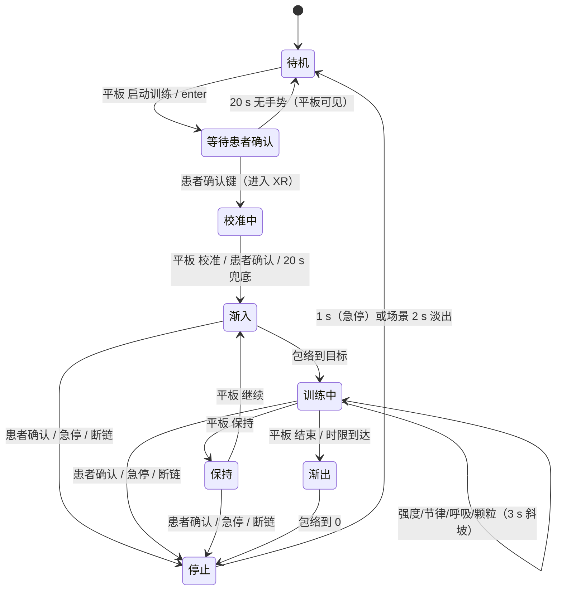

# UX/UI 评估与改进计划

**基线**：v0.9.0 工作树（2026-10-24）　**范围**：患者端（头显页面）、技术员端（平板）、头显控制台、落地页、漂浮与起身的运动设计　**不含**：医学结论、场景美术制作

本文件只记录现状与计划。实现前先在 `core.md` 更新目标与非目标（仓库规则 1）；完成后本文删除，结论并入 `core.md`。

> **状态：草案，可与场景重设计并行。** 场景正在重做（单一 `shore`：`dome.ts` / `clouds.ts` / `water.ts` / `shoreline.ts`；`motes.ts` 已删、改动尚未提交）。§3 的数值是 2026-10-24 工作树的快照，场景落定后按 §3 末的重算清单重跑一次再引用；§4–§8.2 的交互与协议结论不依赖这些常量。

## 0 结论

1. **“浮”看不见，不是不够强，是动在了看不见的深度。** 世界整体位移 65 mm，在天穹（90 m）只值 0.08°、云层（34 m）0.22°；仰卧主视方向恰好是最看不见运动的那一层——抬头就是一张静止的画，唯一明显的地平线摆又读作“世界在倾斜”。（§3）
2. **动画本身也过度拼接**：一条 12 s 主波只拿到 72% 的幅度预算，另外 28% 分给 7.5 s 呼吸与 2.7 s 微颤；叠加后失去可辨认的周期。复杂度花在了看不见的地方（§3）。
3. **控制侧只有“强度 0–3”这一个旋钮**，没有渐入、没有节律、没有保持、没有时限、没有回读；档位 a/b/c 同时改幅度与周期，把两个独立维度绑死（§4）。病人端与平板都看不到“现在到底在动多少”。
4. **校准由患者端静默 4 s 完成**，平板既不能主导也看不到状态，而线协议已带 `calibrating` 与 `confidence`，只是没人读。改为技术员主导（§7）。
5. 平板仍有 8 个控制分区（`core.md` §6.2 只允许 6 项），常驻急停写在滚动区末端；患者端整屏点击即进入 XR（§5）。
6. **展示侧只完成了一半**：镜像能看朝向，但看不见起伏（漂浮不进 payload）、看不见真实场景（取注册表默认）、视野写死 72°，且跨端采样 5 Hz / 1 Hz 直贴 60 fps，没有补帧。想用它录屏讲系统、给患者预习，画面既不像患者所见，也带着控制面板（§3.1、§8.2）。

## 1 证据与方法

- 已删除 `artifacts/pico-20261020-*.png`（41 张实机截屏）。此后结论一律以代码、算术与协议为准；未在设备上复核的标 **[推断]**。
- 只读，未改代码。涉及删除的条目一律标注“待 D1/D2 书面确认”。

## 2 现状清单

| 表面 | 进入方式 | 状态来源 | 关键文件 |
| --- | --- | --- | --- |
| 患者端入口 | `enter` 拉起页面 / 控制台自动打开 | `detectXR` + 点击 | `src/ui/start-screen.ts`、`src/index.html` |
| 患者端校准卡 | 进入 XR 后自动 | 4 s 计时 + 确认键 | `src/ui/calibration-card.ts`、`src/app/App.ts:79` |
| 患者端训练态 | 校准完成 | session reducer | `src/app/session.ts`、`src/ui/spatial-hud.ts` |
| 漂浮 | 会话中持续 | `float.ts` + `App.updateFloat` | `src/core/xr/float.ts`、`App.ts:729-790` |
| 头显控制台 | 头显桌面图标 | 4 页：主页/设置/帮助/SUS | `PortalActivity.kt` |
| 平板配对 | 冷启动 | BLE 阶段机 | `PairingScreen.kt` |
| 平板控制 | 接管后 | `ControlUiState` | `ControlScreen.kt`、`components/ControlPanel.kt` |
| 落地页 | `qs.205716.xyz` | 静态 | `site/index.html` |

## 3 感知预算：为什么“浮”不明显

漂浮的实际实现是 `host.content.position.y` 整体平移（`scene/host.ts:118-121`），并叠加 `content.rotation.x` 的地平线摆（`App.ts:771-781`）。头显是 3DoF，头部平移在视觉上等价于世界平移，所以“看得见多少”只取决于那一层内容离眼多远。

场景已在 2026-10-24 重写为单一 `shore`（`dome.ts` R=90、`clouds.ts` y=34/72、`water.ts` 300 m 深）；下表按新常量与默认强度（A = 65 mm、T = 12 s，峰值 34 mm/s）计算。

| 层 | 距离 | 峰值角速度 | 峰峰角位移 | 仰卧主视方向 |
| --- | --- | --- | --- | --- |
| 天穹 `shore-dome` | 90 m（`DOME_RADIUS`） | 0.022°/s | 0.08° | **不可见** |
| 云层 2 片 | 34 / 72 m（`BASE_HEIGHT + i*38`） | 0.057 / 0.027°/s | 0.22 / 0.10° | 极弱 |
| 水面（画面下缘） | 2–10 m（`water.ts`，300 m 深穿过脚下） | 0.39–1.9°/s | 1.5–7.4° | 低头时明显 |
| 水面（雾中） | 48–135 m | 0.05–0.13°/s | 0.2–0.5° | 弱 |
| 岸桩 / 芦苇 | 1.1–5.4 m（`shoreline.ts` 的 posts/clumps） | 1.8–0.36°/s | 6.8–1.4° | 视线下缘才见 |
| 近场微粒 | 0.22–1.1 m（`NEAR/FAR_LAYER.radius*`） | **0（不随世界位移）** | — | 只有自身上飘 |

重写之后，近景只剩 3 根岸桩与 2 丛芦苇（1.1–5.4 m），而且全在视线下缘；仰卧主视方向（抬头看天）里没有任何一层跟着起伏——天穹 0.02°/s、云 0.03–0.06°/s，加上海面纹理本身不动（`water.ts` 明写“Nothing animates”），抬头就是一张静止的画。水岸的 1.4–6.8° 只有低头或转头时才拿得到。

（场景仍在改动中；落地前按当时的常量重算本表。）

再看叠加：

| 分量 | 周期 | 权重 | 现值 | 判定 |
| --- | --- | --- | --- | --- |
| 主波 | 12 s | 0.72 | 主导 | 保留，拉长到 18 s |
| 呼吸层 | 7.5 s | 0.22 | 世界位移 | 下移到微粒层 + 音频 |
| 微颤 | 2.7 s（0.37 Hz） | 0.06 | 世界位移 | 删除 |
| 兴衰 | 43 s | ×0.88–1.0 | 避免机械感 | 保留 |
| 地平线摆 | 9 s（仅档 c） | 1.0° | 唯一明显项 | 保留，≤0.6° |

合成曲线实测：峰值 59.6 mm、峰峰 114 mm、最大速度 57.6 mm/s，分布在 5 个频率上——患者看到的是“缓慢而无节的晃”，不是单一方向的漂。

**设计含义**（不是加大幅度，而是换位置）：

1. **分层视差，天穹固定**：内容整体平移保留（水面靠它拿到 1.5° 的起伏），天穹反向补偿 0×、云 0.4×、微粒 0.5×。这样地平线不动而脚下在呼吸，正是文献要求的“稳定主观垂直”。
2. **微粒与主波同相位**：现在微粒只按 `cueFlow` 上飘；叠加 0.5× 的世界位移后，仰卧抬头也能看到起伏——这是主视方向唯一可用的近场。
3. **周期 12 s → 18 s、幅度 65 mm → 45 mm**：峰值速度 34 → 15.7 mm/s；水面前缘仍有 0.9–1.8°/s，微粒 0.5× 约 1.9°/s（0.5 m）。
4. **删微颤、呼吸下移**：主波权重重回 0.9 以上，曲线重新可辨认。

**重算清单（场景落定后执行，30 分钟）**

1. 从当前常量取各层距离：`DOME_RADIUS`、云层 `BASE_HEIGHT`、`shoreline` 的 posts/clumps、水面四边形近缘。
2. 用生效的幅度与周期（`FLOAT_PROFILES` 或预设上限）算峰值线速度 `2πA/T`，再除以距离得角速度；只看 ≥0.5°/s 的层。
3. 确认微粒是否跟随世界位移（现为否）；若否，抬头方向没有可用线索。
4. 确认天穹是否做了反向补偿（现为否）；补偿后地平线静止、近场才动。

## 3.1 帧率与补帧：谁在插值，谁在贴图

| 环节 | 节奏 | 位置 | 插值 |
| --- | --- | --- | --- |
| XR 渲染循环 | 设备刷新率（60/72 Hz） | `setAnimationLoop` | — |
| dt | `performance.now()` 差值，clamp 0.25 s | `App.onFrame` | — |
| 视图重定向 | 每帧指数逼近 | `view-motion.ts` | 是（源本身连续） |
| 舒适 / 起身 | 每帧 + 15/30 °/s 上限 | `comfort.ts` | 是 |
| 主波、呼吸 | 每帧累加相位 | `float.ts`、`App.updateFloat` | 是 |
| 世界壳层写入 | 每帧 | `world-shell.ts:update` | **否，也不需要** |
| 页面上报 state | 移动 5 Hz / 其它 **1 Hz** | `portal-link.ts:91-93` | — |
| “移动”判定 | 仅 `viewAnim` 或 `sitUpMoving` | `App.ts:253` | — |
| 遥测 pose | 5 Hz | `portal-link.ts:90` | — |
| 平板镜像喂数 | 5 Hz | `SceneMirror.kt:101` | — |
| 镜像渲染 | 显示刷新率 | `mirror/main.ts` | **无插值，直贴最新样本** |
| HUD 文本 | 2 Hz | `App.ts:1318` | — |

结论：

1. **头显内不存在“补帧”问题**：动画由每帧 `dt` 积分，指数缓动对帧率鲁棒（`1−exp(−dt/τ)`）；掉帧时 `dt` 被 clamp，运动滞后而不是跳变。
2. **世界壳层自己不插值**（`world-shell.ts` 只把当帧写入的旋转应用到眼点，单一写入者）。这是对的；补帧属于“采样上游”，不属于壳层。
3. **跨设备没有任何补帧**：平板把最新样本直接贴到 60 fps 上。漂浮会话的 state 是 **1 Hz**（`isMotionActive` 只看起身与视图动画），起身是 5 Hz、峰值 40°/s → 每步 8°，台阶肉眼可见；镜像的世界来自 state、相机来自遥测，两者采样时刻不同，转身时会看到“头动了、世界慢半拍”。
4. 修法有两条，按代价排序：
   - 把 payload 打时间戳、镜像缓冲 100 ms 后插值渲染（球面插值角度、线性插值偏移）；
   - 顺带把“移动”判定扩展到漂浮与舒适过渡，或干脆静止时也保持 5 Hz（20 B × 5/s 太小，不值得省）。
5. 颜色/亮度类动画（云漂移、水面）在镜像里由本地 `dt` 驱动，不受采样影响；只有“世界角度”与“漂浮偏移”受制。

## 4 控制侧：运动编排（Motion Console）

病人在床上经历的是一段时间，不是一组参数。控制侧现在只有一个“强度”档，等于只给指挥一个音量旋钮。

### 4.1 词汇表

| 词 | 含义 | 取值 | 默认 | 生效方式 |
| --- | --- | --- | --- | --- |
| 强度 | 幅度，无级 | 0–100%，1% 步进 | 55% | 3 s 斜坡，不跳变 |
| 节律 | 主波周期，无级 | 6–24 s，0.5 s 步进 | 18 s | 3 s 斜坡 |
| 呼吸 | 引导呼吸 | 4–8 次/分 | 6 | 驱动微粒与音频低通 |
| 颗粒 | 近场微粒 | 关 / 低 / 高 | 低 | 立即，带 τ |
| 渐入 | 会话起始包络 | 15 / 30 / 45 / 60 s | 30 s | 会话前设定 |
| 渐出 | 会话结束包络 | 10 / 20 / 30 s | 20 s | 会话前设定 |
| 时限 | 会话计划长度 | 8 / 10 / 12 min | 10 min | 到点自动渐出 |
| 保持 | 冻结运动，不结束会话 | 开 / 关 | 关 | 3 s 斜坡 |
| 急停 | 立即停止 | — | — | ≤1 s，不走渐出 |

强度与节律必须解耦。现状 `FLOAT_PROFILES`（`float.ts:47-51`）里 a/b/c 同时改幅度与周期，技术员无法回答“再高一点但别更快”这种最基本的要求。

无级之后：

- 百分比线性映射到**本次会话的幅度上限**（标准 = 65 mm，故 55% 即 36 mm），读数同时显示 % 与 mm，两者不再分家。
- 预设（安静/标准/沉浸）不再是“档位”，只保存三件事：幅度上限、初始节律、初始强度（安静 60% / 标准 85% / 沉浸 100%）。滑杆可以拖到 100%，但**上限由预设钳制**：安静预设下拖不到 85% 以上。
- 上限的存在是为了让一次误拖不会直接推向最大幅度，而不是限制技术员的选择——换预设即可放开。
- `core.md` §6.1/§6.2 的“强度 0–3 档”需同步改写为“强度无级，百分比显示”。

### 4.2 会话弧

一次会话是一条时间轴，三个区段由包络决定：

```text
0:00        渐入 30 s            稳定（可调）           渐出 20 s      10:00
 ├──────────────┬──────────────────────────────────────┬──────────────┤
 强度 0 ─────────────► 目标强度 ──（保持/继续、强度变更）──► 0
```

- 渐入期间不响应“强度”变更（排队到稳定段），避免患者刚进入就被推一下。
- 稳定段内的一切变更都走 3 s 斜坡，并且**不改变已发生的相位**。
- 到时限自动渐出，平板提示“本次即将结束”；技术员可延长 2 min（一次）。
- 保持 = 走渐出但不结束会话；继续 = 从当前值走渐入（用剩余的渐入时长），患者可在中途说话而不丢会话。

### 4.3 反馈（现在的空白）

平板今天只能知道“档位=标准、强度=2”，不知道实际幅度、相位、包络段。建议：

- **幅度条**：当前 / 目标，单位 mm，来源为页面上报的已应用幅度。
- **60 s 轨迹**：滚动折线，一眼看出是否有斜坡、是否真的在动、是否卡在 0。
- **相位点**：一个随主波移动的圆点，技术员据此判断“正在上升沿”。
- **会话弧条**：渐入 / 稳定 / 渐出三段 + 播放头 + 已发生事件（改强度、保持、模式）。

### 4.4 协议代价

state 帧 20 字节已满（`ControlProtocol.kt:668-698` 的字段全部在用），新增“已应用幅度（1 B）”与“包络段（2 bit）”需要 v11：扩到 22 字节或压缩现有字段；`HELLO/WELCOME` 版本号随之 +1。新命令：

| 命令 | 语义 |
| --- | --- |
| `float:level:<0..100>` | 强度百分比，取代 `float:level:0-3` |
| `float:period:<6000..24000>` | 节律，毫秒（0.5 s 步进由 UI 保证） |
| `float:breath:rate:<4..8>` | 呼吸频率；`float:breath:on\|off` 保留为总开关 |
| `float:ramp:<attackMs>:<releaseMs>` | 包络，会话前设定 |
| `float:hold:on\|off` | 保持 / 继续 |
| `session:limit:<minutes>` | 时限，到点自动渐出 |
| `audio:volume:<0..100>` | 音量（当前只有静音开关） |

`float:profile:a|b|c` 在 v11 后不再作为控制项存在：档位信息（幅度上限、默认节律）由预设携带，页面只接受强度百分比与节律毫秒。

### 4.5 不做的事

- 不做关键帧/多段编排编辑器：一位技术员在床边单手操作，编辑器的认知成本高于收益，且会绕开舒适上限。
- 不做自由拖动时间轴；会话弧只读，改的是参数不是历史。
- 不做“反向流”等压晕动手段（会同时压掉漂浮感，见 `research-standing-sensation.md` §2.3）。

## 5 问题清单

### F0 · 产品叙事分叉（阻断）

页面侧已经收敛：`registry.ts` 只剩 `shore`，`build()` 也不再收 quality。协议与两端仍停在多场景：`SCENE_IDS` 有 4 个 id、`DEFAULT_SCENE = bathroom`、`CAP_SCENE` 仍申报、平板 `ScenePage` 仍列 4 项、state byte 1 仍是场景索引。于是选了 `shore` 之外的场景会在页面报“未知场景”，而平板看不出原因。D4 在 web 侧已定（看湖），剩下的是协议与两端的切除。

### F1 · 平板死面：能力位强制暴露已废弃的控制

`CAPABILITIES_MASK` 打开 `CAP_SCENE | CAP_SUS | CAP_EYE_HEIGHT | CAP_GAZE_DWELL`（`ControlProtocol.kt:172-174`），握手要求全位匹配，所以平板不可能隐藏它们；于是 8 个分区（`ControlPanel.kt:72,142,160,174,198,216,247,290`）、4 个页签（`ControlScreen.kt:255-272`）、场景页、镜像、SUS、目视选择全部在线。

### F2 · 常驻急停不常驻

`ControlPanel.kt:310-313` 的急停是 `verticalScroll` 列的最后一个子项；8 节最小高度合计 ≈1000–1100 dp，超过 10 英寸横屏可用高度（约 700 dp）**[推断]**。

### F3 · 停止只有一种速度

`endSession()` 与 `emergencyStop()` 都发 `stop`（`ControlViewModel.kt:181-192`），页面立即冻结并在 1 s 内渐出（`App.ts:81,556`）。有运动编排之后，这两个词才真正需要区分：**结束**走渐出（20 s），**急停**走 1 s（D7）。

### F4 · 会话中间态缺失

“启动训练”实为 `enter`（`ControlViewModel.kt:177-179`），页面打开后仍需患者按确认键；期间 `session=false`，平板继续显示“待机”且按钮可点。

### F5 · 校准不可主导、无回读

`CALIBRATION_AUTO_RECORD_MS = 4000`（`App.ts:79`），进入校准即静默计时；平板 `recalibrate()` 无回执，校准按钮只在 `running` 时可用（`ControlPanel.kt:107`）——此时早已不在校准相；`ControlState.calibrating` 在平板 UI 中零引用。

### F6 · 回执会把失败说成成功

`sendCommand` 入队即 `notice="命令已发送"`（`ControlViewModel.kt:312`）；任何 `OK:` 都改成“头显已接收指令”（`:434`）；ACK `REJECTED/BUSY` 走 `onError`（`BleController.kt:508-511`），于是“消息”和“错误”同时显示。

### F7 · 患者端整屏即“开始”

`start-screen.ts:49-55` 在 `.start` 上监听 click，除控件外任意位置都进入 XR；Firefox Reality 的确认在注视点派发 click **[推断]**，等于任意一次误触都可能开始。

### F8 · 校准卡片版面溢出（算术）

卡片 0.72×0.34 m、padding 0.05（`spatial/surface.ts:205-207`）；标题纹理高 0.155 m + 间隙 0.018 + 正文纹理高 0.31 m = 0.483 m，超出卡面 0.34 m。进度条在 −0.135，正文首行中心在 −0.140：**进度条横穿正文，后 3 行落在卡面外**，且正文色 `#5e655a` 在黑底上仅 3.5:1。

### F9 · 视觉与文案欠账

| 项 | 实测 | 结论 |
| --- | --- | --- |
| Warning `#96652C` on `#ECE6DA` | 4.03:1 | 低于 AA 4.5；改 `#8A5A24`（4.74:1） |
| Danger `#A34D3D` on Surface | 4.58:1 | 叠 alpha 后不足；急停文字不叠透明度 |
| text 最小的 `labelLarge` | 12 sp | 分区标题与状态 chip 偏小，分区标题 ≥14 sp |
| 触控高度 | `TextButton` 默认 40 dp | 顶栏页签与“断开”低于 48 dp |
| 字符串 | 39 键中 19 键无引用 | 文案无单一来源 |
| 硬编码 | `index.html`、`start-screen.ts:99,130`、Android 字面量 | `lang` 只影响部分副本 |

### F10 · 文档与代码的数字不一致

README 与 `core.md` §10 写“标准 35 mm / 11 s、温和 22 mm / 14 s、沉浸 45 mm / 9 s”，代码是 65 / 40 / 100 mm 与 12 / 15 / 9 s（`float.ts:47-51`）。这类偏差会让志愿者测试的结论无法复现。

### F11 · 模式可会话中切换

`App.ts:658-690` 允许运行中 `mode:`，`session.ts:59-73` 的 `mode` 事件明写 mid-session，而文件头注释与 `core.md:39` 都写“不切换”。三处互相矛盾（D5）。切换时 `armPostureAt(1)` 直接跳到站立位，是一次跳切。

### F12 · 多台头显无法选择

`control-plane.md` §2 明写“匹配到第一台就自动连接，没有设备列表”，`PairingScreen` 也没有列表位。病房多床时可能接管错误的头显。

### F13 · 头显控制台的小结构问题

头部 `‹ 1/1 ›` 常驻但只有 SUS 页内部翻页可用（`PortalActivity.kt:241-247,332-350`）**[推断：视觉噪音]**；主页提示“页面会自动打开”，与“平板 `enter` 打开”两条路径重复。

### F14 · 落地页与 README 承诺超出产品

落地页写“场景、眼高、SUS 量表与虚拟起身”，`README` 写“单屏——连接、会话时长、模式、开始/结束、漂浮强度、水声、常驻急停”，两者与代码、与 `core.md` 三方不一致。

### F15 · 强度只有四级，且与节律绑死

`FLOAT_MAX_LEVEL = 3`、电平线性取整（`float.ts:57-60`），命令白名单只收 `float:level:0-3`（`ControlProtocol.kt:412-413`）；同时 `FLOAT_PROFILES` 把幅度与周期写在同一条记录里，a/b/c 一次改两个维度。技术员无法表达“再高一点、但别更快”，也无法在同一档里找到患者的临界点。

### F16 · 角度只有数字，没有参照

平板上唯一的姿态显示是左下角 74 dp 的 `AngleGauge`（`AngleGauge.kt`），把偏航画进罗盘、俯仰画成气泡，两者共用一张图；`StatusPanel` 则直接打印“视点高度 1.35 米”“位置 0.00 0.00 1.35 米”。线协议里真正有用的角度是分开的三个量——`viewPitch`（已应用的视图仰角）、`worldPitch/worldRoll`（实际写进场景的世界旋转）、`posturePitch`（测得的世界倾角）——它们各有自己的参照系，用一张罗盘图和一堆浮点数表达不出来。

### F17 · 镜像看不见起伏，也看不见真实场景

`SceneMirror.kt:101` 每 200 ms 推一次 JSON，字段只有 session/eyeHeight/world*/pose/postureRise；`mirror/main.ts` 的 `settleFloor()` 只算 `session ? -eyeHeight : 0`，所以**漂浮完全不在画面里**；场景来自注册表默认（`import { SCENE }`），不跟随实际场景；FOV 写死 72°；没有粒子、没有音频；相机只用 yaw/pitch，**丢掉 roll**。它能回答“朝哪”，不能回答“在动吗”。

### F18 · 跨端采样没有补帧

见 §3.1：漂浮会话 state 1 Hz、镜像 5 Hz、渲染 60 fps，直贴最新样本。起身时每步 8°。这是"演示看起来像卡了"的真正原因，不是平板性能。

### F19 · 展示与录制没有出口

`core.md` §2 写“不录屏”，代码里也确实没有录制；顶栏只有一个“镜像”开关，且镜像作为底层被面板遮挡。想“用平板录屏讲系统、给患者预习”目前只能靠系统录屏对着一个带控制面板的界面录，演示里还混着调试数字。

## 6 目标交互模型

两条不变量：**患者端只做确认**；**技术员端任一时刻只有一个主决定**（运行中就是“停止”）。



- 点线只属于可回读参数；它们的真值来自 `state` 帧，不来自写入结果（F6）。
- “等待患者确认”是纯 UI 状态，由“已发 `enter` 且 `session=false`”推导，不新增协议位。
- 保持是“运动为零、会话仍在”，与停止不同；停止永远可用且立即。

## 7 校准协议 v2（技术员主导）

| 阶段 | 头显（患者） | 平板（技术员） | 触发 |
| --- | --- | --- | --- |
| 等待 | 黑场 + 卡片：“保持这个姿势 / 看向正前方，操作员开始后记录” | 状态带“校准中 · 待开始”；主按钮“开始校准” | 操作员点按 |
| 记录 | 卡片不变，进度环在触发的 800 ms 内走完 | 按钮转“记录中…”并禁用 | `calibrate` 写入 |
| 完成 | 卡片淡出，场景 2 s 淡入，渐入开始 | “已校准 hh:mm:ss · 置信度 92”；按钮转“重新校准” | `calibrated` + state |
| 兜底 | 20 s 无人触发 → 自动记录，补一行“已自动记录” | “已自动记录（未由操作员触发）” | 计时器 |
| 失败 | 卡片保留，补“没有拿到稳定姿态，请重试” | 红色“校准失败 · 重试” | `pose-lost` |

- 患者确认键始终可提前记录（现有语义）。
- 平板“校准”在 `calibrating` 相即可用；失败 3 次走 `stop`（复用 `MAX_CAPTURE_ATTEMPTS`）。
- `CALIBRATION_AUTO_RECORD_MS` 从 4000 改为 20000 并降级为兜底，卡片文案同步。
- 患者端不用“校准”一词：主行“保持这个姿势”，副行“看向正前方，稍等片刻”，兜底行“已记录，开始”。

## 8 平板：四带布局

左列三张卡：会话（做什么）、姿态（现在朝哪）、会话弧（这一段怎么走）。

```svg
<svg viewBox="0 0 1280 800" width="100%" role="img" aria-label="平板四带布局">
  <rect x="16" y="16" width="1248" height="52" rx="10" fill="var(--surface)" stroke="var(--border)"/>
  <text x="36" y="49" font-size="18" fill="var(--fg)">静岸控制台</text>
  <rect x="150" y="30" width="80" height="24" rx="12" fill="var(--success)" opacity="0.14"/>
  <text x="190" y="47" font-size="13" text-anchor="middle" fill="var(--success)">已连接</text>
  <text x="244" y="47" font-size="13" fill="var(--muted)">尾号 A1B2 · 信号 3/4</text>
  <text x="1112" y="47" font-size="14" fill="var(--muted)">日志</text>
  <text x="1176" y="47" font-size="14" fill="var(--muted)">断开</text>

  <rect x="16" y="84" width="744" height="212" rx="14" fill="var(--surface)" stroke="var(--border)"/>
  <text x="40" y="112" font-size="12" letter-spacing="1" fill="var(--muted)">会话</text>
  <text x="40" y="168" font-size="34" fill="var(--fg)">训练中</text>
  <text x="736" y="168" font-size="34" text-anchor="end" fill="var(--muted)">04:12 / 10:00</text>
  <text x="40" y="194" font-size="13" fill="var(--muted)">患者可随时按确认键停止；停止立即渐出</text>
  <rect x="40" y="212" width="176" height="52" rx="10" fill="none" stroke="var(--border)"/>
  <text x="128" y="244" font-size="16" text-anchor="middle" fill="var(--fg)">结束本次</text>
  <rect x="228" y="212" width="136" height="52" rx="10" fill="none" stroke="var(--border)"/>
  <text x="296" y="244" font-size="16" text-anchor="middle" fill="var(--fg)">保持</text>
  <rect x="376" y="212" width="152" height="52" rx="10" fill="none" stroke="var(--border)"/>
  <text x="452" y="244" font-size="16" text-anchor="middle" fill="var(--fg)">重新校准</text>
  <text x="40" y="288" font-size="13" fill="var(--muted)">校准 09:41:02 · 置信度 92 · 渐入 30 s · 渐出 20 s</text>

  <rect x="16" y="308" width="744" height="220" rx="14" fill="var(--surface)" stroke="var(--border)"/>
  <text x="40" y="336" font-size="12" letter-spacing="1" fill="var(--muted)">姿态</text>
  <text x="744" y="336" font-size="11" text-anchor="end" fill="var(--muted)">实测 / 已应用 · 角度按真实值绘制</text>
  <line x1="80" y1="478" x2="400" y2="461" stroke="var(--accent)" stroke-width="2"/>
  <text x="404" y="459" font-size="12" fill="var(--accent)">世界 −3°</text>
  <path d="M330 470 A120 120 0 0 0 210 350" fill="none" stroke="var(--border)"/>
  <line x1="313.9" y1="410" x2="321.9" y2="406" stroke="var(--border)"/>
  <line x1="270" y1="366.1" x2="275" y2="359.5" stroke="var(--border)"/>
  <text x="326" y="406" font-size="10" fill="var(--muted)">30</text>
  <text x="278" y="356" font-size="10" fill="var(--muted)">60</text>
  <text x="330" y="486" font-size="11" fill="var(--muted)">0°</text>
  <text x="196" y="342" font-size="11" text-anchor="middle" fill="var(--muted)">90°</text>
  <line x1="120" y1="470" x2="200" y2="470" stroke="var(--fg)" stroke-width="3"/>
  <circle cx="210" cy="470" r="9" fill="none" stroke="var(--fg)" stroke-width="2"/>
  <line x1="210" y1="470" x2="327.4" y2="445.1" stroke="var(--fg)" stroke-width="2"/>
  <text x="332" y="443" font-size="12" fill="var(--fg)">头部</text>
  <line x1="90" y1="470" x2="90" y2="410" stroke="var(--muted)"/>
  <line x1="84" y1="470" x2="96" y2="470" stroke="var(--muted)"/>
  <line x1="84" y1="410" x2="96" y2="410" stroke="var(--muted)"/>
  <text x="102" y="444" font-size="12" fill="var(--muted)">眼高 1.35 m</text>
  <text x="470" y="368" font-size="13" fill="var(--muted)">头部（实测）</text>
  <text x="744" y="368" font-size="15" text-anchor="end" fill="var(--fg)">+12°</text>
  <line x1="470" y1="378" x2="744" y2="378" stroke="var(--border)"/>
  <line x1="607" y1="378" x2="607" y2="384" stroke="var(--muted)"/>
  <line x1="607" y1="381" x2="678" y2="381" stroke="var(--fg)" stroke-width="2"/>
  <text x="470" y="408" font-size="13" fill="var(--muted)">世界（已应用）</text>
  <text x="744" y="408" font-size="15" text-anchor="end" fill="var(--fg)">−3° · 横滚 −0.5°</text>
  <line x1="470" y1="418" x2="744" y2="418" stroke="var(--border)"/>
  <line x1="607" y1="418" x2="607" y2="424" stroke="var(--muted)"/>
  <line x1="597" y1="421" x2="607" y2="421" stroke="var(--accent)" stroke-width="2"/>
  <text x="470" y="448" font-size="13" fill="var(--muted)">视线（已应用）</text>
  <text x="744" y="448" font-size="15" text-anchor="end" fill="var(--fg)">+15°</text>
  <line x1="470" y1="458" x2="744" y2="458" stroke="var(--border)"/>
  <line x1="607" y1="458" x2="607" y2="464" stroke="var(--muted)"/>
  <line x1="607" y1="461" x2="688" y2="461" stroke="var(--success)" stroke-width="2"/>
  <text x="470" y="488" font-size="13" fill="var(--muted)">姿态 0% · 起身 0.00 m</text>
  <text x="744" y="488" font-size="13" text-anchor="end" fill="var(--muted)">仅起身模式显示进度</text>

  <rect x="16" y="540" width="744" height="168" rx="14" fill="var(--surface)" stroke="var(--border)"/>
  <text x="40" y="568" font-size="12" letter-spacing="1" fill="var(--muted)">会话弧 04:12 / 10:00</text>
  <rect x="40" y="578" width="96" height="18" rx="4" fill="var(--accent)" opacity="0.10" stroke="var(--accent)"/>
  <rect x="140" y="578" width="536" height="18" rx="4" fill="var(--accent)" opacity="0.28" stroke="var(--accent)"/>
  <rect x="680" y="578" width="56" height="18" rx="4" fill="var(--accent)" opacity="0.10" stroke="var(--accent)"/>
  <line x1="332" y1="574" x2="332" y2="600" stroke="var(--error)" stroke-width="2"/>
  <text x="88" y="616" font-size="11" text-anchor="middle" fill="var(--muted)">渐入</text>
  <text x="408" y="616" font-size="11" text-anchor="middle" fill="var(--muted)">稳定</text>
  <text x="708" y="616" font-size="11" text-anchor="middle" fill="var(--muted)">渐出</text>
  <text x="332" y="636" font-size="11" text-anchor="middle" fill="var(--error)">现在</text>
  <polyline points="40,690 70,668 100,650 130,644 160,652 190,672 220,686 250,690 280,676 310,656 340,646 370,648 400,666 430,684 460,690 490,676 520,658 550,646 580,646 610,662 640,682 670,690 700,680 736,668"
    fill="none" stroke="var(--accent)" stroke-width="2"/>
  <text x="40" y="652" font-size="11" fill="var(--muted)">幅度 60 s</text>
  <text x="744" y="652" font-size="11" text-anchor="end" fill="var(--muted)">峰 36 mm · 55%</text>

  <rect x="776" y="84" width="488" height="624" rx="14" fill="var(--surface)" stroke="var(--border)"/>
  <text x="800" y="116" font-size="12" letter-spacing="1" fill="var(--muted)">运动</text>
  <text x="800" y="144" font-size="12" fill="var(--muted)">预设</text>
  <rect x="800" y="154" width="104" height="40" rx="8" fill="none" stroke="var(--border)"/>
  <text x="852" y="180" font-size="15" text-anchor="middle" fill="var(--muted)">安静</text>
  <rect x="912" y="154" width="104" height="40" rx="8" fill="var(--accent)" opacity="0.16" stroke="var(--accent)"/>
  <text x="964" y="180" font-size="15" text-anchor="middle" fill="var(--fg)">标准</text>
  <rect x="1024" y="154" width="104" height="40" rx="8" fill="none" stroke="var(--border)"/>
  <text x="1076" y="180" font-size="15" text-anchor="middle" fill="var(--muted)">沉浸</text>
  <text x="800" y="228" font-size="12" fill="var(--muted)">强度</text>
  <text x="1240" y="228" font-size="12" text-anchor="end" fill="var(--muted)">55% · 36 mm / 上限 85%</text>
  <line x1="800" y1="252" x2="1240" y2="252" stroke="var(--border)" stroke-width="8" stroke-linecap="round"/>
  <line x1="800" y1="252" x2="1042" y2="252" stroke="var(--accent)" stroke-width="8" stroke-linecap="round"/>
  <line x1="1174" y1="238" x2="1174" y2="266" stroke="var(--muted)"/>
  <circle cx="1030" cy="252" r="11" fill="var(--accent)"/>
  <text x="800" y="286" font-size="11" fill="var(--muted)">0</text>
  <text x="1240" y="286" font-size="11" text-anchor="end" fill="var(--muted)">100%</text>
  <text x="800" y="322" font-size="12" fill="var(--muted)">节律</text>
  <text x="1240" y="322" font-size="12" text-anchor="end" fill="var(--muted)">18.0 s</text>
  <line x1="800" y1="346" x2="1240" y2="346" stroke="var(--border)" stroke-width="8" stroke-linecap="round"/>
  <line x1="800" y1="346" x2="1093" y2="346" stroke="var(--accent)" stroke-width="8" stroke-linecap="round"/>
  <circle cx="1093" cy="346" r="11" fill="var(--accent)"/>
  <text x="800" y="378" font-size="11" fill="var(--muted)">6 s</text>
  <text x="1240" y="378" font-size="11" text-anchor="end" fill="var(--muted)">24 s</text>
  <text x="800" y="412" font-size="12" fill="var(--muted)">呼吸</text>
  <rect x="800" y="422" width="72" height="40" rx="8" fill="none" stroke="var(--border)"/>
  <text x="836" y="448" font-size="15" text-anchor="middle" fill="var(--muted)">4</text>
  <rect x="880" y="422" width="72" height="40" rx="8" fill="none" stroke="var(--border)"/>
  <text x="916" y="448" font-size="15" text-anchor="middle" fill="var(--muted)">5</text>
  <rect x="960" y="422" width="72" height="40" rx="8" fill="var(--accent)" opacity="0.16" stroke="var(--accent)"/>
  <text x="996" y="448" font-size="15" text-anchor="middle" fill="var(--fg)">6</text>
  <rect x="1040" y="422" width="72" height="40" rx="8" fill="none" stroke="var(--border)"/>
  <text x="1076" y="448" font-size="15" text-anchor="middle" fill="var(--muted)">7</text>
  <rect x="1120" y="422" width="72" height="40" rx="8" fill="none" stroke="var(--border)"/>
  <text x="1156" y="448" font-size="15" text-anchor="middle" fill="var(--muted)">8</text>
  <text x="1240" y="412" font-size="11" text-anchor="end" fill="var(--muted)">次/分</text>
  <text x="800" y="496" font-size="12" fill="var(--muted)">颗粒</text>
  <rect x="800" y="506" width="140" height="40" rx="8" fill="none" stroke="var(--border)"/>
  <text x="870" y="532" font-size="15" text-anchor="middle" fill="var(--muted)">关</text>
  <rect x="950" y="506" width="140" height="40" rx="8" fill="var(--accent)" opacity="0.16" stroke="var(--accent)"/>
  <text x="1020" y="532" font-size="15" text-anchor="middle" fill="var(--fg)">低</text>
  <rect x="1100" y="506" width="140" height="40" rx="8" fill="none" stroke="var(--border)"/>
  <text x="1170" y="532" font-size="15" text-anchor="middle" fill="var(--muted)">高</text>
  <text x="800" y="580" font-size="12" fill="var(--muted)">包络与时限</text>
  <rect x="800" y="590" width="140" height="40" rx="8" fill="none" stroke="var(--border)"/>
  <text x="870" y="616" font-size="14" text-anchor="middle" fill="var(--fg)">渐入 30 s</text>
  <rect x="950" y="590" width="140" height="40" rx="8" fill="none" stroke="var(--border)"/>
  <text x="1020" y="616" font-size="14" text-anchor="middle" fill="var(--fg)">渐出 20 s</text>
  <rect x="1100" y="590" width="140" height="40" rx="8" fill="none" stroke="var(--border)"/>
  <text x="1170" y="616" font-size="14" text-anchor="middle" fill="var(--fg)">10 min</text>
  <line x1="800" y1="648" x2="1240" y2="648" stroke="var(--border)"/>
  <text x="800" y="680" font-size="13" fill="var(--muted)">水声</text>
  <text x="872" y="680" font-size="13" fill="var(--muted)">音量 60</text>
  <line x1="948" y1="676" x2="1140" y2="676" stroke="var(--border)" stroke-width="6" stroke-linecap="round"/>
  <line x1="948" y1="676" x2="1063" y2="676" stroke="var(--success)" stroke-width="6" stroke-linecap="round"/>
  <rect x="1164" y="662" width="76" height="28" rx="14" fill="var(--success)" opacity="0.18" stroke="var(--success)"/>
  <circle cx="1224" cy="676" r="10" fill="var(--success)"/>

  <rect x="16" y="724" width="1248" height="56" rx="12" fill="var(--error)" opacity="0.14" stroke="var(--error)"/>
  <text x="640" y="759" font-size="18" text-anchor="middle" fill="var(--error)">急停 · 立即停止（≤1 s）</text>
</svg>
```

| 带 | 高度 | 内容 | 规则 |
| --- | --- | --- | --- |
| 状态带 | 52 dp | 连接、尾号、信号；日志、断开 | 只有“断开”不可逆，置最右 |
| 会话带 | 212 dp | 状态、时钟、结束/保持/校准、校准与包络摘要 | 运行中主按钮是“结束本次” |
| 姿态带 | 220 dp | 侧视示意：水平参考、世界、头部、视线、眼高；右侧三条读数 | 只读；三个角度各有参照系，不合成一个数 |
| 会话弧 | 168 dp | 包络条 + 播放头 + 60 s 幅度轨迹 | 只读；改参数不改历史 |
| 运动带 | 624 dp | 预设、强度（滑杆）、节律（滑杆）、呼吸、颗粒、包络与时限、水声与音量 | 强度与节律无级；上限由预设钳制 |
| 停止带 | 56 dp | 急停（≤1 s）；计划内结束是会话带的“结束本次”，走渐出 | 固定带，不滚动，不叠 alpha |

### 8.1 姿态卡：三个角度，三个参照

`AngleGauge` 把偏航和俯仰塞进一张罗盘，`StatusPanel` 又打印一串浮点数，两者都不能回答“患者现在到底朝哪”。改成一张侧视图 + 三条读数：

| 量 | 来源 | 参照 | 画法 |
| --- | --- | --- | --- |
| 头部俯仰 | `telemetry.pitch`（页面 `readHeadPose` 欧拉角） | 设备自身·会话起始帧 | 从头部圆点出发的实线箭头，标注“实测” |
| 世界俯仰 / 横滚 | `state.worldPitch`、`worldRoll` | 场景内容实际写入的旋转（舒适层 × 起身基座 × 视图重定向） | 一条与水平参考成该角的实线，标注“已应用” |
| 视线仰角 | `state.viewPitch` | 页面已应用的视图偏移（+ = 更多天空） | 不画针：与头部只差几度时两针必然重合；只给中点式读数条 + 数字 |

- 三者**不合成**成“最终视线”：头部是设备帧、世界是内容帧、视线是偏移量，硬加会教给技术员一个错的模型。
- 读数条以 0 为中点向左右生长，所以 `−3°` 与 `+12°` 的差别一眼可见；这是数字列表给不了的。
- 世界线按真实角度绘制，横滚（±0.5° 量级）只在读数里出现——放大它等于撒谎，不放大也不影响判断。
- 起身模式下追加一行“姿态 42% · 起身 0.55 m”，并显示 `posturePitch` 作为测得值与 `worldPitch` 的对照（两者不一致说明有角度被夹紧）。
- 数据全部来自 state v10 与 telemetry，**不需要新协议**；纯投影函数 `attitudeView(state, pose)` 可单测（±90° 夹紧、姿态过期、起身比例、符号保持）。
- 同一张卡在 2D 预览里可用同一函数渲染，桌面调参不必依赖平板。

删除清单（**待 D1/D2 书面确认后执行**）：`ScenePage`、`SceneMirror`、SUS、目视选择、呼吸开关（并入呼吸频率）、起身三段按钮与 4/6/10/14 s 档位、`AngleGauge` 的姿态坐标行、`StatusPanel` 的“视点高度/起身进度”。能力位、白名单、`CAPABILITIES_MASK` 同批收敛；`float:profile` 在 v11 后由预设取代。

### 8.2 展示侧：监看、演示、讲解

现有实现是一个 WebView 迷你页（`src/mirror/main.ts` → `assets/mirror.html`），5 Hz 喂数、关闭即销毁、pixelRatio 1。方向是对的（不新增控制通道、不常驻），问题在保真度与出口。

三个表面，共用一套渲染：

| 表面 | 目的 | 数据源 | 记录 | 何时用 |
| --- | --- | --- | --- | --- |
| 监看 | 会话中看患者所见 | 实时 state / telemetry | 不录 | 全程 |
| 演示 | 讲系统、给患者预习 | 本地脚本，无患者数据 | 允许系统录屏 | 上机前、培训 |
| 讲解卡 | 床边大字说明 | 文本 | 不录 | 患者看不清小字时 |

**监看的保真度契约**

| 项 | 现在 | 改为 |
| --- | --- | --- |
| 场景 | 注册表默认 | payload 带 `scene`，跟随 `state.control.scene`，变化时重建 |
| 世界 | `worldYaw/Pitch/Roll` 直贴 | 头显发**已合成**的内容偏移：`floatMm`、`swayDeg`、`world*`；镜像只赋值，不重算曲线 |
| 相机 | yaw + pitch | yaw + pitch + **roll**，位置取遥测 |
| 视野 | 固定 72° | 会话开始上报一次水平/垂直 FOV；拿不到就标“示意视野” |
| 时间 | 无时间戳 | 时间戳 + 100 ms 缓冲 + 插值（§3.1） |
| 音频 | 无 | 可选，默认开（用来确认水声在响）；WebView 允许自动播放 |
| 状态条 | 场景名 + 训练中 | 场景名 · 训练中/保持/渐出 · 延迟 · 数据中断 |

**演示模式**

- 90 s 脚本：黑场 → 校准卡 → 淡入 → 漂浮（渐入）→ 起身 → 保持 → 渐出，由镜像页内的小状态机驱动，**不连头显**，断网可用。
- 字幕随阶段切换，同时就是给患者的预习词；"大字"把字幕放大到 28 sp 居中，平板可以直接转向床边。
- 控制只有四个：播放/暂停、进度、声音、字幕。
- 录制只依赖系统录屏；应用提供的是"舞台"——16:9 letterbox、字幕安全区、无调试元素、无控制面板。
- 演示里不出现任何患者数据、床号、时长统计；它是产品说明，不是病例记录。

**入口**

- 顶栏"监看"（已连接）+ 配对页"播放演示"（未连接也可用）。
- 监看是全屏表面而不是卡片：进入后顶部只留"返回 + 状态"，底部保留急停带；演示没有患者，不显示急停带。

**成本**

- 场景构建一次（`shore` 现为 5 draw call / ~600 三角形，主要成本是画布纹理），进入监看前预热，避免首帧卡顿。
- pixelRatio：监看 1.0、演示 1.5；不可见立即停。
- 镜像音频独立于头显音量：镜像静音不改变患者端。

## 9 头显端入口

- 一张卡片：场景名、一句提示、目标圆、状态行。去掉 `gaze-guide.ts` 的虚线辐条——患者不是不会点，是不该点。
- 命中区 = 目标圆 ×1.5，卡片外不响应（F7）。
- 状态行只承担三件事：设备是否就绪、操作员是否已接管、上次结束原因。帧率自适应提示（`App.ts:545-550`）不进患者视野。
- 进入后：黑场 → 卡片 → 1 s 淡入场景 → 渐入开始；不再瞬间出现。
- 会话内第 0–8 s 显示一次性提示条“按右侧确认键可随时停止”，8 s 后淡出。
- 结束：渐出 → 场景 2 s 淡出 → 入口卡片改“已结束”，主按钮“再开始”，不自动重进。
- HUD 默认关；开启时只留 `FPS + 场景名`。

## 10 视觉与文案规范

- 色彩：`Warning` → `#8A5A24`（4.74:1）；`Danger` 文字不叠 alpha；空间面板正文改用 `--text` 派生色（黑底 ≥4.5:1）。
- 字号：分区标题 ≥14 sp，正文 ≥14 sp，状态大字 ≥32 sp；空间卡片正文 2 行预算（≤0.12 m 墨迹高），标题 ≤8 字。
- 触控：≥48 dp；停止带 ≥56 dp 整宽。
- 文案：患者端第二人称、单句 ≤14 字、不用“校准/模式/强度/量表”；技术员端动词开头（“开始校准”“结束本次”）。禁用词：SUS、镜像、量表、场景索引。
- 单源：患者端 12 键 + 技术员端 24 键，Web 用 `strings.ts`，Android 用 `res/values/strings.xml`，键名一一对应；删除 19 个无引用键。

## 11 阶段计划

| 阶段 | 内容 | 验收 | 触及文件 |
| --- | --- | --- | --- |
| **P0 决策** | D4 场景叙事、D5 模式切换、D6 校准职责、D7 停止语义、D8 协议 v11 | 写进 `core.md` 决策表 | `docs/core.md` |
| **P0 安全** | 急停移出滚动区；点击收窄到卡片；“结束”走渐出、“急停”走 1 s | 10 英寸平板上急停 0 滚动可见且 ≥56 dp；空白处点击不进入 XR；急停实测 ≤1 s | `ControlScreen.kt`、`ControlPanel.kt`、`start-screen.ts`、`App.ts` |
| **P0 运动** | 分层视差（天穹补偿）、删微颤、周期 18 s/幅度 45 mm、微粒同相位；渐入 30 s | 头显内 A/B 盲测：仰卧能否在 5 s 内说出“上升/下降”；幅度轨迹与实测一致 | `float.ts`、`App.ts`、`posture-cue.ts`、`scenes/shore/dome.ts`、`scenes/shore/index.ts` |
| **P0 主线** | 等待患者确认；校准五态；校准改技术员触发 | 平板五态与头显一致；正常路径 ≤15 s；不触发时 20 s 自愈 | `ControlUiState.kt`、`ControlViewModel.kt`、`calibration-card.ts` |
| **P1 控制** | 运动带（无级强度、无级节律、呼吸、颗粒、包络、时限、保持）、幅度条与轨迹；协议 v11 | 强度 1% 与节律 0.5 s 步进；预设上限钳制生效；每个参数变更 3 s 内从轨迹上可读；保持/继续不丢会话 | `ControlPanel.kt`、`ControlProtocol.kt`、`App.ts` |
| **P1 姿态** | 姿态卡：侧视图 + 三条读数，取代 `AngleGauge` 与 `StatusPanel` 的坐标行 | 三个角度与 state/telemetry 逐个对上；投影函数单测覆盖夹紧与过期 | `ControlScreen.kt`、`AngleGauge.kt`、`StatusPanel.kt`、新增 `AttitudeCard.kt` |
| **P1 收敛** | 按 D1/D2 删除死面与能力位；页签收敛到“日志/断开” | 平板单屏无滚动即可完成主线 | `ControlProtocol.kt`、`ScenePage.kt`、`SceneMirror.kt` |
| **P1 视觉** | 三/四带布局；对比度、字号、触控；回执语义（已发出/已执行） | 正文 ≥4.5:1；触控 ≥48 dp；“已执行”只在 ACK OK 后出现 | `ControlTheme.kt`、`StatusPanel.kt` |
| **P1 展示** | 监看保真：场景跟随、已合成偏移、roll、FOV、时间戳插值、状态条；全屏表面 + 常驻急停 | 同一时刻与头显角度差 ≤0.5°、偏移 ≤2 mm；起身过程无可见台阶 | `SceneMirror.kt`、`src/mirror/main.ts`、`ControlScreen.kt`、`App.ts` |
| **P2 展示** | 演示模式与讲解卡：90 s 脚本、字幕、大字、舞台；配对页入口 | 断网可播；录制画面无控件；字幕与阶段一一对应 | `src/mirror/main.ts`、`mirror.html`、`PairingScreen.kt` |
| **P2 患者端** | 入口卡片重做、校准卡版面预算、HUD 收敛、8 s 提示条 | 卡片内容不越界（按纹理算术核对）；提示条只出现一次 | `index.html`、`styles.css`、`calibration-card.ts`、`spatial-hud.ts` |
| **P2 文案** | 键表 + 双语 + Android 资源；README/落地页对齐 D4 | 39 键收敛且全有引用；`lang=en` 无中文；落地页无未实现功能 | `strings.ts`、`PortalActivity.kt`、`site/index.html`、`README.md` |
| **P3 验收** | 实机冒烟 + 5 名志愿者（`core.md` §8） | 见 §13 | — |

顺序：P0 决策先于删除与 v11；P0 安全、P0 运动、P1 控制可并行；P2 全部依赖 D4。

## 12 待确认决策

| 编号 | 问题 | 选项 | 建议 |
| --- | --- | --- | --- |
| D4 | 患者看到的是湖还是病房卫生间 | ① 单一湖畔 ② 单一病房卫生间（现状默认）③ 双场景由技术员选 | ①：与“降低排尿心理负担”一致；②把临床语义直接推给患者 |
| D5 | 模式能否会话中切换 | ① 仅会话前 ② 运行中可切 | ①：切换是重定上方向，与“地平线稳定”冲突，且现在是一次跳切 |
| D6 | 校准兜底与失败上限 | 20 s / 3 次 或保留 4 s | 20 s：留出口头指令窗口 |
| D7 | “结束”与“急停”是否分开 | ① 合并为单一停止（1 s）② 结束走渐出、急停 1 s | ②：有了包络之后两者语义确实不同 |
| D8 | 是否为“已应用幅度/包络段”升协议 v11 | ① 升到 22 B ② 压字段凑 20 B ③ 不做，平板自行推算 | ①：这是控制侧唯一的真值来源，②会让协议难读 |
| D9 | 漂浮是否改为单向慢漂 | ① 保持对称往复 ② 长上升 + 长回落（非对称） | ②更接近失重、不易读作摇篮；需在志愿者里 A/B |
| D10 | 无级强度的标定 | ① 100% = 预设幅度上限（标准 65 mm）② 100% = 固定绝对值，预设只改节律 | ①：换预设即换上限，读数仍用百分比与 mm 双单位 |
| D11 | 演示录制规则 | ① 维持“不录屏” ② 仅演示模式允许系统录屏 ③ 任意时刻允许 | ②：会话仍不录，演示无患者数据、只存本机 |
| D12 | 镜像视野 | ① 固定 72°（现状） ② 采用头显实测 FOV | ②：指导患者时“看到的一样”比省一个字段重要 |

## 13 验收与度量

- **感知**：仰卧 A/B 盲测（同一场景，运动开/关随机），患者或操作员在 5 s 内能否指认运动方向；不能指认即判定该档无效，回退到下一档参数。
- **上限**：任何时刻主视层的峰值角速度 ≤2°/s，地平线摆 ≤0.6°；超限即视为缺陷，不再上调。
- **包络**：从按下“启动训练”到幅度到达目标的实测时间与设定值误差 ≤20%；结束时渐出曲线无阶跃（逐帧位移差 ≤1 mm）。
- **无级**：滑杆拖到任意位置后，实测幅度在 3 s 内到达且误差 ≤2 mm；拖过预设上限时被钳住并有触觉/视觉反馈。
- **上机 ≤3 min 拆解**：配对 ≤60 s、启动到患者确认 ≤45 s、校准 ≤20 s；超时写原因。
- **停止**：任意状态 ≤1 次触控、0 次滚动；急停“按下到运动归零” ≤1 s。
- **误触**：志愿者上机前 30 s 记录未经提示的确认/点击次数（验证 F7）。
- **监看保真**：同一时刻，镜像与头显的头部朝向差 ≤0.5°、浮沉偏移差 ≤2 mm；起身全程逐帧位移差 ≤1 帧的量（无台阶）。
- **演示**：断网可播完 90 s；字幕与阶段一致；系统录屏的成片里不出现控制面板与调试数字。
- **主观**：0–10 漂感、头晕、恶心；另记“是否注意到校准发生”和“是否发现地平线在动”。
