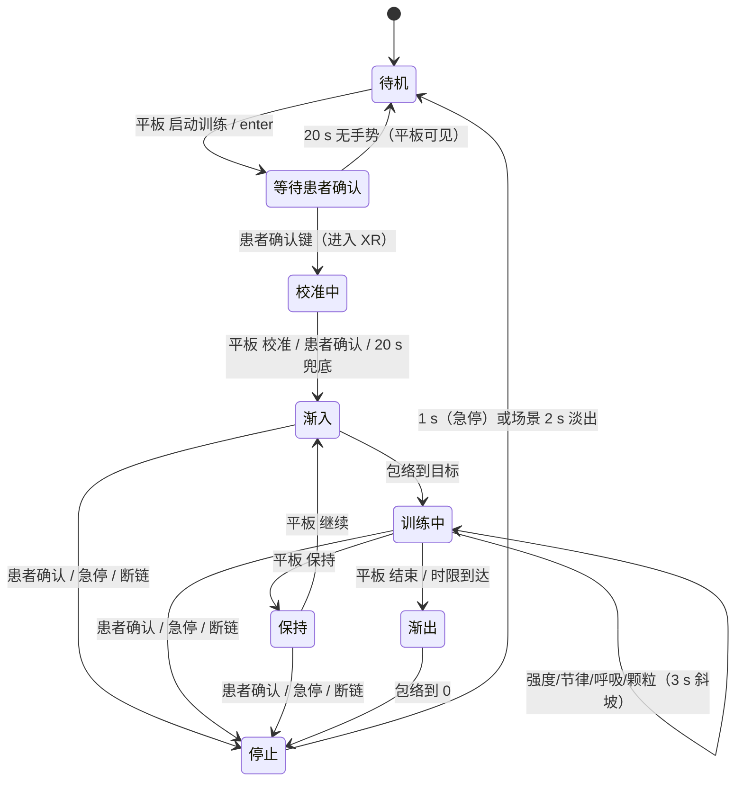

# UX/UI 评估与改进计划

**基线**：v0.9.0 工作树（2026-10-24）　**范围**：患者端（头显页面）、技术员端（平板）、头显控制台、落地页、漂浮与起身的运动设计　**不含**：医学结论、场景美术制作

本文件只记录现状与计划。实现前先在 `core.md` 更新目标与非目标（仓库规则 1）；完成后本文删除，结论并入 `core.md`。

## 0 结论

1. **“浮”看不见，不是不够强，是动在了看不见的深度。** 世界整体位移 65 mm，在天穹（80 m）只值 0.09°、云层（26 m）0.29°；患者仰卧的主视方向恰好是最看不见运动的那一层。唯一清楚可见的是地平线俯仰（0.7°/s），而它读作“世界在倾斜”，读不出“我在漂浮”。
2. **动画本身也过度拼接**：一条 12 s 主波只拿到 72% 的幅度预算，另外 28% 分给 7.5 s 呼吸与 2.7 s 微颤；叠加后失去可辨认的周期。复杂度花在了看不见的地方（§3）。
3. **控制侧只有“强度 0–3”这一个旋钮**，没有渐入、没有节律、没有保持、没有时限、没有回读；档位 a/b/c 同时改幅度与周期，把两个独立维度绑死（§4）。病人端与平板都看不到“现在到底在动多少”。
4. **校准由患者端静默 4 s 完成**，平板既不能主导也看不到状态，而线协议已带 `calibrating` 与 `confidence`，只是没人读。改为技术员主导（§7）。
5. 平板仍有 8 个控制分区（`core.md` §6.2 只允许 6 项），常驻急停写在滚动区末端；患者端整屏点击即进入 XR（§5）。

## 1 证据与方法

- 已删除 `artifacts/pico-20261020-*.png`（41 张实机截屏）。此后结论一律以代码、算术与协议为准；未在设备上复核的标 **[推断]**。
- 只读，未改代码。涉及删除的条目一律标注“待 D1/D2 书面确认”。

## 2 现状清单

| 表面 | 进入方式 | 状态来源 | 关键文件 |
| --- | --- | --- | --- |
| 患者端入口 | `enter` 拉起页面 / 控制台自动打开 | `detectXR` + 点击 | `src/ui/start-screen.ts`、`src/index.html` |
| 患者端校准卡 | 进入 XR 后自动 | 4 s 计时 + 确认键 | `src/ui/calibration-card.ts`、`src/app/App.ts:79` |
| 患者端训练态 | 校准完成 | session reducer | `src/app/session.ts`、`src/ui/spatial-hud.ts` |
| 漂浮 | 会话中持续 | `float.ts` + `App.updateFloat` | `src/core/xr/float.ts`、`App.ts:729-790` |
| 头显控制台 | 头显桌面图标 | 4 页：主页/设置/帮助/SUS | `PortalActivity.kt` |
| 平板配对 | 冷启动 | BLE 阶段机 | `PairingScreen.kt` |
| 平板控制 | 接管后 | `ControlUiState` | `ControlScreen.kt`、`components/ControlPanel.kt` |
| 落地页 | `qs.205716.xyz` | 静态 | `site/index.html` |

## 3 感知预算：为什么“浮”不明显

漂浮的实际实现是 `host.content.position.y` 整体平移（`scene/host.ts:118-121`），并叠加 `content.rotation.x` 的地平线摆（`App.ts:771-781`）。头显是 3DoF，头部平移在视觉上等价于世界平移，所以“看得见多少”只取决于那一层内容离眼多远。

| 层 | 距离 | 峰值角速度 | 峰峰角位移 | 仰卧主视方向 |
| --- | --- | --- | --- | --- |
| 天穹 `sky-dome` | 80 m（`sky.ts:17`） | 0.024°/s | 0.09° | **不可见** |
| 云层 3 片 | 26 / 33 / 40 m（`sky.ts:20-22`） | 0.075°/s | 0.29° | 极弱 |
| 山脊 / 水面 | 26–57 m | 0.10–0.19°/s | 0.4–0.7° | 仅低头时 |
| 芦苇 / 栈桥 | 2–3 m（`landscape.js:936-1046`） | 0.65–0.97°/s | 1.5–1.9° | 仅低头时 |
| 近场微粒 | 0.22–1.1 m（`posture-cue.ts:87-105`） | 不随世界位移 | — | 只有自身上飘 |

（按默认档 b、强度 3：A = 65 mm、T = 12 s，峰值速度 34 mm/s。）

幅度不是被“强度”省掉了，是被分配到看不见的层里。再看叠加：

| 分量 | 周期 | 权重 | 现值 | 判定 |
| --- | --- | --- | --- | --- |
| 主波 | 12 s | 0.72 | 主导 | 保留，拉长到 18 s |
| 呼吸层 | 7.5 s | 0.22 | 世界位移 | 下移到微粒层 + 音频 |
| 微颤 | 2.7 s（0.37 Hz） | 0.06 | 世界位移 | 删除 |
| 兴衰 | 43 s | ×0.88–1.0 | 避免机械感 | 保留 |
| 地平线摆 | 9 s（仅档 c） | 1.0° | 唯一明显项 | 保留，≤0.6° |

合成曲线实测：峰值 59.6 mm、峰峰 114 mm、最大速度 57.6 mm/s，分布在 5 个频率上——患者看到的是“缓慢而无节的晃”，不是单一方向的漂。

**设计含义**（不是加大幅度，而是换位置）：

1. **分层视差**：近层（微粒与 1–3 m 岸边）随幅度 1.0×，中景（芦苇、栈桥）0.6×，天穹与远山 0×（对 `sky.root` 反向补偿平移即可，每帧一次赋值）。这样“地面在呼吸、天空不动”，既是漂浮的视差特征，也守住文献里“地平线须稳定”的约束（`research-standing-sensation.md` §2.2）。
2. **微粒与主波同相位**：现在微粒只按 `cueFlow` 上飘，与世界不同频；改为叠加世界位移后，仰卧时头顶也会跟着起伏——这是主视方向唯一能看见的运动。
3. **周期 12 s → 18 s，幅度 65 mm → 45 mm**：牺牲幅度换方向感，峰值速度 34 → 15.7 mm/s，近层约 1.8°/s（0.5 m）、中景约 0.5°/s（3 m）。
4. **删微颤、呼吸下移**：主波权重重回 0.9 以上，曲线重新可辨认。

## 4 控制侧：运动编排（Motion Console）

病人在床上经历的是一段时间，不是一组参数。控制侧现在只有一个“强度”档，等于只给指挥一个音量旋钮。

### 4.1 词汇表

| 词 | 含义 | 取值 | 默认 | 生效方式 |
| --- | --- | --- | --- | --- |
| 强度 | 幅度 0–3 | 0–3 | 2 | 3 s 斜坡，不跳变 |
| 节律 | 主波周期 | 8–24 s，步长 2 | 18 s | 3 s 斜坡 |
| 呼吸 | 引导呼吸 | 4–8 次/分 | 6 | 驱动微粒与音频低通 |
| 颗粒 | 近场微粒 | 关 / 低 / 高 | 低 | 立即，带 τ |
| 渐入 | 会话起始包络 | 15 / 30 / 45 / 60 s | 30 s | 会话前设定 |
| 渐出 | 会话结束包络 | 10 / 20 / 30 s | 20 s | 会话前设定 |
| 时限 | 会话计划长度 | 8 / 10 / 12 min | 10 min | 到点自动渐出 |
| 保持 | 冻结运动，不结束会话 | 开 / 关 | 关 | 3 s 斜坡 |
| 急停 | 立即停止 | — | — | ≤1 s，不走渐出 |

强度与节律必须解耦。现状 `FLOAT_PROFILES`（`float.ts:47-51`）里 a/b/c 同时改幅度与周期，技术员无法回答“再高一点但别更快”这种最基本的要求。

### 4.2 会话弧

一次会话是一条时间轴，三个区段由包络决定：

```text
0:00        渐入 30 s            稳定（可调）           渐出 20 s      10:00
 ├──────────────┬──────────────────────────────────────┬──────────────┤
 强度 0 ─────────────► 目标强度 ──（保持/继续、强度变更）──► 0
```

- 渐入期间不响应“强度”变更（排队到稳定段），避免患者刚进入就被推一下。
- 稳定段内的一切变更都走 3 s 斜坡，并且**不改变已发生的相位**。
- 到时限自动渐出，平板提示“本次即将结束”；技术员可延长 2 min（一次）。
- 保持 = 走渐出但不结束会话；继续 = 从当前值走渐入（用剩余的渐入时长），患者可在中途说话而不丢会话。

### 4.3 反馈（现在的空白）

平板今天只能知道“档位=标准、强度=2”，不知道实际幅度、相位、包络段。建议：

- **幅度条**：当前 / 目标，单位 mm，来源为页面上报的已应用幅度。
- **60 s 轨迹**：滚动折线，一眼看出是否有斜坡、是否真的在动、是否卡在 0。
- **相位点**：一个随主波移动的圆点，技术员据此判断“正在上升沿”。
- **会话弧条**：渐入 / 稳定 / 渐出三段 + 播放头 + 已发生事件（改强度、保持、模式）。

### 4.4 协议代价

state 帧 20 字节已满（`ControlProtocol.kt:668-698` 的字段全部在用），新增“已应用幅度（1 B）”与“包络段（2 bit）”需要 v11：扩到 22 字节或压缩现有字段；`HELLO/WELCOME` 版本号随之 +1。新命令：

| 命令 | 语义 |
| --- | --- |
| `float:period:<8..24>` | 节律，步长 2 s |
| `float:breath:rate:<4..8>` | 呼吸频率；`float:breath:on\|off` 保留为总开关 |
| `float:ramp:<attackMs>:<releaseMs>` | 包络，会话前设定 |
| `float:hold:on\|off` | 保持 / 继续 |
| `session:limit:<minutes>` | 时限，到点自动渐出 |
| `audio:volume:<0..100>` | 音量（当前只有静音开关） |

### 4.5 不做的事

- 不做关键帧/多段编排编辑器：一位技术员在床边单手操作，编辑器的认知成本高于收益，且会绕开舒适上限。
- 不做自由拖动时间轴；会话弧只读，改的是参数不是历史。
- 不做“反向流”等压晕动手段（会同时压掉漂浮感，见 `research-standing-sensation.md` §2.3）。

## 5 问题清单

### F0 · 产品叙事分叉（阻断）

`core.md` §5 写“单一场景·仰望湖面、禁止马桶”，§10 写“只装一个 `landscape`”；代码注册 4 个场景，`SCENES[0]` 与 `DEFAULT_SCENE` 都是 `bathroom`（`registry.ts:15-20`、`ControlProtocol.kt:572-575`），`bathroom/index.ts:18-19` 自述“马桶就在正前方”。README 只承认 landscape，落地页却写“湖畔与病房”。看湖还是看马桶，先定（D4）。

### F1 · 平板死面：能力位强制暴露已废弃的控制

`CAPABILITIES_MASK` 打开 `CAP_SCENE | CAP_SUS | CAP_EYE_HEIGHT | CAP_GAZE_DWELL`（`ControlProtocol.kt:172-174`），握手要求全位匹配，所以平板不可能隐藏它们；于是 8 个分区（`ControlPanel.kt:72,142,160,174,198,216,247,290`）、4 个页签（`ControlScreen.kt:255-272`）、场景页、镜像、SUS、目视选择全部在线。

### F2 · 常驻急停不常驻

`ControlPanel.kt:310-313` 的急停是 `verticalScroll` 列的最后一个子项；8 节最小高度合计 ≈1000–1100 dp，超过 10 英寸横屏可用高度（约 700 dp）**[推断]**。

### F3 · 停止只有一种速度

`endSession()` 与 `emergencyStop()` 都发 `stop`（`ControlViewModel.kt:181-192`），页面立即冻结并在 1 s 内渐出（`App.ts:81,556`）。有运动编排之后，这两个词才真正需要区分：**结束**走渐出（20 s），**急停**走 1 s（D7）。

### F4 · 会话中间态缺失

“启动训练”实为 `enter`（`ControlViewModel.kt:177-179`），页面打开后仍需患者按确认键；期间 `session=false`，平板继续显示“待机”且按钮可点。

### F5 · 校准不可主导、无回读

`CALIBRATION_AUTO_RECORD_MS = 4000`（`App.ts:79`），进入校准即静默计时；平板 `recalibrate()` 无回执，校准按钮只在 `running` 时可用（`ControlPanel.kt:107`）——此时早已不在校准相；`ControlState.calibrating` 在平板 UI 中零引用。

### F6 · 回执会把失败说成成功

`sendCommand` 入队即 `notice="命令已发送"`（`ControlViewModel.kt:312`）；任何 `OK:` 都改成“头显已接收指令”（`:434`）；ACK `REJECTED/BUSY` 走 `onError`（`BleController.kt:508-511`），于是“消息”和“错误”同时显示。

### F7 · 患者端整屏即“开始”

`start-screen.ts:49-55` 在 `.start` 上监听 click，除控件外任意位置都进入 XR；Firefox Reality 的确认在注视点派发 click **[推断]**，等于任意一次误触都可能开始。

### F8 · 校准卡片版面溢出（算术）

卡片 0.72×0.34 m、padding 0.05（`spatial/surface.ts:205-207`）；标题纹理高 0.155 m + 间隙 0.018 + 正文纹理高 0.31 m = 0.483 m，超出卡面 0.34 m。进度条在 −0.135，正文首行中心在 −0.140：**进度条横穿正文，后 3 行落在卡面外**，且正文色 `#5e655a` 在黑底上仅 3.5:1。

### F9 · 视觉与文案欠账

| 项 | 实测 | 结论 |
| --- | --- | --- |
| Warning `#96652C` on `#ECE6DA` | 4.03:1 | 低于 AA 4.5；改 `#8A5A24`（4.74:1） |
| Danger `#A34D3D` on Surface | 4.58:1 | 叠 alpha 后不足；急停文字不叠透明度 |
| text 最小的 `labelLarge` | 12 sp | 分区标题与状态 chip 偏小，分区标题 ≥14 sp |
| 触控高度 | `TextButton` 默认 40 dp | 顶栏页签与“断开”低于 48 dp |
| 字符串 | 39 键中 19 键无引用 | 文案无单一来源 |
| 硬编码 | `index.html`、`start-screen.ts:99,130`、Android 字面量 | `lang` 只影响部分副本 |

### F10 · 文档与代码的数字不一致

README 与 `core.md` §10 写“标准 35 mm / 11 s、温和 22 mm / 14 s、沉浸 45 mm / 9 s”，代码是 65 / 40 / 100 mm 与 12 / 15 / 9 s（`float.ts:47-51`）。这类偏差会让志愿者测试的结论无法复现。

### F11 · 模式可会话中切换

`App.ts:658-690` 允许运行中 `mode:`，`session.ts:59-73` 的 `mode` 事件明写 mid-session，而文件头注释与 `core.md:39` 都写“不切换”。三处互相矛盾（D5）。切换时 `armPostureAt(1)` 直接跳到站立位，是一次跳切。

### F12 · 多台头显无法选择

`control-plane.md` §2 明写“匹配到第一台就自动连接，没有设备列表”，`PairingScreen` 也没有列表位。病房多床时可能接管错误的头显。

### F13 · 头显控制台的小结构问题

头部 `‹ 1/1 ›` 常驻但只有 SUS 页内部翻页可用（`PortalActivity.kt:241-247,332-350`）**[推断：视觉噪音]**；主页提示“页面会自动打开”，与“平板 `enter` 打开”两条路径重复。

### F14 · 落地页与 README 承诺超出产品

落地页写“场景、眼高、SUS 量表与虚拟起身”，`README` 写“单屏——连接、会话时长、模式、开始/结束、漂浮强度、水声、常驻急停”，两者与代码、与 `core.md` 三方不一致。

## 6 目标交互模型

两条不变量：**患者端只做确认**；**技术员端任一时刻只有一个主决定**（运行中就是“停止”）。



- 点线只属于可回读参数；它们的真值来自 `state` 帧，不来自写入结果（F6）。
- “等待患者确认”是纯 UI 状态，由“已发 `enter` 且 `session=false`”推导，不新增协议位。
- 保持是“运动为零、会话仍在”，与停止不同；停止永远可用且立即。

## 7 校准协议 v2（技术员主导）

| 阶段 | 头显（患者） | 平板（技术员） | 触发 |
| --- | --- | --- | --- |
| 等待 | 黑场 + 卡片：“保持这个姿势 / 看向正前方，操作员开始后记录” | 状态带“校准中 · 待开始”；主按钮“开始校准” | 操作员点按 |
| 记录 | 卡片不变，进度环在触发的 800 ms 内走完 | 按钮转“记录中…”并禁用 | `calibrate` 写入 |
| 完成 | 卡片淡出，场景 2 s 淡入，渐入开始 | “已校准 hh:mm:ss · 置信度 92”；按钮转“重新校准” | `calibrated` + state |
| 兜底 | 20 s 无人触发 → 自动记录，补一行“已自动记录” | “已自动记录（未由操作员触发）” | 计时器 |
| 失败 | 卡片保留，补“没有拿到稳定姿态，请重试” | 红色“校准失败 · 重试” | `pose-lost` |

- 患者确认键始终可提前记录（现有语义）。
- 平板“校准”在 `calibrating` 相即可用；失败 3 次走 `stop`（复用 `MAX_CAPTURE_ATTEMPTS`）。
- `CALIBRATION_AUTO_RECORD_MS` 从 4000 改为 20000 并降级为兜底，卡片文案同步。
- 患者端不用“校准”一词：主行“保持这个姿势”，副行“看向正前方，稍等片刻”，兜底行“已记录，开始”。

## 8 平板：四带布局

```svg
<svg viewBox="0 0 1280 800" width="100%" role="img" aria-label="平板四带布局">
  <rect x="16" y="16" width="1248" height="52" rx="10" fill="var(--surface)" stroke="var(--border)"/>
  <text x="36" y="49" font-size="18" fill="var(--fg)">静岸控制台</text>
  <rect x="150" y="30" width="80" height="24" rx="12" fill="var(--success)" opacity="0.14"/>
  <text x="190" y="47" font-size="13" text-anchor="middle" fill="var(--success)">已连接</text>
  <text x="244" y="47" font-size="13" fill="var(--muted)">尾号 A1B2 · 信号 3/4</text>
  <text x="1112" y="47" font-size="14" fill="var(--muted)">日志</text>
  <text x="1176" y="47" font-size="14" fill="var(--muted)">断开</text>

  <rect x="16" y="84" width="744" height="248" rx="14" fill="var(--surface)" stroke="var(--border)"/>
  <text x="40" y="116" font-size="12" letter-spacing="1" fill="var(--muted)">会话</text>
  <text x="40" y="176" font-size="34" fill="var(--fg)">训练中</text>
  <text x="736" y="176" font-size="34" text-anchor="end" fill="var(--muted)">04:12 / 10:00</text>
  <text x="40" y="204" font-size="13" fill="var(--muted)">患者可随时按确认键停止；停止立即渐出</text>
  <rect x="40" y="224" width="200" height="56" rx="10" fill="none" stroke="var(--border)"/>
  <text x="140" y="259" font-size="16" text-anchor="middle" fill="var(--fg)">结束本次</text>
  <rect x="256" y="224" width="160" height="56" rx="10" fill="none" stroke="var(--border)"/>
  <text x="336" y="259" font-size="16" text-anchor="middle" fill="var(--fg)">保持</text>
  <rect x="432" y="224" width="160" height="56" rx="10" fill="none" stroke="var(--border)"/>
  <text x="512" y="259" font-size="16" text-anchor="middle" fill="var(--fg)">重新校准</text>
  <text x="40" y="310" font-size="13" fill="var(--muted)">校准 09:41:02 · 置信度 92 · 渐入 30 s · 渐出 20 s</text>

  <rect x="16" y="344" width="744" height="356" rx="14" fill="var(--surface)" stroke="var(--border)"/>
  <text x="40" y="376" font-size="12" letter-spacing="1" fill="var(--muted)">会话弧</text>
  <rect x="40" y="392" width="96" height="20" rx="4" fill="var(--accent)" opacity="0.10" stroke="var(--accent)"/>
  <rect x="140" y="392" width="536" height="20" rx="4" fill="var(--accent)" opacity="0.28" stroke="var(--accent)"/>
  <rect x="680" y="392" width="56" height="20" rx="4" fill="var(--accent)" opacity="0.10" stroke="var(--accent)"/>
  <text x="88" y="434" font-size="12" text-anchor="middle" fill="var(--muted)">渐入</text>
  <text x="408" y="434" font-size="12" text-anchor="middle" fill="var(--muted)">稳定</text>
  <text x="708" y="434" font-size="12" text-anchor="middle" fill="var(--muted)">渐出</text>
  <line x1="332" y1="388" x2="332" y2="418" stroke="var(--error)" stroke-width="2"/>
  <text x="332" y="452" font-size="12" text-anchor="middle" fill="var(--error)">现在 04:12</text>
  <text x="40" y="486" font-size="12" letter-spacing="1" fill="var(--muted)">幅度 60 s</text>
  <polyline points="40,610 70,588 100,566 130,552 160,560 190,584 220,606 250,612 280,596 310,572 340,556 370,558 400,578 430,600 460,610 490,596 520,574 550,558 580,558 610,576 640,598 670,608 700,600 730,588"
    fill="none" stroke="var(--accent)" stroke-width="2"/>
  <line x1="40" y1="632" x2="736" y2="632" stroke="var(--border)"/>
  <text x="40" y="662" font-size="13" fill="var(--muted)">03:40 保持 → 03:52 继续</text>
  <text x="40" y="686" font-size="13" fill="var(--muted)">02:10 强度 1 → 2 · 起伏 14 mm</text>

  <rect x="776" y="84" width="488" height="616" rx="14" fill="var(--surface)" stroke="var(--border)"/>
  <text x="800" y="116" font-size="12" letter-spacing="1" fill="var(--muted)">运动</text>
  <text x="800" y="148" font-size="12" fill="var(--muted)">预设</text>
  <rect x="800" y="158" width="104" height="40" rx="8" fill="none" stroke="var(--border)"/>
  <text x="852" y="184" font-size="15" text-anchor="middle" fill="var(--muted)">安静</text>
  <rect x="912" y="158" width="104" height="40" rx="8" fill="var(--accent)" opacity="0.16" stroke="var(--accent)"/>
  <text x="964" y="184" font-size="15" text-anchor="middle" fill="var(--fg)">标准</text>
  <rect x="1024" y="158" width="104" height="40" rx="8" fill="none" stroke="var(--border)"/>
  <text x="1076" y="184" font-size="15" text-anchor="middle" fill="var(--muted)">沉浸</text>
  <text x="800" y="238" font-size="12" fill="var(--muted)">强度</text>
  <text x="1240" y="238" font-size="12" text-anchor="end" fill="var(--muted)">当前 34 / 目标 45 mm</text>
  <rect x="800" y="248" width="74" height="44" rx="8" fill="none" stroke="var(--border)"/>
  <text x="837" y="276" font-size="15" text-anchor="middle" fill="var(--muted)">关</text>
  <rect x="882" y="248" width="74" height="44" rx="8" fill="none" stroke="var(--border)"/>
  <text x="919" y="276" font-size="15" text-anchor="middle" fill="var(--muted)">1</text>
  <rect x="964" y="248" width="74" height="44" rx="8" fill="var(--accent)" opacity="0.16" stroke="var(--accent)"/>
  <text x="1001" y="276" font-size="15" text-anchor="middle" fill="var(--fg)">2</text>
  <rect x="1046" y="248" width="74" height="44" rx="8" fill="none" stroke="var(--border)"/>
  <text x="1083" y="276" font-size="15" text-anchor="middle" fill="var(--muted)">3</text>
  <rect x="800" y="302" width="320" height="8" rx="4" fill="var(--border)"/>
  <rect x="800" y="302" width="242" height="8" rx="4" fill="var(--accent)"/>
  <text x="800" y="338" font-size="12" fill="var(--muted)">节律</text>
  <text x="800" y="368" font-size="15" fill="var(--fg)">18 s</text>
  <text x="1240" y="368" font-size="12" text-anchor="end" fill="var(--muted)">8 — 24 s</text>
  <rect x="800" y="382" width="440" height="6" rx="3" fill="var(--border)"/>
  <rect x="800" y="382" width="300" height="6" rx="3" fill="var(--accent)"/>
  <circle cx="1100" cy="385" r="8" fill="var(--accent)"/>
  <text x="800" y="424" font-size="12" fill="var(--muted)">呼吸</text>
  <rect x="800" y="434" width="72" height="40" rx="8" fill="none" stroke="var(--border)"/>
  <text x="836" y="460" font-size="15" text-anchor="middle" fill="var(--muted)">4</text>
  <rect x="880" y="434" width="72" height="40" rx="8" fill="none" stroke="var(--border)"/>
  <text x="916" y="460" font-size="15" text-anchor="middle" fill="var(--muted)">5</text>
  <rect x="960" y="434" width="72" height="40" rx="8" fill="var(--accent)" opacity="0.16" stroke="var(--accent)"/>
  <text x="996" y="460" font-size="15" text-anchor="middle" fill="var(--fg)">6</text>
  <rect x="1040" y="434" width="72" height="40" rx="8" fill="none" stroke="var(--border)"/>
  <text x="1076" y="460" font-size="15" text-anchor="middle" fill="var(--muted)">7</text>
  <rect x="1120" y="434" width="72" height="40" rx="8" fill="none" stroke="var(--border)"/>
  <text x="1156" y="460" font-size="15" text-anchor="middle" fill="var(--muted)">8</text>
  <text x="1240" y="424" font-size="12" text-anchor="end" fill="var(--muted)">次/分</text>
  <text x="800" y="492" font-size="12" fill="var(--muted)">颗粒</text>
  <rect x="800" y="504" width="140" height="40" rx="8" fill="none" stroke="var(--border)"/>
  <text x="870" y="530" font-size="15" text-anchor="middle" fill="var(--muted)">关</text>
  <rect x="950" y="504" width="140" height="40" rx="8" fill="var(--accent)" opacity="0.16" stroke="var(--accent)"/>
  <text x="1020" y="530" font-size="15" text-anchor="middle" fill="var(--fg)">低</text>
  <rect x="1100" y="504" width="140" height="40" rx="8" fill="none" stroke="var(--border)"/>
  <text x="1170" y="530" font-size="15" text-anchor="middle" fill="var(--muted)">高</text>
  <text x="800" y="576" font-size="12" fill="var(--muted)">包络与时限</text>
  <rect x="800" y="588" width="140" height="40" rx="8" fill="none" stroke="var(--border)"/>
  <text x="870" y="614" font-size="14" text-anchor="middle" fill="var(--fg)">渐入 30 s</text>
  <rect x="950" y="588" width="140" height="40" rx="8" fill="none" stroke="var(--border)"/>
  <text x="1020" y="614" font-size="14" text-anchor="middle" fill="var(--fg)">渐出 20 s</text>
  <rect x="1100" y="588" width="140" height="40" rx="8" fill="none" stroke="var(--border)"/>
  <text x="1170" y="614" font-size="14" text-anchor="middle" fill="var(--fg)">10 min</text>
  <line x1="800" y1="630" x2="1240" y2="630" stroke="var(--border)"/>
  <text x="800" y="662" font-size="13" fill="var(--muted)">水声</text>
  <rect x="1164" y="646" width="76" height="28" rx="14" fill="var(--success)" opacity="0.18" stroke="var(--success)"/>
  <circle cx="1224" cy="660" r="10" fill="var(--success)"/>
  <text x="880" y="662" font-size="13" fill="var(--muted)">音量 60</text>
  <rect x="948" y="652" width="196" height="6" rx="3" fill="var(--border)"/>
  <rect x="948" y="652" width="118" height="6" rx="3" fill="var(--success)"/>

  <rect x="16" y="724" width="1248" height="56" rx="12" fill="var(--error)" opacity="0.14" stroke="var(--error)"/>
  <text x="640" y="759" font-size="18" text-anchor="middle" fill="var(--error)">急停 · 立即停止（≤1 s）</text>
</svg>
```

| 带 | 高度 | 内容 | 规则 |
| --- | --- | --- | --- |
| 状态带 | 52 dp | 连接、尾号、信号；日志、断开 | 只有“断开”不可逆，置最右 |
| 会话带 | 248 dp | 状态、时钟、结束/保持/校准、校准与包络摘要 | 运行中主按钮是“结束本次” |
| 会话弧 | 356 dp | 三段包络条 + 播放头、幅度轨迹、最近事件 | 只读；改参数不改历史 |
| 运动带 | 616 dp | 预设、强度、节律、呼吸、颗粒、包络与时限、水声与音量 | 强度是主控制（最大字号），其余同权 |
| 停止带 | 56 dp | 急停（≤1 s）；计划内结束是会话带的“结束本次”，走渐出 | 固定带，不滚动，不叠 alpha |

删除清单（**待 D1/D2 书面确认后执行**）：`ScenePage`、`SceneMirror`、SUS、目视选择、呼吸开关（并入频率）、起身三段按钮与 4/6/10/14 s 档位、`AngleGauge` 姿态坐标行、`StatusPanel` 的“视点高度/起身进度”。能力位、白名单、`CAPABILITIES_MASK` 同批收敛。

## 9 头显端入口

- 一张卡片：场景名、一句提示、目标圆、状态行。去掉 `gaze-guide.ts` 的虚线辐条——患者不是不会点，是不该点。
- 命中区 = 目标圆 ×1.5，卡片外不响应（F7）。
- 状态行只承担三件事：设备是否就绪、操作员是否已接管、上次结束原因。帧率自适应提示（`App.ts:545-550`）不进患者视野。
- 进入后：黑场 → 卡片 → 1 s 淡入场景 → 渐入开始；不再瞬间出现。
- 会话内第 0–8 s 显示一次性提示条“按右侧确认键可随时停止”，8 s 后淡出。
- 结束：渐出 → 场景 2 s 淡出 → 入口卡片改“已结束”，主按钮“再开始”，不自动重进。
- HUD 默认关；开启时只留 `FPS + 场景名`。

## 10 视觉与文案规范

- 色彩：`Warning` → `#8A5A24`（4.74:1）；`Danger` 文字不叠 alpha；空间面板正文改用 `--text` 派生色（黑底 ≥4.5:1）。
- 字号：分区标题 ≥14 sp，正文 ≥14 sp，状态大字 ≥32 sp；空间卡片正文 2 行预算（≤0.12 m 墨迹高），标题 ≤8 字。
- 触控：≥48 dp；停止带 ≥56 dp 整宽。
- 文案：患者端第二人称、单句 ≤14 字、不用“校准/模式/强度/量表”；技术员端动词开头（“开始校准”“结束本次”）。禁用词：SUS、镜像、量表、场景索引。
- 单源：患者端 12 键 + 技术员端 24 键，Web 用 `strings.ts`，Android 用 `res/values/strings.xml`，键名一一对应；删除 19 个无引用键。

## 11 阶段计划

| 阶段 | 内容 | 验收 | 触及文件 |
| --- | --- | --- | --- |
| **P0 决策** | D4 场景叙事、D5 模式切换、D6 校准职责、D7 停止语义、D8 协议 v11 | 写进 `core.md` 决策表 | `docs/core.md` |
| **P0 安全** | 急停移出滚动区；点击收窄到卡片；“结束”走渐出、“急停”走 1 s | 10 英寸平板上急停 0 滚动可见且 ≥56 dp；空白处点击不进入 XR；急停实测 ≤1 s | `ControlScreen.kt`、`ControlPanel.kt`、`start-screen.ts`、`App.ts` |
| **P0 运动** | 分层视差（天穹补偿）、删微颤、周期 18 s/幅度 45 mm、微粒同相位；渐入 30 s | 头显内 A/B 盲测：仰卧能否在 5 s 内说出“上升/下降”；幅度轨迹与实测一致 | `float.ts`、`App.ts`、`posture-cue.ts`、`scenes/landscape/sky.ts` |
| **P0 主线** | 等待患者确认；校准五态；校准改技术员触发 | 平板五态与头显一致；正常路径 ≤15 s；不触发时 20 s 自愈 | `ControlUiState.kt`、`ControlViewModel.kt`、`calibration-card.ts` |
| **P1 控制** | 运动带（节律/呼吸/颗粒/包络/时限/保持）、幅度条与轨迹；协议 v11 | 每个参数变更 3 s 内从轨迹上可读；保持/继续不丢会话；到时限自动渐出 | `ControlPanel.kt`、`ControlProtocol.kt`、`App.ts` |
| **P1 收敛** | 按 D1/D2 删除死面与能力位；页签收敛到“日志/断开” | 平板单屏无滚动即可完成主线 | `ControlProtocol.kt`、`ScenePage.kt`、`SceneMirror.kt` |
| **P1 视觉** | 三/四带布局；对比度、字号、触控；回执语义（已发出/已执行） | 正文 ≥4.5:1；触控 ≥48 dp；“已执行”只在 ACK OK 后出现 | `ControlTheme.kt`、`StatusPanel.kt` |
| **P2 患者端** | 入口卡片重做、校准卡版面预算、HUD 收敛、8 s 提示条 | 卡片内容不越界（按纹理算术核对）；提示条只出现一次 | `index.html`、`styles.css`、`calibration-card.ts`、`spatial-hud.ts` |
| **P2 文案** | 键表 + 双语 + Android 资源；README/落地页对齐 D4 | 39 键收敛且全有引用；`lang=en` 无中文；落地页无未实现功能 | `strings.ts`、`PortalActivity.kt`、`site/index.html`、`README.md` |
| **P3 验收** | 实机冒烟 + 5 名志愿者（`core.md` §8） | 见 §13 | — |

顺序：P0 决策先于删除与 v11；P0 安全、P0 运动、P1 控制可并行；P2 全部依赖 D4。

## 12 待确认决策

| 编号 | 问题 | 选项 | 建议 |
| --- | --- | --- | --- |
| D4 | 患者看到的是湖还是病房卫生间 | ① 单一湖畔 ② 单一病房卫生间（现状默认）③ 双场景由技术员选 | ①：与“降低排尿心理负担”一致；②把临床语义直接推给患者 |
| D5 | 模式能否会话中切换 | ① 仅会话前 ② 运行中可切 | ①：切换是重定上方向，与“地平线稳定”冲突，且现在是一次跳切 |
| D6 | 校准兜底与失败上限 | 20 s / 3 次 或保留 4 s | 20 s：留出口头指令窗口 |
| D7 | “结束”与“急停”是否分开 | ① 合并为单一停止（1 s）② 结束走渐出、急停 1 s | ②：有了包络之后两者语义确实不同 |
| D8 | 是否为“已应用幅度/包络段”升协议 v11 | ① 升到 22 B ② 压字段凑 20 B ③ 不做，平板自行推算 | ①：这是控制侧唯一的真值来源，②会让协议难读 |
| D9 | 漂浮是否改为单向慢漂 | ① 保持对称往复 ② 长上升 + 长回落（非对称） | ②更接近失重、不易读作摇篮；需在志愿者里 A/B |

## 13 验收与度量

- **感知**：仰卧 A/B 盲测（同一场景，运动开/关随机），患者或操作员在 5 s 内能否指认运动方向；不能指认即判定该档无效，回退到下一档参数。
- **上限**：任何时刻主视层的峰值角速度 ≤2°/s，地平线摆 ≤0.6°；超限即视为缺陷，不再上调。
- **包络**：从按下“启动训练”到幅度到达目标的实测时间与设定值误差 ≤20%；结束时渐出曲线无阶跃（逐帧位移差 ≤1 mm）。
- **上机 ≤3 min 拆解**：配对 ≤60 s、启动到患者确认 ≤45 s、校准 ≤20 s；超时写原因。
- **停止**：任意状态 ≤1 次触控、0 次滚动；急停“按下到运动归零” ≤1 s。
- **误触**：志愿者上机前 30 s 记录未经提示的确认/点击次数（验证 F7）。
- **主观**：0–10 漂感、头晕、恶心；另记“是否注意到校准发生”和“是否发现地平线在动”。
