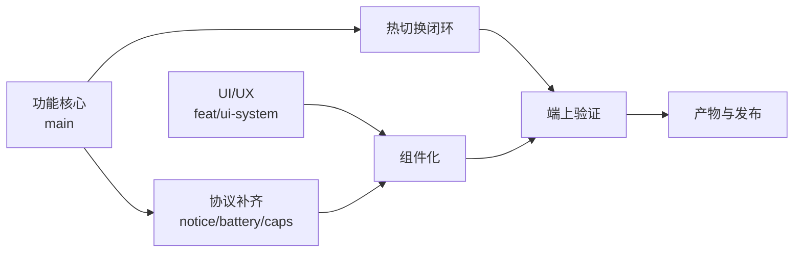

# todotree —— 接下来的任务树与里程碑

状态：2026-11-12 夜。**新开会话先读 `docs/handoff-next.md`**（goal 原文 + 已定决策 + 最新需求 + 在飞项）。**这份文件是排期与验收的唯一入口**；`TODO.md` 记录零散待办，`docs/ux-tree.md` 记录 UX 结构与触发，两者都不覆盖这里的里程碑与依赖。

标记：`[x]` 已落地 · `[~]` 进行中 · `[ ]` 未开始 · `[?]` 需要用户决策 · `[!]` 被外部条件卡住

## 树 A · 系统功能核心（我，`main`）

目标：会话在真设备上不掉帧、不丢状态、不误触。

| 里程碑 | 内容 | 状态 | 验收 |
| --- | --- | --- | --- |
| A1 | 场景热切换（内容停放 + 只换内容，rest mix 按斜坡） | [x] `de95b9f` | 单测 3 项 + headless 切换无报错 |
| A2 | 预载与停放安全（不在呈现中构建；会话结束补建；每次 load 停放） | [x] `d7d8488` | 230 测试通过；预建 83 ms（本机） |
| A3 | 停止渐出与切换互斥；同体位切换不动漂浮相位 | [x] `81a4ab6` | `stopping` 期间切换被拒绝 |
| A4 | 拒绝原因回传（`notice` 页→服务→平板） | [x] `bg_88` | 八处拒绝点走同一句文案 |
| A5 | 强度上限可见（`caps.floatMax`） | [x] `39bdda3` | 平板步进器由回读夹紧，越界被拒 |
| A6 | 会话摘要（时长/强度/场景/语音条数）落一份本地记录 | [x] `6f01744` | 结束后平板可读；SUS 归档不重复 |
| A7 | 场景切换的实机验证（手感、切换瞬间的音频/字幕） | [!] 需头显 | 见树 D1 |

## 树 B · UI/UX（阶段一：`UiOwner` 已完成；阶段二：DS 接手）

阶段一已合入 main（`1de2353`）：浅色单行顶栏（蓝信号条 + 状态标签 + 等宽设备号）、
两条三层电量条、四页底部导航、会话中切场景解锁、VR 断链 5 秒退出。
**阶段二由新代理接手**，任务与规则全部写在 `docs/ui-v2-handoff.md`——那份文档是
下一阶段唯一需要读的交接件。

目标：APK 为重心，先把组件化做出来，再让屏幕只做编排。

| 里程碑 | 内容 | 状态 | 验收 |
| --- | --- | --- | --- |
| B1 | 入口页去掉场景预告（`// 01 / 04` 与场景名整块） | [~] | 入口页只剩指令/图/状态/页脚 |
| B2 | 平板组件库（CommandBar / Readout / SceneStrip / Stepper / ActionKey / SectionCard / StatusDot / MirrorView / SusSheet / OperatorCopy） | [~] | 每屏只编排，无自绘重复 |
| B3 | 会话中快捷动作（场景条即时生效、强度、结束；急停常驻） | [~] | 按下即发，回读校正，不弹确认 |
| B4 | 电量读数按 skill 收成"数字 + 3 dp 轨" | [x]（APK 侧）|[~]（平板侧等 `flags.battery`） |
| B5 | WEB 患者页组件化（InstructionTarget / DevicePictogram / StateRow / HintLine / SusCard / SubtitleCard / CalibrationCard） | [ ] | 入口页无场景名、横屏两档成立 |
| B6 | 模拟器自证（配对页/会话页截图） | [~] | `/tmp/gui-ui/` 有图，报告点位/字号风险 |

## 树 C · 端上（头显壳 APK，`main`）

| 里程碑 | 内容 | 状态 | 验收 |
| --- | --- | --- | --- |
| C1 | 控制台换肤 + 电量横栏（含 ≤20% 的 ice 底墨字） | [x] `38ca183` + 后续收口 | 编译通过；电量随 `ACTION_BATTERY_CHANGED` 更新 |
| C2 | 入口监督（25 s / 20 s 两条时限 + `retry=N` 提示） | [x] `38ca183` | 单测覆盖；实机待验（D1） |
| C3 | 电量进 BLE `flags`（平板可读） | [x] `7079d01` | 平板解码后显示 |
| C4 | `notice` 中继（页→BLE JSON） | [x] `bg_88` | 平板提示与页面同一句 |
| C5 | 自动点击（无障碍服务注入一次按压） | [x] | `TapService` + `EntryRetry.TAP`；未启用时旧路径完全不变；启用命令见 `docs/pico-g2.md` §3.1a；实机确认命中点（D6） |
| C6 | 控制台在 2160×3840 / density 720 的占高复核 | [!] 需头显 | 顶栏+电量+三卡不挤压提示区 |

## 树 D · 验证（实机 / 志愿者）

| 里程碑 | 内容 | 状态 | 验收 |
| --- | --- | --- | --- |
| D1 | 头显冒烟：进入、按压、记录体位、**会话中切场景**、强度、停止、退出 | [ ] | 每次切换 ≤1 帧卡顿；无黑场跳变 |
| D2 | 入口监督实机：不按时重拉是否回到视线前方、是否留重复窗口 | [ ] | 见 `docs/pico-g2.md` §8 |
| D3 | SUS 卡片新行栈（1.02→0.755 m）不压答案行 | [ ] | 三行题面 + 五档仍在卡内 |
| D4 | HUD 最长状态行（约 71 字符）不截断 | [ ] | 1024×576 下可见 |
| D5 | 平板 10 英寸可读性与触控尺寸（字号上调后） | [ ] | 48dp 目标；无截断 |
| D6 | 自动点击：注入的点击是否落在 FxR 的 2D 面板、是否还需第二次确认 | [ ] | 启用无障碍后，不按任何键 20 s 内进入会话 |

## 树 E · 交付与发布

| 里程碑 | 内容 | 状态 | 验收 |
| --- | --- | --- | --- |
| E1 | 推送 `main` 与 `feat/ui-system` | [x] 远端已恢复，main 已推送 | 本地与远端 0 ahead |
| E2 | 重建 1.0.0 产物（`artifacts/apk-1.0.0`、`artifacts/flash` + SHA256SUMS） | [x] `bd32f74`，归档于 `artifacts/releases/v1.0.0/` | 与 `dist/standalone.html` 哈希一致 |
| E3 | UI 分支合并策略（评审后 ff / squash） | [x] `1de2353` 合入，234 测试与 tsc 绿 |
| E4 | 平板屏幕遗留：`wm size` 覆盖（`Override size: 1600x2560`） | [?] | **等用户发话**，我不动设备 |
| E5 | 平板当前装的是"UI 革新前"版本 | [x] 已装 | 新 UI 定型后再装 |

## 规则

1. **设备**：物理平板（`AUK6R23323000733`）不经用户明确同意不做任何写操作；子代理只用模拟器 `qs_tablet`。
2. **分支**：UI 改动只进 `feat/ui-system`；功能改动只进 `main`；组件化之前不合并。
3. **验收**：每个里程碑必须留下可复现的命令或截图；只写"应该可以"不算。
4. 本文件随里程碑推进更新；过期条目不保留，直接改行。

## 树 F · v2 界面下一阶段（DS，`feat/ui-system`）

依据：`docs/ui-v2-handoff.md`。全部在模拟器验收（本批次无设备）。

| 里程碑 | 内容 | 状态 |
| --- | --- | --- |
| F1 | 主区域三态：初始态（标题 + 扫描设备列表，手动连接）/ 控制台 / 说明页 | [ ] |
| F2 | 删除底部导航；语音与量表改为控制台内展开块 | [ ] |
| F3 | 说明页复用统一顶栏（去自带 AppBar） | [ ] |
| F4 | 急停文案清理（故障表与配对页安全句改「结束」） | [ ] |
| F5 | 断开不自动重连的日志验证（抓 logcat） | [ ] |
| F6 | 会话右栏 `体位` 行被钉住区压掉一行：滚动区 + 渐隐，钉住区不滚 | [ ] |

## 树 G · 会话流程与可控性（v2.1）

依据：`docs/session-flow.md`。三步走，全部在模拟器/页面预览上可验。

| 里程碑 | 内容 | 状态 |
| --- | --- | --- |
| G1 | 校准显式化：患者按下后等待技术员点「记录起始体位」，不再自动触发；会话中可重做且不清零台账 | [x] `18b1e34` + 本轮 |
| G2 | 段的编排：平板 `SessionProgram`（段列表/时长/语音/强度上限），`program:` 下发；页面自动推进、JSON 回传流程带 | [x] 本轮 |
| G3 | 过渡与朝向：段间淡出；FxR 窗口朝向对齐，减少一次手动点击 | [!] 需真机 |
| G4 | ~~解除 3D 句柄绑定~~ **不做**：本系统只跑同构 VR 场景，不接非 3D 内容（2026-11-12 定） | [x] 决策 |
| G5 | 场景策略下沉：目录/文案/上限由页面 `registry` 单一来源；平板与头显只渲染收到的目录 | [x] 本轮 |
| G6 | 台账记录 `peakMix` / `peakPitchDeg` / 每段停留，并对齐业务母目标（见 `docs/business-goal.md`） | [x] `37b09bf` |
| G7 | 内置准备间 `prep`（空灰房间、镜像可用）：进 VR 第一站，标定后再选正式场景 | [x] 本轮；真机待验 |
| G8 | 场景解锁与两步进入：XR + 标定后解锁列表；点卡只标记，`进入/切换` 才发命令 | [x] 本轮 |

## 树 H · 应用层级（app level）

依据：`docs/apps.md`。应用 = 可在主区域切换的产品面，各有主区域内容、自己的说明书与记录语义。

| 里程碑 | 内容 | 状态 |
| --- | --- | --- |
| H1 | 顶栏应用选择器：`i` 左边，电量列左让位；平时显示当前应用，点击下拉切换 | [ ] |
| H2 | `i` 指向**当前应用的说明书**（先切应用再点 `i`），不设全局说明书入口 | [ ] |
| H3 | VR 侧同步：切换命令下行，头显回报当前应用；顶栏显示帧里的值 | [ ] |
| H4 | 问卷应用：题目配置化加载 + 作答存储 + 控制侧按次查看（含时间）+ 按问卷与时间筛选导出 | [ ] |
| H5 | 题面文字重绘残留 | [x] 画布只增不减（`src/ui/spatial/text.ts`） |
